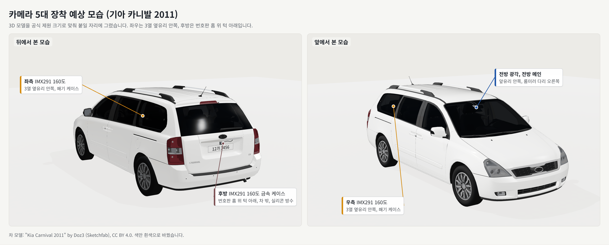
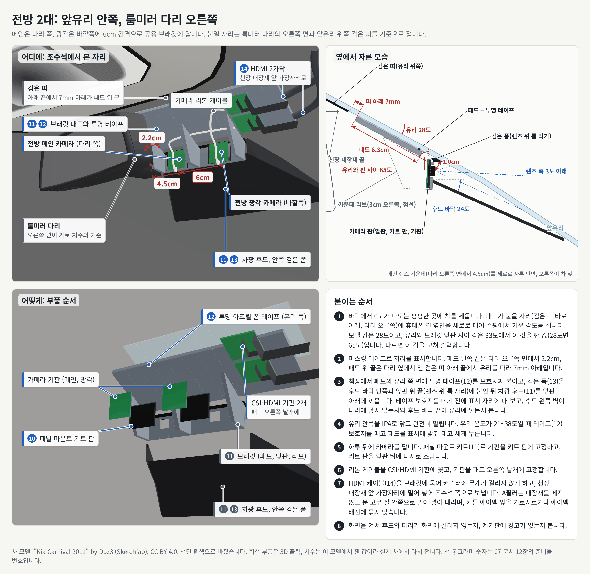
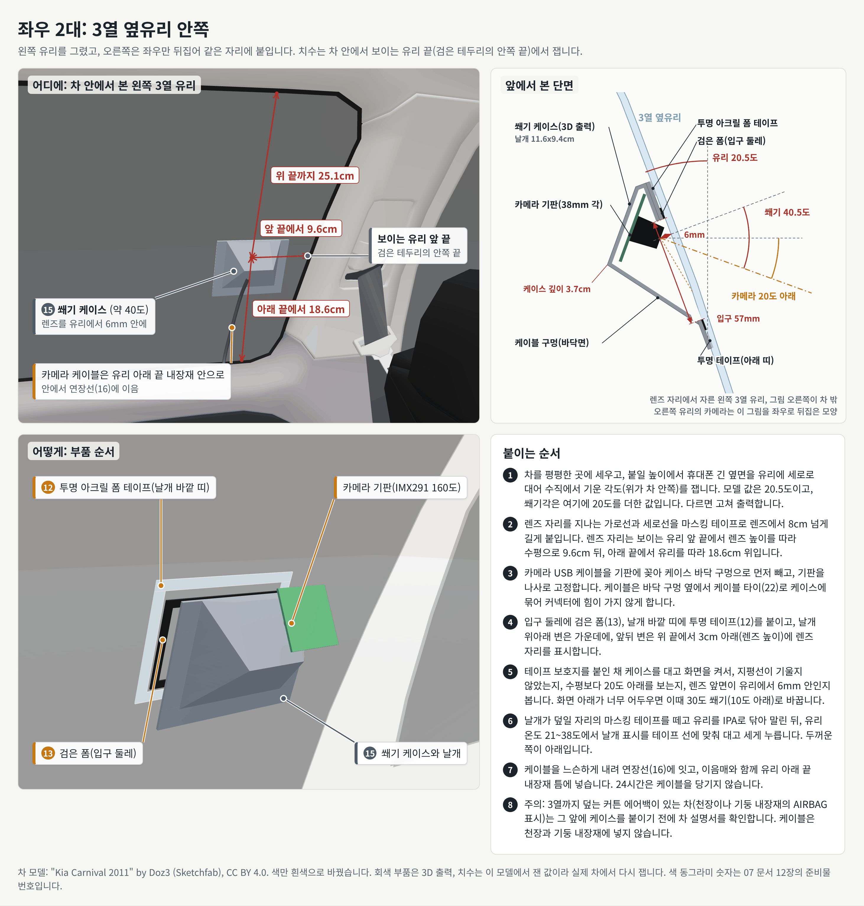
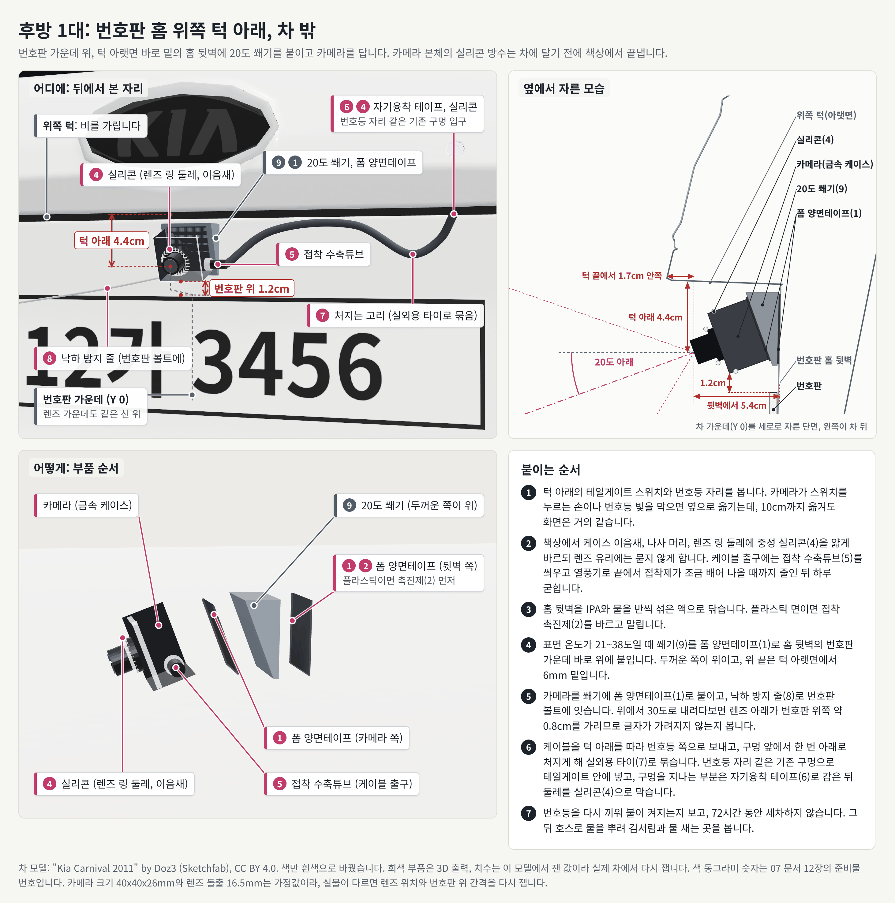
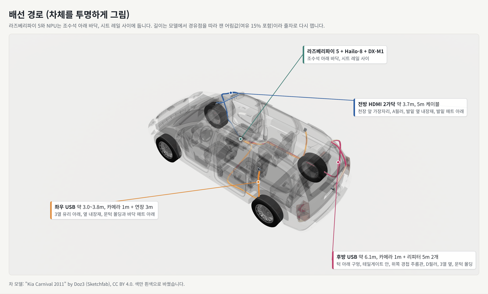

# 07. 차량 장착과 학습 순환 계획

이 문서는 카메라를 실제 차량에 달아 실시간으로 돌리기 전에 준비할 내용을 정리한 계획서입니다. 타공 없이 카메라를 붙이는 방법, 배선과 전원과 발열, 국내 법규, 테슬라가 모델을 학습시키는 방식, 공개 모델을 우리 영상으로 추가 학습하고 NPU에 다시 올리는 순환까지 순서대로 다룹니다. 카메라 제품 선정과 배선 방식 비교는 [06 문서](06_pi5_camera_selection.md)에 있으므로 여기서는 반복하지 않습니다.

## 1. 네 질문에 대한 답과 근거

### 1.1 타공 없이 카메라를 어떻게 붙이나

카메라 5대 가운데 4대는 유리 안쪽에 붙이고, 후방 1대만 차 밖 번호판 위에 붙입니다. 전방 광각과 전방 메인은 앞유리 상단 룸미러 다리 오른쪽(블랙박스 자리)에 공용 브래킷으로 나란히 붙이고, 좌우는 3열 옆유리 안쪽에 쐐기 모양 케이스로 붙입니다. 유리 안쪽은 방수가 필요 없고 차 밖으로 나오는 것이 없어 법규 문제도 적습니다. 후방은 뒷유리 안쪽에 달면 차 바로 뒤에 선 사람의 발이 트렁크에 가려 거리를 멀리 잡기 때문에([06 문서](06_pi5_camera_selection.md)) 테일게이트 번호판 홈의 위쪽 턱 아래에 구멍 없이 붙이고 실리콘으로 막습니다. 자리와 각도는 사용자 차와 같은 기아 카니발 2011의 3D 모델에서 잰 값입니다([20번 측정](measurements/20_carnival_mount.md)). 자리별 방법은 2.1절, 후방 방수와 고정은 2.2절, 배선은 2.3절, 준비물 전체는 12장에 있습니다.

차 밖에 구멍 없이 붙이는 방법은 아크릴 폼 양면테이프, 번호판 볼트에 끼우는 브라켓, 자석, 흡착판입니다. 자석은 차체 패널이 강철일 때만 붙어 내 차의 해당 부위 재질은 확인 필요입니다. 흡착판은 촬영용 제품이 있습니다. SmallRig 4인치 흡착 마운트는 1/4인치 나사 구멍이 있고 하중 50kg, 흡착 24시간 유지로 표기돼 있지만 [V1], 주행 속도 한계와 낙하 방지 줄에 대한 안내는 제품 페이지에 없어 확인 필요입니다. 그래서 후방은 테이프나 번호판 볼트로 고정하고, 자석과 흡착판은 차 밖에 쓰지 않습니다.

외부 부착에 걸리는 국내 법규는 3장에 정리했습니다. 요약하면 자동차관리법은 "자동차에 부착물을 추가하는 것"을 튜닝으로 정의하고 [L1], 성능 기준은 차체 외형이 돌출되어 안전운행에 위험을 주면 안 된다고 정하며 [L3], 번호판을 가리면 과태료가 붙습니다 [L4].

### 1.2 테슬라는 실시간으로 학습하나

아닙니다. 확인한 자료 가운데 차량이 주행 중에 스스로 모델 가중치를 바꾼다고 한 곳은 없습니다. 차량은 추론만 하고, 학습은 데이터 센터에서 합니다. 흐름은 다음과 같습니다.

1. 섀도 모드: 오토파일럿이 차를 제어하지 않을 때도 계산을 병렬로 돌리고, 예측이 운전자의 행동과 어긋나면 카메라와 주행 값을 짧은 스냅샷으로 기록해 올립니다 [T1].
2. 트리거와 캠페인: 엔지니어가 특정 장면을 찾는 검출기를 만들어 차량에 내려보내면 차량이 그 장면을 찾아 올립니다 [T1]. 테슬라 특허 분석에서는 이 트리거 분류기가 본 주행 시스템과 따로 돌며, 몇 분 안에 새 트리거를 배포해 수집을 시작할 수 있다고 설명합니다 [T2]. 이 내용은 특허 기준이라 실제 운영과 같은지는 확인 필요입니다.
3. 오프라인 자동 라벨링: 올라온 클립은 서버에서 라벨링합니다. 서버의 오프라인 모델은 과거 프레임뿐 아니라 미래 프레임까지 볼 수 있어 차 안의 실시간 모델보다 정확한 정답을 만들 수 있고, 같은 장소를 여러 차가 지나간 영상을 합쳐 도로 표면을 재구성합니다 [T3]. 여러 차량의 데이터를 합친 3D 모델로 새 영상에 라벨을 붙이는 특허도 있습니다 [T4].
4. 시뮬레이션: 라벨링이 어려운 장면이나 드문 장면은 시뮬레이션으로 보충합니다 [T3]. v15에서는 데이터 센터의 뉴럴 월드 시뮬레이터를 평가와 강화학습에 씁니다([01 문서](01_fsd_v15_reality_view_research.md) 3.2절).
5. 학습과 배포: 학습은 대형 클러스터에서 합니다. 위키백과 정리에 따르면 Dojo 이전에 A100 5,760개 GPU 클러스터를 썼고 자동 라벨링 전용 1,752개 GPU 클러스터가 따로 있었으며, 학습 데이터 예로 36fps 10초 클립 100만 개(1.5PB)가 언급됩니다 [T5]. 학습된 모델은 소프트웨어 업데이트로 차량에 배포됩니다.

FSD v12부터는 영상에서 바로 조향과 가속을 내는 엔드투엔드 신경망을 씁니다 [T6]. 그래서 지금은 "사람이 어떻게 운전했는가"가 담긴 주행 클립 자체가 학습 데이터입니다.

### 1.3 공개 모델에 추가 학습해서 써도 되나

됩니다. 지금 파이에서 돌리는 YOLOv8s 검출과 BiSeNetV2 세그는 COCO, Cityscapes 같은 공개 데이터로 학습된 모델이고, 우리 차량 영상으로 미세조정한 뒤 다시 NPU용으로 변환하면 됩니다. 두 NPU 회사 모두 이 흐름을 공식으로 안내합니다. Hailo Model Zoo는 모델마다 재학습 안내(도커 환경, 학습, 내보내기)를 제공하고 [H1], DEEPX는 ONNX와 설정 파일과 보정 이미지로 .dxnn을 만드는 흐름을 안내합니다 [D1].

주의할 점이 세 가지 있습니다. 첫째, 학습과 변환은 파이에서 할 수 없고 x86 리눅스 환경이 필요합니다. 사용자 데스크탑의 Windows에서는 WSL2로 마련합니다(6장). 둘째, Ultralytics YOLO는 AGPL-3.0이라 결과물을 공개하지 않는 상업 용도에는 별도 라이선스가 필요합니다 [U1]. 개인 연구 프로젝트에서는 문제 되지 않습니다. 셋째, FlashOcc처럼 3D 점유를 내는 모델은 nuScenes의 라이다 기반 정답으로 학습되고 깊이 감독도 라이다를 씁니다 [B1]. 라이다가 없는 우리 차에서는 같은 품질의 정답을 만들기 어려워, 추가 학습은 2D 검출과 세그부터 하는 것이 맞습니다.

### 1.4 학습이 끝난 모델을 계속 학습시킬 수 있나

됩니다. 지난번 학습 결과(best.pt)를 시작점으로 새 데이터를 더해 다시 학습하면 됩니다. 다만 두 가지 제약이 있습니다.

새 데이터로만 학습하면 예전에 잘하던 것을 잊는 문제가 생깁니다. 연속 학습 분야에서는 이를 파국적 망각이라 부르고, 이전 데이터를 일부 섞어 다시 보여 주는 재현(replay)이 대표적인 완화 방법입니다 [C1]. 그래서 매 회차마다 이전 데이터 일부를 섞고, 고정된 시험 세트로 예전 성능이 떨어지지 않았는지 확인합니다.

또 Hailo-8과 DX-M1은 추론 전용입니다. Hailo는 런타임을 "컴파일된 모델의 실시간 추론"용으로, 컴파일러를 "오프라인 컴파일"용으로 설명합니다 [H2]. 그래서 학습할 때마다 서버에서 INT8 양자화와 컴파일을 다시 하고 파이에 새 모델 파일을 올려야 합니다. 차에서 바로 배우는 구조는 테슬라도 쓰지 않습니다.

Ultralytics에서 `resume`은 끊긴 학습을 옵티마이저 상태와 에폭까지 그대로 이어 가는 기능이고, 새 데이터로 계속 학습할 때는 이전 가중치를 시작점으로 새 학습을 여는 쪽입니다 [U2][U3].

## 2. 차량 장착

### 2.1 자리별 장착 방법

| 자리 | 장착 위치 | 고정 방법 |
|---|---|---|
| 전방 광각, 전방 메인 | 앞유리 상단, 룸미러 다리 오른쪽 | 패널 마운트, 공용 브래킷, 차광 후드, 유리용 아크릴 폼 테이프 |
| 좌, 우 | 3열 옆유리 안쪽 | 쐐기 케이스(약 40도), 유리용 아크릴 폼 테이프, 검은 폼 |
| 후방 | 번호판 홈 위쪽 턱 아래, 차 밖 | 20도 쐐기, 아크릴 폼 양면테이프, 중성 실리콘 |

그림의 번호는 12장 표의 번호와 같습니다. 차는 사용자 차와 같은 기아 카니발 2011의 공개 3D 모델을 공식 제원 크기에 맞춰 그렸고, 카메라 자리와 각도, 케이블 경로는 이 모델에서 잰 값입니다([20번 측정](measurements/20_carnival_mount.md)). 자리별 그림(전방, 좌우, 후방)에는 실제 차에서 찾을 수 있는 기준(룸미러 다리, 유리의 검은 띠와 테두리, 번호판 홈의 턱)에서 잰 치수, 자른 단면, 부품을 붙이는 순서를 함께 넣었습니다. 모델은 실제 차를 잰 것이 아니어서 붙일 자리와 내장재 구조는 실제 차에서 다시 확인합니다. 회색으로 그린 브래킷, 쐐기, 케이스는 3D 출력 부품이라 실제 차에서 치수와 각도를 잰 뒤 한 번에 맡깁니다.

그림의 차 모델은 Doz3의 ["Kia Carnival 2011"](https://sketchfab.com/3d-models/kia-carnival-2011-855c464351f244cbaafa8269a5d472df)([Doz3](https://sketchfab.com/Doz3), [CC BY 4.0](http://creativecommons.org/licenses/by/4.0/))이고, 차체 색을 흰색으로 바꾸고 카메라, 부착 부품, 배선을 더해 그렸습니다 [V2].

전방 2대는 6cm 간격을 두고 공용 판 하나에 답니다. 카니발에서는 룸미러 다리 오른쪽에 메인을 안쪽(차 가운데에서 6.5cm), 광각을 바깥쪽(12.5cm)에 두고, 높이는 바닥 위 1.53m입니다(`configs/five_cam_carnival.yaml`). Camera Module 3는 Adafruit 패널 마운트 키트로 기판을 판에 고정합니다 [K1]. 판을 앞유리에 붙일 쐐기형 브래킷과 차광 후드는 3D 출력으로 만드는데, 쐐기각은 앞유리 기울기에 맞춰야 하고 테이프로 붙인 뒤에는 바꿀 수 없으므로 휴대폰 수평계 앱으로 유리 기울기를 먼저 잽니다. 모델에서 앞유리는 룸미러 높이에서 수평으로부터 약 30도(바닥 위 1.45m에서 33.6도, 1.56m에서 28.4도) 기울어 있고, 브래킷 패드를 붙이는 바닥 위 1.55~1.58m에서는 약 28도입니다. 카메라를 3도 아래로 보게 하려면 브래킷이 유리면과 카메라 판 사이를 93도에서 유리 기울기를 뺀 약 65도로 잡습니다(계산값). 브래킷 패드(경사 방향 약 6.3cm)는 위 끝이 앞유리 위쪽 검은 띠의 아래 끝에서 유리를 따라 7mm 아래, 왼쪽 끝이 룸미러 다리의 오른쪽 면에서 2.2cm 떨어지게 붙이고, 그러면 메인 렌즈는 다리 오른쪽 면에서 4.5cm, 광각은 다시 6cm 오른쪽에 옵니다(모델 값). 검은 띠의 아래 끝은 광각보다 바깥쪽에서 위로 올라가므로 7mm는 다리 가까이에서 잽니다. 자리는 룸미러 뒤에서 틴팅 띠, 센서, 스티커를 피해 고르고, 붙이기 전에 알코올로 닦아 완전히 말립니다 [M1]. 룸미러 뒤에 순정 전방 카메라나 센서가 있는 차는 브래킷과 후드가 그 시야를 가리지 않는지, 붙인 뒤 계기판에 경고가 뜨지 않는지 확인합니다. 3M 자료는 유리에는 별도 표면 처리가 필요할 수 있다고 적고 있어 [R2], 첫 주는 브래킷이 들뜨지 않는지 자주 봅니다. 카니발은 앞유리가 많이 누워 있어 유리에 75도보다 비스듬히 들어가는 시선이 메인 화면의 21%, 광각 화면의 32%이고, 이런 시선에는 대시보드가 비치기 쉽습니다. 그래서 차광 후드의 바닥판을 렌즈 아래 끝에서 메인 화면의 아래 끝 시선(수평에서 약 24도 아래)을 따라 유리까지 내리고 안쪽에 검은 폼을 붙입니다. 바닥판을 수평으로 두면 화면 아래를 가립니다. 이 바닥판은 광각 화면의 아래 두 모서리(약 2%)를 가리지만, 유리를 아주 비스듬히 지나 쓸모가 적은 시선입니다. 후드가 유리에 닿는 면은 경사 방향 약 10cm, 좌우 약 25cm이고, 왼쪽 벽이 룸미러 다리와 가장 가까운 곳에서 약 6.5mm밖에 떨어지지 않으므로 실제 차에서 다리 자리를 재고 그립니다(20번 측정 3장). CSI-HDMI 확장 기판의 HDMI 커넥터는 차량 진동에 맞게 만든 것이 아니어서([06 문서](06_pi5_camera_selection.md)) 케이블을 브래킷에 묶어 무게가 커넥터에 걸리지 않게 합니다. 앞유리 위쪽은 와이퍼가 닦지 않는 영역이 있어 비 오는 날 화면이 가려지는지 첫 시험에서 확인합니다.

좌우 카메라(B0202)는 케이스가 없는 기판형이라 3D 출력 케이스에 넣고, 케이스를 3열 옆유리 안쪽에 유리용 아크릴 폼 테이프로 붙입니다. 렌즈가 유리에서 떨어져 있으면 실내 빛이 유리에 비쳐 들어오는데, 160도 렌즈는 가장자리가 렌즈 축에서 80도까지 벌어져 렌즈가 유리에서 1cm만 떨어져도 그 둘레를 가리는 후드는 반지름이 약 5.7cm가 되어야 합니다(1cm × tan 80도, 계산값). 그래서 렌즈 앞면을 유리에서 6mm 안에 두고, 케이스의 유리 쪽 테두리에 검은 폼을 둘러 렌즈와 유리 사이를 막습니다. 흡착판과 볼헤드로 띄워 다는 대신 유리에 바로 붙이는 이유입니다. 렌즈 자리는 차 안에서 보이는 3열 유리(검은 테두리 안쪽)의 앞 끝에서 렌즈 높이를 따라 수평으로 9.6cm 뒤, 아래 끝에서 유리를 따라 18.6cm 위이고, 오른쪽은 좌우만 뒤집은 같은 자리입니다(모델 값).

정측면에서 20도 아래를 보게 하는 각도는 케이스를 쐐기 모양으로 만들어 맞춥니다. 옆유리는 위쪽이 차 안쪽으로 기울어 있어, 렌즈를 유리에 바로 붙이면 카메라는 유리가 기운 만큼 위를 봅니다. 카니발 모델의 3열 옆유리는 약 20도 기울어 있으므로 쐐기각은 20도에 유리 기울기를 더한 약 40도이고, 아래쪽이 두꺼운 쐐기가 됩니다(20번 측정 4장). 이렇게 기울이면 화면 아래쪽 시선이 유리를 비스듬히 지나므로, 케이스의 유리 쪽 입구는 렌즈 중심을 유리에 내린 점 기준 앞뒤 각 42mm, 아래 48mm, 위 9mm(폭 84mm, 높이 57mm)를 터서 렌즈 아래쪽을 크게 엽니다. 입구 둘레의 날개(11.6x9.4cm)는 안쪽에 검은 폼, 바깥쪽에 투명 아크릴 폼 테이프를 둘러 유리에 붙입니다(20번 측정 4장). 유리 기울기는 휴대폰 수평계 앱으로 붙일 자리에서 잰 뒤 출력을 맡깁니다. 첫 시험에서 화면 아래가 너무 어두우면 30도 쐐기(10도 아래)로 바꿉니다. 시뮬레이션에서 10도와 20도의 결과는 같았습니다(20번 측정 6장).

좌우를 2열 슬라이딩 도어 유리가 아니라 3열 옆유리에 다는 이유는 케이블입니다. 슬라이딩 도어는 열 때마다 문 전체가 뒤로 미끄러져, 문 유리에 단 카메라의 케이블이 움직이는 문과 차체 사이를 건너야 합니다. 3열 옆유리는 차체에 붙은 유리라 케이블이 옆 내장재 안으로 바로 들어가고, 시뮬레이션의 후진 출차 장면도 3열이 나았습니다(20번 측정 6장). 3열 유리가 바깥으로 살짝 열리는 환기창인지는 확인 필요이고, 열리는 창이면 시험 중에는 열지 않습니다. 커튼 에어백은 천장 가장자리와 필러를 따라 들어 있어 [M3], 옆유리 안쪽에 붙인 케이스는 에어백이 펴지는 길에 놓일 수 있습니다. 케이스를 작고 가볍게 만들어 유리에 바짝 붙이는 것도 이 때문이지만, 커튼 에어백이 3열까지 오는지와 전개에 영향이 없는지는 확인 필요라 이 자리는 시험 기간에만 씁니다. 3열에 사람이 타면 케이스가 머리 옆에 오므로 모서리를 둥글게 만듭니다.

창유리 가시광선 투과율 기준은 앞유리 70% 이상, 운전석과 조수석 유리 40% 이상이고 [L5], 뒷좌석 유리와 뒷유리에는 기준이 없어 [L7] 짙게 틴팅된 차가 많습니다. 좌우 카메라는 3열 유리 너머로 보므로 야간 화질은 실제 차의 틴팅 농도로 먼저 확인합니다.

카메라를 붙인 뒤에는 차에서 외부 보정을 다시 해야 합니다. 카니발 모델에서 잰 자리를 `configs/five_cam_carnival.yaml`에 넣어 두었으므로 이 파일의 카메라 좌표와 각도를 실측값으로 바꾸고, 보정 절차는 [모형 보정 문서](phase1_model_rig_calibration.md)를 차량 크기로 늘려 씁니다. 바닥 마커는 차 둘레에 놓을 만큼 크게 출력합니다. 160도 카메라는 렌즈 값도 아직 등거리 어안 가정값이라(`five_cam.yaml`) 차에 달기 전에 체커보드로 내부 보정부터 합니다. 화면 가장자리까지 맞추려면 체커보드가 화면 모서리에 들어간 사진이 있어야 하고, 목표는 RMS 1px 이하입니다([1단계 측정 문서](measurements/01_stage1_hailo.md)). 높이 1m 카메라의 아래 방향 각도가 1도 틀리면 5m 앞 바닥 위치가 0.4~0.5m 어긋나므로(계산값), 붙인 뒤 각도가 바뀌지 않게 움직이는 관절 없이 고정합니다.

### 2.2 후방 카메라 방수와 고정

후방 카메라(UB020201)는 금속 케이스지만 방수 등급 표기가 없어(06 문서) 직접 막습니다. 차에 달기 전에 책상에서 막고 굳힌 뒤 붙입니다.

실리콘은 초산형이 아닌 중성 실리콘을 씁니다. 초산형은 굳을 때 아세트산이 나와 부식성으로 분류되고, 옥심형은 약한 부식성, 알콕시형은 비부식으로 분류됩니다 [R1]. 그래서 알콕시형인 DOWSIL 3140을 씁니다. 판매 페이지에는 경화 방식이 적혀 있지 않지만, 제조사 안전 자료에 메톡시 실란 성분과 분해 생성물 메탄올이 적혀 있어 알콕시형으로 봅니다 [R5]. 값싼 건축용 비초산 실리콘(럭키 LC-909S)은 옥심형이고 제조사가 구리, 황동, 아연에 닿는 곳에 쓰지 말라고 적어 두어 [R6] 쓰지 않습니다. 3140은 짜면 흘러 퍼지는 제품이라 [R7] 바를 면이 위를 보게 눕혀 두고 굳힙니다. 케이스 이음새, 나사 머리, 렌즈 링과 케이스 사이(렌즈 유리면은 제외), 케이블 출구에 얇게 바르고 하루 이상 굳힙니다. 이 카메라는 마이크가 들어 있어 [S1] 케이스에 마이크 구멍이 있으면 그것도 막습니다. 케이블 출구에는 접착제가 든 수축튜브를 2~3cm 씌워 줄인 뒤 끝만 실리콘으로 덧막습니다. 완전히 막은 케이스 안에 김이 차는지는 물 시험에서 확인합니다.

비가림은 번호판 홈의 위쪽 턱이 맡습니다. 카니발은 이 턱이 홈 뒷벽에서 약 7cm 나와 있고, 뒷벽에 쐐기와 카메라를 붙이면 렌즈 앞면이 턱 끝보다 약 1.7cm 안쪽, 턱 아랫면에서 약 4.4cm 아래에 옵니다(20번 측정 5장). 바로 위에서 떨어지는 비는 턱이 막지만, 수직에서 약 20도보다 더 기울어 뒤에서 들이치는 비는 렌즈에 닿을 수 있습니다(계산값). 턱은 160도 화면에 들어오지 않으므로 처음에는 차양 없이 달고, 비 오는 날 렌즈에 물방울이 남으면 차양을 덧답니다. 차양은 렌즈 중심에서 차양까지의 높이를 h라 할 때 좌우로 각 h, 렌즈 중심에서 앞으로 0.95h를 넘지 않아야 160도 화면에 들어오지 않습니다. 이 값은 `five_cam.yaml`의 보정 전 렌즈 값(등거리 어안, 768x432)으로 계산한 것이라 보정 뒤 다시 확인합니다.

고정은 둘 중 하나로 합니다. 첫째는 20도 쐐기를 아크릴 폼 양면테이프(3M VHB 5952)로 번호판 홈 뒷벽에 붙이는 방법입니다. 3M 기술 자료는 21~38도에서 붙이고 10도 아래에서는 처음 붙이지 말라고 하며, 표면을 IPA와 물을 반씩 섞은 액으로 닦고 세게 누르라고 합니다. 접착력은 상온에서 20분 뒤 50%, 24시간 뒤 90%, 72시간 뒤 100%에 이릅니다 [R2]. 붙일 면이 플라스틱이라면 접착 촉진제를 먼저 바릅니다(홈 뒷벽의 재질은 확인 필요). 3M K520UV와 4298UV는 얇게 바르고 30~90초 말린 뒤 1시간 안에 테이프를 붙이며, 4298UV는 15~25도에서 쓰도록 되어 있습니다 [R3][R4]. 국내에서 소량으로 파는 것은 3M 06396(2.5ml 1회용 25개)인데, 위 두 제품과 같은 성분인지는 확인 필요입니다. 둘째는 번호판 윗볼트를 풀어 브라켓을 번호판과 차체 사이에 끼우고, 브라켓 두께만큼 긴 같은 규격 볼트로 다시 조이는 방법입니다. 번호판 봉인제는 폐지되었고 번호판을 볼트로 고정하는 방식은 그대로입니다 [L6]. 국내에서는 번호판 볼트에 끼우는 카메라 브라켓 단품을 찾지 못해, ㄱ자 브라켓으로 만들거나 해외 제품(미국 번호판 기준이라 볼트 간격 실측 필요)을 씁니다. 어느 쪽이든 카메라와 번호판 볼트 사이를 낙하 방지 줄로 짧게 잇습니다.

후방은 설정대로 20도 아래를 보게 해야 하는데, 홈 뒷벽은 거의 수직이라 3D 출력한 20도 쐐기를 벽과 카메라 사이에 넣습니다. 번호판 볼트에 끼우는 방법에서는 ㄱ자 브라켓과 카메라 사이에 넣습니다. 각도가 바뀌면 외부 보정을 다시 해야 하므로 볼헤드처럼 움직이는 관절은 쓰지 않습니다. 금속 케이스에 삼각대 나사 구멍이 있는지는 판매 페이지로 확인하지 못해 [S1], 구멍이 없으면 카메라를 쐐기에 아크릴 폼 양면테이프로 붙이고 낙하 방지 줄로 한 번 더 잡습니다. 쐐기가 플라스틱이라 금속 케이스가 차체에 닿지 않는 것도 장점입니다(케이스가 USB 접지와 이어져 있는지는 확인 필요).

기온이 10도 아래인 철에는 난방되는 실내 주차장에서 작업하거나 붙일 면을 데운 뒤, 적외선 온도계로 표면 온도를 재고 붙입니다(테이프 21~38도 [R2], 4298UV 15~25도 [R4]). 열풍기는 IPA와 촉진제가 다 마른 뒤에만 쓰고, 도장면과 플라스틱이 뜨거워지지 않게 거리를 둡니다. 붙인 뒤 72시간은 세차하지 않습니다.

카메라는 번호판 위 끝과 턱 사이에 두되 번호판 글자와 번호등 불빛을 가리지 않게 합니다. 쐐기 위 끝을 턱 아랫면 6mm 밑에 두면 턱 아랫면에서 카메라 케이스 아래 끝까지 약 5.7cm가 필요하고, 그림처럼 번호판 위 끝이 턱 아랫면에서 6.9cm 아래라면 케이스와 번호판 사이는 약 1.2cm 남습니다. 이 값은 카메라 케이스를 40x40x26mm, 렌즈 돌출을 16.5mm로 잡은 계산값이라 실제 크기는 확인 필요입니다. 렌즈가 뒷벽에서 약 5.4cm 나와 있어 위에서 30도로 내려다보면 렌즈 아래 끝이 번호판 위쪽 약 0.8cm를 덮으므로(계산값), 실제 번호판 위 끝이 이보다 높아 글자와 가까우면 번호판 볼트에 끼우는 방법으로 바꿉니다. 번호판 종류(긴 번호판 또는 짧은 번호판)와 실제 높이, 번호등과 테일게이트를 여는 스위치나 손잡이(모델에는 없음)가 턱 아랫면 어디에 있는지는 확인 필요라 붙이기 전에 사진으로 자리를 정합니다. 카메라가 스위치를 누르거나 손잡이를 잡는 손을 막으면 옆으로 옮기고, 옮긴 만큼 설정 파일의 좌표를 바꿉니다. 좌우로 10cm 옮겨도 화면은 거의 같습니다(20번 측정 5장). 번호판 일부를 가린 후방 카메라 때문에 자동차 검사를 받지 못한 국내 사례가 있고 [M2], 위에서 내려다보는 단속 카메라 각도에서도 글자를 가리지 않아야 하므로 카메라 아래 끝과 번호판 사이를 넉넉히 띄웁니다.

다 붙인 뒤에는 호스로 위, 뒤, 옆에서 5~10분 약하게 물을 뿌려 테일게이트 안쪽이 젖는지, 영상에 김서림이나 물방울이 생기는지 봅니다. 처음 1~2주는 고압 세차를 피하고, 일주일 뒤 고정과 실링을 다시 점검합니다. 자동 세차기 브러시는 카메라를 칠 수 있어 시험 기간에는 손세차를 하고, 겨울에는 주행 전에 렌즈에 묻은 눈과 제설제를 닦습니다.

### 2.3 배선

라즈베리파이와 두 NPU는 파이 케이스에 넣어 조수석 아래 바닥, 시트 레일 사이에 둡니다. 햇볕이 닿지 않고, 전방 HDMI가 내려오는 오른쪽 A필러와 USB가 지나는 오른쪽 문턱에 가깝습니다. 모델의 시트는 두께 없는 껍데기라 시트 아래 높이를 알 수 없어, 파이 케이스가 들어가는지와 사람이 앉았을 때 시트에 닿지 않는지는 차에서 직접 확인합니다. 그림의 경로는 카니발 모델에서 경유점을 이어 그린 것이고, 아래 길이는 그 경로에 여유 15%를 더한 어림값이라 실제 차에서 줄자로 다시 재야 합니다(20번 측정 7장).

전방 2대의 HDMI 케이블은 천장 내장재 앞 가장자리에 밀어 넣어 조수석 쪽으로 보내고, A필러를 따라 문 고무 실 안쪽으로 내린 뒤 대시 옆과 조수석 발밑 옆을 지나 조수석 아래로 갑니다. 이 경로가 여유를 넣어 약 3.7m라 HDMI 케이블은 5m를 씁니다. CSI-HDMI 확장은 HDMI로 10m까지 늘릴 수 있습니다(06 문서). 커튼 에어백은 천장 가장자리를 따라 필러 근처까지 있어, 전개 경로에 놓인 케이블은 에어백을 방해하거나 위험물이 될 수 있습니다 [M3]. 그래서 케이블을 에어백 앞으로 가로지르거나 에어백 배선에 묶지 않습니다. A필러 내장재는 차종마다 떼고 다는 순서가 정해져 있으므로(모델 Y의 예 [M4]), 내장재는 떼지 않고 고무 실 쪽으로 밀어 넣습니다.

좌우 카메라는 카메라 케이블 1m에 USB 2.0 연장 케이블 3m를 이어 4m이고, 필요한 길이는 우측 약 3.0m, 좌측 약 3.8m입니다. 케이블은 3열 유리 아래 끝, 렌즈 바로 밑에서 옆 내장재 안으로 넣어 내리고, 문턱 몰딩 아래로 앞으로 보낸 뒤 조수석 뒤에서 시트 아래의 파이 케이스에 넣습니다. 3열 유리 바로 앞의 C필러 내장재에는 2열 안전벨트가 지나므로(모델 값, 확인 필요) 케이블을 그 안에 넣지 않습니다. 좌측은 2열 발밑의 바닥 매트 아래로 비스듬히 오른쪽으로 건너옵니다. 3열 유리는 차체에 붙은 유리라 케이블이 문틈을 건너지 않습니다. 슬라이딩 도어 레일과 시트 레일에 케이블이 끼지 않는지 문을 끝까지 열고 시트를 끝까지 밀고 당겨 봅니다. B0202는 기판 쪽 커넥터에서 케이블을 뺄 수 있지만 [S2] 잠금 표기가 없어, 케이블을 케이스에 묶어 당기는 힘이 커넥터에 걸리지 않게 합니다.

후방 카메라 케이블(1m)은 턱 아랫면의 번호등 자리 같은 기존 구멍이나 고무 그로밋으로 테일게이트 안에 넣습니다. 들어가기 직전에 케이블이 아래로 한 번 처지게 해 물이 그 자리에서 떨어지게 하고, 구멍을 지나는 부분은 자기융착 테이프로 감은 뒤 둘레를 실리콘으로 막습니다. 번호등을 다시 끼운 뒤 불이 켜지는지, 가스켓이 밀착되는지 확인합니다. 케이블이 1m라 USB 연결부는 테일게이트 안에 남는데, 철판 안쪽처럼 물이 흐를 수 있는 곳이 아니라 내장재 안쪽의 마른 곳에 둡니다. 플러그가 구멍을 지나는지는 실측 필요입니다. 테일게이트에서 차체로는 공장 배선이 지나는 경첩 쪽 고무 주름관으로 넘어갑니다. 테슬라 정비 지침도 테일게이트 배선을 이 그로밋으로 넣고 [M5], 국내 시공점도 후방 카메라 배선을 주름관으로 보냅니다 [M6]. 차체 쪽에서 요비선을 넣어 테일게이트 쪽으로 빼고, 입구에 고무용 실리콘 스프레이를 조금 바른 뒤 케이블 플러그를 요비선 끝에 감아 당깁니다. 테이프를 붙일 면은 기름과 이형제가 없어야 하므로 [R4], 스프레이는 테이프와 촉진제 작업을 마친 뒤 천에 뿌려 씁니다. 그다음 D필러 내장재, 3열 옆 내장재, 오른쪽 문턱 몰딩 아래를 지나 조수석 아래로 갑니다.

이 경로는 여유를 넣어 약 6.1m라, 카메라 케이블 1m 뒤에 USB 2.0 리피터 5m 하나를 이은 6m로는 모자랍니다. 그래서 리피터 두 개를 잇고, 남는 길이는 조수석 아래에서 감아 묶습니다. 둘을 이으면 허브가 두 단이 되므로 둘 다 5V 전원을 넣습니다. USB 2.0 케이블은 한 구간이 최대 5m이고 [S3], A 플러그와 A 리셉터클로 된 수동 연장 케이블은 USB 규격이 금지하는 형태라 [S4], 더 길게 늘릴 때는 리피터나 자체 전원 허브를 씁니다 [S3][S5]. 좌우의 수동 연장 3m도 규격 밖 형태이지만 합계 4m라 길이 안에 들고, 차에 달기 전에 책상에서 같은 조합으로 30분 넘게 녹화해 끊기지 않는지 확인합니다. 리피터의 칩이 든 굵은 쪽은 테일게이트 안에서 물이 흐르지 않는 높은 곳에 둡니다. 플러그가 주름관을 지나가지 못하면 케이블을 잘라 통과시킨 뒤 납땜하고 수축튜브로 감싸 잇습니다. 고무 실 아래로 납작한 케이블을 넣는 방법은 문을 닫을 때마다 케이블이 눌려 피복이 상하거나 틈으로 물이 들 수 있어 마지막 수단으로 둡니다.

리피터는 안에 허브 칩이 든 케이블이라 전원을 먼저 봐야 합니다. 리눅스는 자체 전원이 없는 허브의 포트마다 100mA만 배정하고, 장치가 요구하는 전류가 이보다 크면 그 장치의 설정을 자동으로 고르지 않은 채 "insufficient available bus power"를 남깁니다 [S6]. 이 카메라는 최대 300mA라(06 문서) 전원 없는 리피터 뒤에서는 장치로 잡히기만 하고 영상이 나오지 않을 수 있습니다. 그래서 5V 입력 단자가 있는 리피터(12장 17번)를 고르고, 책상에서 먼저 전원 없이 이어 봅니다. dmesg에 위 문구가 나오면 sysfs의 `bConfigurationValue`에 설정 번호를 써서 직접 고를 수 있고, 이때 커널은 전력 한도를 넘는다는 경고만 남기고 설정을 적용합니다 [S6]. 그래도 영상이 끊기면 리피터의 5V 입력에 전원을 넣습니다. 차에서는 두 개 모두 처음부터 4.1절의 5V 강압 모듈에서 전원을 따옵니다. 어느 경우든 USB 테스터로 카메라 쪽 끝의 전압과 전류를 재어 남깁니다.

케이블은 30cm 안팎 간격으로 케이블 타이 마운트와 타이로 고정하고, 쓸리는 곳은 하네스 테이프로 감습니다. 페달, 시트 레일, 안전벨트, 접히는 시트는 피합니다. 커넥터 근처는 케이블 무게가 커넥터에 걸리지 않게 묶고(5.2절), 좌우 연장선의 USB-A 이음부도 양쪽 케이블을 한 점에 묶어 빠지지 않게 합니다.

## 3. 법규와 안전

아래 조문은 국가법령정보센터에서 직접 확인했습니다.

자동차관리법 제2조 제11호는 "자동차의 튜닝"을 구조나 장치를 바꾸거나 "자동차에 부착물을 추가하는 것"으로 정의하고 [L1], 제34조 제1항은 국토교통부령으로 정한 항목을 튜닝할 때 시장, 군수, 구청장의 승인을 받도록 합니다 [L1]. 카메라를 일시적으로 붙이는 것이 승인 대상 항목에 들어가는지는 확인 필요입니다. 블랙박스처럼 실내 유리에 붙이는 방식이 가장 안전한 이유가 이것입니다.

자동차관리법 시행령 별표 2는 번호판을 가리거나 알아보기 곤란하게 한 경우(법 제10조 제5항) 과태료를 1차 50만원, 2차 150만원, 3차 이상 250만원으로 정합니다 [L4]. 후방 카메라 자리는 이 기준에 맞춰 정했습니다(2.2절).

자동차 및 자동차부품의 성능과 기준에 관한 규칙 제19조 제6항은 차체 외형이 날카롭게 각이 지거나 돌출되어 안전운행에 위험을 줄 우려가 있으면 안 된다고 정합니다 [L3]. 차 밖 흡착 카메라는 여기에 걸릴 수 있습니다.

도로교통법 제39조 제4항은 운전 중 실은 화물이 떨어지지 않게 확실히 고정하도록 합니다 [L2]. 카메라는 화물이 아니지만, 고속에서 떨어진 부착물은 뒤차에 위험하므로 차 밖에 단다면 낙하 방지 줄을 별도로 다는 것을 원칙으로 합니다.

도로교통법 제49조 제1항 제11호는 운전 중 영상표시장치로 영상을 보는 것을 금지하고, 예외로 지리안내나 교통정보안내 영상, 차의 좌우나 전후방을 볼 수 있게 돕는 영상을 둡니다 [L2]. 같은 항 제11호의2는 운전 중 영상표시장치 조작을 금지합니다 [L2]. 리얼리티 뷰 화면이 이 예외에 해당하는지는 확인 필요입니다. 그래서 차량 시험은 운전자가 화면을 보지 않고, 동승자가 노트북으로 실행과 확인을 맡는 방식으로 합니다. 같은 항 제3호의 창유리 가시광선 투과율 기준도 있으므로 [L2] 앞유리와 운전석 옆유리 시야를 가리는 위치에는 카메라를 두지 않습니다.

## 4. 전원

### 4.1 공급 방식

라즈베리파이 5의 권장 전원은 5V 5A입니다 [P1]. 파이 5는 USB PD로 5V 5A를 요청하고, PD가 없는 전원이면 5V 3A로 간주해 USB 포트 전체 전류를 1.6A 대신 600mA로 제한합니다 [P1]. 이러면 USB SSD와 USB 카메라가 제대로 동작하지 않을 수 있고, 5V 5A가 아니면 USB 부팅도 꺼집니다 [P1].

차량 12V를 5V 5A로 바꾸는 방법은 두 가지입니다. 첫째는 PD 5V 5A를 지원하는 변환기를 쓰는 것이고, 둘째는 PD가 없는 강압 컨버터를 쓰고 EEPROM의 `PSU_MAX_CURRENT=5000`으로 5A를 가정하게 하는 것입니다 [P1]. 국내에서는 오토크루 차량용 12V/24V to 5V 5A 강압 모듈이 17,270원(부가세 포함)입니다 [K3]. 출력 단자가 USB-C인지, 파이 5의 5V 핀으로 넣어야 하는지는 상세 이미지에서 확인 필요입니다.

강압 컨버터를 쓸 때는 전선이 굵고 짧아야 합니다. Pololu 포럼 사례에서 브레드보드용 점퍼선을 거쳐 파이 5에 전원을 넣자 부하에서 4.7V까지 떨어졌고, 전선을 보드에 직접 납땜하자 4.96V 아래로 내려가지 않았습니다 [P2].

### 4.2 시동과 함께 켜고 끄기

시동을 끄면 파이가 갑자기 꺼지며 저장 중이던 영상과 SD 카드가 손상될 수 있습니다(공식 수치는 찾지 못해 확인 필요). 그래서 시동(ACC) 신호를 감지해 안전하게 종료하는 회로를 둡니다. 완제품으로는 CarPiHAT PRO 5가 있으며, 파이 5에 5A까지 공급하고 12V 입력을 감시해 전원이 빠지면 정상 종료하는 기능을 갖췄습니다 [P3]. 가격은 116.80파운드이고 품절 표시가 있었습니다 [P3]. 국내 판매처는 찾지 못해 확인 필요입니다. 직접 만든다면 ACC 12V를 포토커플러로 GPIO에 넣고, 꺼짐을 감지하면 `shutdown`을 실행하며, 그동안 버틸 작은 UPS나 슈퍼커패시터를 둡니다.

시거잭은 대부분 ACC 전원이지만 차종에 따라 상시 전원인 차도 있어 확인 필요입니다. 퓨즈박스에서 전원을 따는 블랙박스 상시전원 케이블 방식도 있으나, 첫 시험에서는 시거잭으로 시작하고 배터리 방전을 막기 위해 주차 중에는 장비를 끕니다.

### 4.3 소비전력

Hailo-8 칩은 일반 소비전력 2.5W [N1], DX-M1 M.2 모듈은 최대 5W입니다 [N2]. 파이 5와 USB 카메라 3대, USB SSD를 더한 차량 구성의 실제 소비전력은 측정 필요이며, 차에 달기 전에 책상에서 USB 전력계로 잽니다.

## 5. 발열과 진동

### 5.1 발열

라즈베리파이 5의 동작 온도는 0~70도입니다 [P4]. DX-M1은 상용 등급 0~70도, 산업용 -40~85도 [N2], Hailo-8 M.2 모듈은 -40~85도입니다 [N1]. 우리 DX-M1이 어느 등급인지는 확인 필요입니다.

여름 주차 차량은 이 범위를 쉽게 넘습니다. 미국 애리조나주립대 시험에서 햇볕 아래 주차한 차는 한 시간 만에 실내 평균 46.7도, 대시보드 평균 69.4도였습니다(화씨 116도, 157도) [E1]. 스탠퍼드 시험에서는 바깥 기온과 관계없이 한 시간 안에 실내가 평균 약 22도 올랐고 상승분의 80%가 처음 30분에 일어났습니다 [E2].

카메라의 동작 온도도 봐야 합니다. Camera Module 3는 0~50도의 마른 환경에서 쓰고 급격한 온도 변화는 안에 김을 만들 수 있어 피하라고 안내되어 있고 [P5], IMX291 USB 카메라는 -20~70도입니다(06 문서). 앞유리 안쪽의 전방 카메라는 위의 대시보드 온도에, 차 밖 후방 카메라는 한여름 햇볕과 한겨울 기온에 이 범위를 넘을 수 있습니다.

여기서 나오는 원칙은 네 가지입니다. 파이와 NPU를 대시보드나 뒷선반처럼 햇볕을 받는 곳에 두지 않고, 콘솔이나 좌석 아래 그늘에 둡니다. 여름에는 에어컨으로 실내를 식힌 뒤 켜고, 겨울에는 히터 바람이 앞유리 카메라에 바로 닿지 않게 합니다. 주차할 때는 장비를 꺼내 두거나 최소한 꺼 둡니다. 그리고 지금 방열 없이 과열되는 두 NPU에 방열판과 팬을 다는 일(진행 상황 문서의 사용자 할 일 1, 2번)이 차량 시험의 선행 조건입니다. 실행 중에는 기존 `--hailo-stop-temp`와 `scripts/dx_temp.py`로 온도를 기록하고 넘으면 멈춥니다.

### 5.2 진동

차량 진동에 대한 별도 측정이나 규격 확인은 아직 하지 않았으므로, 아래는 일반적인 대책입니다. SD 카드 대신 USB SSD에 시스템과 녹화 파일을 둡니다(M.2 슬롯 두 개는 NPU가 쓰고 있습니다). 듀얼 M.2 HAT의 고정 나사와 스페이서를 확인하고 풀림 방지제를 씁니다. HDMI와 USB 커넥터는 케이블 무게가 커넥터에 걸리지 않게 근처에서 케이블을 묶어 고정합니다. 파이는 케이스에 넣어 벨크로나 고무 받침으로 바닥에 고정해 급제동 때 날아가지 않게 합니다.

## 6. 학습 서버

### 6.1 요구 조건

Hailo-8용 모델 변환에는 Model Zoo v2.x 브랜치(최신 v2.17)와 Dataflow Compiler 3.33.0을 씁니다 [H1]. master 브랜치는 Hailo-10H용(DFC 5.x)입니다 [H3]. 파이에 설치된 HailoRT 4.23.0이 v2.17이 요구하는 버전과 같으므로 [H1] 이 조합을 그대로 씁니다. v2.17이 요구하는 환경은 Ubuntu 22.04나 24.04 64비트(Windows에서는 WSL2 지원), Python 3.10~3.12, NVIDIA 드라이버 525 이상, CUDA 12.5.1, cuDNN 9.10입니다 [H1]. GPU가 없어도 돌지만 최적화 수준이 0으로 떨어져 실사용 모델에는 권하지 않습니다 [H3].

GPU 세대는 문서마다 다릅니다. master 문서는 compute capability 6.1~8.9(파스칼부터 에이다 러브레이스까지), VRAM 8GB 이상(16GB 권장)을 적고 블랙웰은 지원하지 않는다고 명시합니다 [H3]. 그런데 Hailo-8용 v2.17 문서에는 파스칼, 튜링, 암페어만 적혀 있고 에이다(RTX 40 계열)는 없습니다 [H1]. 그래서 RTX 40 계열에서 DFC 3.33.0이 GPU로 최적화하는지는 직접 돌려 보고 확인해야 합니다. RTX 50 계열(블랙웰)은 두 문서 기준 모두 지원 대상이 아닙니다.

DEEPX DX-COM은 x86_64 리눅스 전용이고 GPU는 필수가 아닙니다 [D1][D2]. Windows와 WSL에 대한 언급은 없습니다 [D2][D3].

두 컴파일러가 모두 x86 기준이므로 Jetson Orin 같은 ARM 보드로 바꿔도 Hailo와 DX-M1 모델 변환은 x86 PC에서 해야 합니다(DX-COM은 x86_64 전용 확인 [D2], DFC의 ARM 지원 여부는 확인 필요).

### 6.2 사용자 데스크탑으로 충분한가

사용자 데스크탑은 RTX 4070(12GB), Ryzen 7950X3D, RAM 64GB, Windows입니다. 별도 GPU 서버 없이 이 데스크탑 한 대로 학습, 자동 라벨링, 두 NPU 변환을 모두 하는 것으로 계획합니다.

| 항목 | 판단 |
|---|---|
| YOLO 미세조정 | 충분 |
| 자동 라벨링 | 충분 |
| DX-COM 변환 | WSL2 동작 확인 필요 |
| Hailo DFC 변환 | GPU 가속 확인 필요 |
| FlashOcc 재학습 | 확인 필요 |

RTX 4070은 compute capability 8.9입니다 [W3]. master 문서의 범위 안이고 VRAM 12GB는 최소 8GB를 넘지만 권장 16GB에는 못 미칩니다 [H3]. Hailo-8용 v2.17 문서에 에이다가 없다는 점은 6.1절과 같습니다. GPU로 안 되면 CPU 최적화(수준 0)로 먼저 변환해 정확도 하락을 재 보고, 하락이 크면 그때 대책을 정합니다. FlashOcc를 12GB에서 학습할 수 있는지는 공개 자료로 확인하지 못했고, 배치 크기를 줄여 시도해 봐야 합니다. Grounding DINO와 SAM 2, Depth Anything V2 Small은 파라미터 수가 크지 않아(SAM 2.1 large 224.4M [A2], Depth Anything V2 Small 24.8M [A5]) 12GB에서 추론으로 돌리는 데 무리가 없을 것으로 보지만 실측 필요입니다.

WSL2는 기본으로 Windows 메모리의 50%를 가져가므로 [W4] 64GB면 32GB가 리눅스 쪽에 잡힙니다. 변환과 학습에는 이 값을 늘려 둡니다(6.3절 3번).

### 6.3 설치 순서

Hailo는 공식으로 WSL2를 지원하므로 [H1] WSL2 Ubuntu를 먼저 시도하고, DX-COM이 WSL2에서 문제가 생기면 그때 Ubuntu 듀얼 부팅으로 바꿉니다.

1. Windows용 NVIDIA 드라이버를 최신으로 설치합니다. WSL 안에는 리눅스용 NVIDIA 드라이버를 설치하면 안 되며, `cuda-drivers`나 `nvidia-open` 패키지도 설치하지 않습니다 [W2].
2. 관리자 PowerShell에서 `wsl --install`을 실행하고 재부팅합니다. 이 명령은 WSL 기능을 켜고 Ubuntu를 설치합니다 [W1]. 설치된 Ubuntu가 22.04나 24.04인지 `lsb_release -a`로 확인합니다.
3. `%UserProfile%\.wslconfig`에 `[wsl2]` 항목을 만들고 `memory=48GB`처럼 메모리를 늘린 뒤 `wsl --shutdown`으로 다시 시작합니다 [W4]. 48GB는 Windows 쪽에 16GB를 남기기 위한 값이며 DFC와 학습의 실제 필요량은 확인 필요입니다.
4. WSL 안에서 `nvidia-smi`로 GPU가 보이는지 확인하고, Hailo 요구에 맞춰 CUDA 12.5와 cuDNN 9.10을 설치합니다 [H1]. CUDA는 툴킷만 설치합니다 [W2].
5. Hailo 환경: Python 3.10 가상환경을 만들고, Hailo 개발자 사이트에서 Dataflow Compiler 3.33.0 휠을 받아 설치한 뒤(로그인 필요, 확인 필요), Model Zoo를 v2.17로 받아 `pip install -e .`로 설치합니다 [H1]. 파이에 있는 YOLOv8s를 `hailomz parse`, `optimize`, `compile`로 다시 만들어 HEF가 나오는지, 로그에 GPU를 쓴다고 나오는지 봅니다.
6. DEEPX 환경: 별도 가상환경에 dx-all-suite 안내대로 DX-COM을 설치합니다 [D3]. 지금 쓰는 YOLOv8s를 .dxnn으로 다시 만들어 파이에서 기존 결과와 같은지 비교합니다. 설치가 안 되면 DEEPX의 Ubuntu 24.04 도커 스크립트 [D3]나 듀얼 부팅으로 넘어갑니다.
7. 학습 환경: 또 다른 가상환경에 CUDA에 맞는 PyTorch를 먼저 설치하고 `pip install -U ultralytics`를 설치합니다 [U4]. Hailo 변환 환경과 학습 환경은 패키지 버전이 부딪힐 수 있어 나눠 둡니다.
8. 자동 라벨링 환경: Grounded-SAM-2와 CVAT를 설치합니다. CVAT는 도커 컴포즈로 돌리므로 Windows의 Docker Desktop에서 WSL2 백엔드를 쓰는 방식이 간단합니다(확인 필요).

듀얼 부팅으로 바꿀 때는 Ubuntu 22.04를 별도 SSD에 설치하는 쪽이 Windows 쪽을 건드리지 않아 안전합니다. 순서는 위 4~8번과 같고, 1번 대신 리눅스용 NVIDIA 드라이버를 설치합니다.

## 7. 데이터 수집

수집은 실시간 시연보다 먼저 합니다. 첫 차량 주행에서는 NPU 추론 없이 카메라 4대 원본과 타임스탬프만 녹화하고(`scripts/record_drive.py`, 사용법은 docs/drive_recording.md), 이 영상으로 보정, 동기화, 라벨링, 학습을 모두 차 밖에서 진행합니다. 실시간 실행은 녹화 영상으로 `--replay` 결과가 만족스러운 뒤에 합니다.

장면은 낮, 밤, 비, 터널 출입, 역광, 주차장, 교차로를 고르게 모읍니다. 모든 회차의 영상 가운데 일부(예를 들어 장면 종류별로 고른 200프레임)는 학습에 절대 쓰지 않는 고정 시험 세트로 따로 둡니다. 이 세트가 회차마다 성능을 비교하는 기준이 됩니다.

테슬라의 트리거를 작게 흉내 낼 수 있습니다. 파이에서 실시간 실행 중에 검출 점수가 애매한 프레임, 추적 ID가 바뀌는 순간, 두 NPU 결과가 크게 어긋나는 프레임(지금도 두 NPU로 같은 YOLOv8s를 돌려 비교하고 있습니다)을 앞뒤 몇 초와 함께 따로 저장하면, 모델이 약한 장면만 골라 모을 수 있습니다.

## 8. 자동 라벨링

자동 라벨링은 가능합니다. 테슬라처럼 차에서가 아니라 학습 서버에서 큰 모델로 정답 후보를 만들고, 사람이 검수하는 방식입니다. 2D 정답은 자동으로 상당 부분 만들 수 있고, 라이다 없는 3D 정답은 어렵고 검수 부담이 큽니다.

### 8.1 무엇으로 무엇을 붙이나

| 정답 | 도구 | 라이선스 |
|---|---|---|
| 차, 사람 박스 | Grounding DINO | Apache-2.0 |
| 도로, 물체 마스크 | SAM 2 | Apache-2.0 |
| 영상 내 추적 | Grounded-SAM-2 | Apache-2.0 외 |
| 상대 깊이 | Depth Anything V2 Small | Apache-2.0 |
| 정지 장면 3D | COLMAP | BSD |

Grounding DINO는 이미지와 문장("car . person . truck .")을 함께 받아 박스를 냅니다 [A1]. 학습 코드는 공개되지 않아 [A1] 우리 데이터로 고칠 수는 없고 라벨러로만 씁니다. SAM 2는 이미지와 영상에서 점이나 박스를 주면 마스크를 만들고, 영상에서는 그 마스크를 다음 프레임으로 이어 갑니다 [A2]. Grounded-SAM-2는 이 둘을 묶어 문장으로 지정한 물체를 영상 전체에서 추적합니다 [A3]. autodistill은 이런 큰 모델로 이미지에 라벨을 붙이고 그 데이터로 YOLOv8 같은 작은 모델을 학습시키는 과정을 명령 한 줄로 묶어 둔 도구입니다 [A4].

깊이는 Depth Anything V2를 씁니다. Small(24.8M 파라미터)만 Apache-2.0이고 Base, Large는 비상업 라이선스(CC-BY-NC-4.0)입니다 [A5]. 기본 모델은 상대 깊이이고 미터 단위 모델은 따로 있습니다 [A5].

### 8.2 라이다 없이 3D 정답을 만드는 방법

세 가지를 조합합니다. 셋 다 실험 단계이며 정확도는 우리 데이터로 측정해야 합니다.

1. 지면 평면 투영: 보정된 카메라 높이와 각도로 박스 아래 끝을 바닥에 투영해 거리를 냅니다. 지금 1단계 데모가 쓰는 방식이고, 모형 보정 후 거리 오차를 잴 예정입니다.
2. 여러 프레임 재구성: 차가 움직이며 찍은 영상에서 COLMAP으로 정지한 배경(도로, 연석, 건물)의 3D를 만들고 [A6], SAM 2 마스크로 움직이는 물체를 빼냅니다. 테슬라가 미래 프레임까지 쓰는 오프라인 라벨링, 여러 번 지나간 영상을 합치는 재구성과 같은 원리입니다 [T3][T4].
3. 깊이 모델 보정: Depth Anything V2의 상대 깊이를 1번의 지면 거리나 2번의 재구성 점으로 축척을 맞춰 미터 단위로 바꿉니다.

이렇게 만든 3D 정답은 FlashOcc 재학습에 쓸 만큼 정확할지 확인 필요입니다. 그래서 계획은 2D 검출과 세그 미세조정을 먼저 하고, 3D는 거리 오차 측정과 비교 실험으로만 다룹니다.

### 8.3 검수

검수는 CVAT 커뮤니티판(자체 설치, 무료)으로 합니다. YOLO 형식을 내보낼 수 있고 Nuclio 서버리스 함수로 자동 라벨 모델을 연결할 수 있습니다 [A7]. 자동 라벨을 CVAT에 불러와 사람이 고치는 방식입니다.

전부 볼 수는 없으므로 두 가지를 봅니다. 하나는 점수가 애매한 박스와 두 라벨러 결과가 어긋나는 프레임처럼 자동으로 걸러 낸 의심 프레임이고, 다른 하나는 무작위 표본입니다. 처음 회차에는 사람이 직접 칠한 200프레임과 자동 라벨을 비교해 박스 IoU와 놓친 비율을 재고, 그 결과로 검수 비율을 정합니다. 7장에서 말한 고정 시험 세트는 자동 라벨이 아니라 사람이 직접 라벨링합니다.

## 9. 추가 학습과 NPU 배포

### 9.1 학습

| 모델 | 시작점 | 학습 데이터 |
|---|---|---|
| YOLOv8s 검출 | COCO 사전학습 | 우리 영상 자동 라벨 + COCO 일부 |
| BiSeNetV2 도로 세그 | 공개 사전학습 | 우리 영상 SAM 2 도로 마스크 |
| 깊이 (선택) | yolo26-depth-n 등 | 8.2절 깊이 정답 |

YOLO는 Ultralytics로 `model=yolov8s.pt`에서 시작해 학습합니다 [U3]. COCO 데이터 일부를 섞는 이유는 1.4절의 망각을 막기 위해서입니다.

### 9.2 NPU 변환

Hailo는 ONNX를 parse, optimize(보정 이미지로 INT8 양자화), compile 순서로 HEF로 만듭니다 [H1]. Model Zoo에 있는 구조를 재학습했다면 `hailomz` 명령을 쓰고, 그 밖의 모델은 Dataflow Compiler를 직접 써야 합니다 [H3]. DEEPX는 ONNX, JSON 설정, 보정 이미지로 .dxnn을 만듭니다 [D1]. 두 경우 모두 보정 이미지는 우리 차량 영상에서 장면 종류별로 고릅니다.

변환할 때마다 서버의 FP32 모델과 NPU의 INT8 모델을 고정 시험 세트에서 비교해 정확도 하락을 기록합니다. Hailo 포럼에는 사용자 YOLOv8을 변환할 때 보정 데이터 정규화 문제로 양자화 오류가 났고 출력층 범위를 지정해 해결한 사례가 있습니다 [H4].

### 9.3 배포와 되돌리기

모델 파일 이름에 회차 번호를 붙여 파이의 `models/` 아래에 쌓고, 설정 파일에서 어떤 회차를 쓸지 고릅니다. 새 모델은 먼저 테슬라의 섀도 모드처럼 기존 모델과 함께 돌려 결과만 기록합니다. 마침 NPU가 두 개라 한쪽에 기존 모델, 다른 쪽에 새 모델을 올려 같은 프레임을 비교할 수 있습니다. 문제가 없으면 기본값을 바꾸고, 문제가 생기면 설정만 이전 회차로 돌립니다.

## 10. 이어서 학습하는 순환

한 회차는 아래 순서로 돕니다.

1. 수집: 주행 녹화와 트리거 클립을 서버로 옮깁니다(7장).
2. 라벨링: 자동 라벨 후 의심 프레임과 표본을 검수합니다(8장).
3. 학습: 직전 회차 best.pt에서 시작하고, 이전 회차 데이터 일부와 COCO 일부를 섞습니다(9.1절).
4. 평가: 고정 시험 세트 전체와 이번 회차 새 장면에서 비교합니다. 예전 장면 성능이 직전 회차보다 떨어지면 섞는 비율을 늘려 다시 학습합니다.
5. 변환: Hailo HEF와 DEEPX .dxnn을 만들고 INT8 하락폭을 기록합니다(9.2절).
6. 섀도 실행과 교체: 두 NPU에 나눠 비교한 뒤 교체합니다(9.3절).

회차마다 데이터 수, 검수 시간, 시험 세트 점수, INT8 하락폭을 `docs/measurements/`에 남겨, 다음 회차에 무엇을 더 모을지 정하는 근거로 씁니다.

## 11. 준비 순서

1. 책상에서: 두 NPU 방열 장착, USB 전력계로 소비전력 측정, 12V 강압 컨버터와 `PSU_MAX_CURRENT` 설정 시험, ACC 꺼짐을 흉내 낸 안전 종료 시험. USB 카메라 3대를 차에 쓸 연장선과 리피터 조합으로 30분 넘게 녹화해 전원과 끊김을 확인하고(2.3절), 160도 카메라 내부 보정과 후방 카메라 실링을 마칩니다(2.1절, 2.2절).
2. 학습 환경 마련: 데스크탑에 6.3절 순서로 WSL2 환경을 만들고, 지금 쓰는 YOLOv8s를 그대로 HEF와 .dxnn으로 다시 만들어 파이 결과와 같은지 확인합니다.
3. 정차 상태 장착: 카메라 5대(유리 안쪽 4대, 번호판 위 1대)를 붙이고 배선한 뒤 후방 물 시험과 외부 보정을 합니다. 기온이 10도 아래면 난방되는 실내에서 합니다(2.2절).
4. 녹화 전용 주행: 동승자가 조작하고 추론 없이 녹화만 합니다.
5. 차 밖 처리: 녹화 영상으로 `--replay` 실행, 자동 라벨링, 첫 미세조정 회차를 돌립니다.
6. 실시간 주행: 동승자 조작으로 실시간 화면을 확인하고 트리거 클립을 모읍니다.
7. 이후 10장의 순환을 반복합니다.

## 12. 장비와 판매처

차에 카메라를 붙이고 배선하는 데 드는 준비물을 자리별로 나눠 적었습니다. 번호는 2장 그림의 번호와 같고, 여러 자리에 함께 쓰는 것은 처음 나오는 자리에 적었습니다. 카메라, CSI-HDMI 확장 모듈, 카메라 케이블은 [06 문서](06_pi5_camera_selection.md)의 구매 목록에 있어 뺐습니다. 14, 16, 17번 케이블은 06 문서 목록과 같은 품목이지만 그림 번호를 맞추려고 함께 적었습니다.

가격은 상품 페이지에 보인 판매가이고, 부가세 별도와 포함이 함께 표시된 곳은 포함 가격을 적었습니다. RS코리아 가격은 "참고 가격"으로 표시돼 있고 부가세 포함 여부는 페이지에 없습니다. 배송비는 12.8절에 모았습니다.

3D 출력 부품(9, 11, 15번)은 실제 차에서 유리 기울기와 붙일 자리를 잰 뒤 모델을 만들어 한 번에 견적을 받습니다. 9번은 차 밖에, 11번과 15번은 햇볕 드는 유리에 붙으므로 여름 차 안 온도(5.1절)를 생각해 재료는 ABS로 정합니다. 출력 대행 페이지에는 재료 PLA, PETG, ABS, 레진과 "1,000원부터", 제작 2~3일이 적혀 있고, 실제 값은 모델 파일을 보내 견적을 받아야 합니다.

### 12.1 후방 카메라

| 번호 | 품목 | 수량 | 가격 | 판매처 |
|---|---|---|---|---|
| 1 | 아크릴 폼 양면테이프 3M VHB 5952, 흑색 20mm x 3m | 1롤 | 9,600원 | [G마켓 하늘기업](https://item.gmarket.co.kr/Item?goodsCode=2871363751) |
| 2 | 접착 촉진제 3M 06396, 2.5ml 25개 | 1상자 | 25,000원 | [공업사스토어](https://bodyshopstore.co.kr/product/3m-pn6396-%EC%A0%91%EC%B0%A9%EC%B4%89%EC%A7%84%EC%A0%9C25%EC%9E%A5-%EB%B0%95%EC%8A%A4/240/) |
| 3 | 스테인리스 ㄱ자 브라켓 30x30mm | 1개 | 1,180원 | [G마켓 삼미호](https://item.gmarket.co.kr/Item?goodsCode=3773754808) |
| 4 | 알콕시형 중성 실리콘 DOWSIL 3140 | 1개 | 10,890원 | [아이씨뱅큐](https://www.icbanq.com/P004703920) |
| 5 | 접착제 든 수축튜브 3:1, 지름 10mm 1.2m | 1개 | 3,200원 | [G마켓 인터넷하나전자](https://item.gmarket.co.kr/Item?goodsCode=793495359) |
| 6 | 자기융착 테이프 3M Scotch 23, 19mm x 9.15m | 1롤 | 36,700원 | [RS코리아](https://kr.rs-online.com/web/p/self-amalgamating-tapes/1921605) |
| 7 | 실외용 흑색 케이블 타이 RS PRO UV 100mm, 100개 | 1봉 | 3,560원 | [RS코리아](https://kr.rs-online.com/web/p/cable-ties/0656025) |
| 8 | 낙하 방지 줄(공구용 3kg) | 1개 | 8,140원 | [G마켓 툴러브](https://item.gmarket.co.kr/Item?goodscode=1488434060) |
| 9 | 20도 쐐기 | 1개 | 3D 출력 견적 | [크몽 출력 대행](https://kmong.com/gig/736271) |

2번은 붙일 면이 플라스틱일 때만 씁니다(2.2절). 상품 페이지에 품절 문구가 함께 보여 재고는 확인 필요이고, [스냅슛](https://snapshoot.co.kr/product/3m-06396-%EC%A0%91%EC%B0%A9-%EC%B4%89%EC%A7%84%EC%A0%9C/1824)에도 같은 품번이 30,000원으로 올라 있습니다. 3번은 번호판 볼트에 끼우는 방법(2.2절)에서 받침으로 쓰고, 쐐기를 홈 뒷벽에 테이프로 붙이면 쓰지 않습니다. 스테인리스 등급과 두께, 구멍 지름은 페이지에 없어 받은 뒤 확인합니다. 4번은 손으로 짜는 튜브라 실리콘건이 필요 없습니다. 7번은 자외선에 견딘다고 표기된 제품이고, 6번과 함께 턱 아래 구멍 앞의 처지는 고리를 묶고 감는 데 씁니다. 8번은 길이와 고리 모양이 페이지 그림에만 있어 받은 뒤 확인하고, 같은 페이지의 1kg형은 5,500원입니다.

카메라 케이스에 삼각대 나사 구멍이 있으면 쐐기에 나사로 묶을 수 있어 1/4-20 UNC 짧은 나사를 따로 삽니다(길이는 쐐기 두께에 맞춤). 번호판 볼트에 끼우는 방법(2.2절)을 쓰면 기존 볼트를 빼서 규격을 확인한 뒤 브라켓 두께만큼 긴 스테인리스 볼트를 삽니다. 해외에서 파는 번호판 카메라 브라켓의 예는 [eBay 제품](https://www.ebay.com/itm/127493305907)(8.67달러)인데, 번호판 볼트에 끼우는 방식인지는 페이지에 없어 확인 필요입니다.

### 12.2 전방 카메라

| 번호 | 품목 | 수량 | 가격 | 판매처 |
|---|---|---|---|---|
| 10 | Camera Module 3 패널 마운트 키트 | 2개 | 개당 9,900원 | [디바이스마트](https://www.devicemart.co.kr/goods/view?no=15014487) |
| 11 | 공용 쐐기 브래킷과 차광 후드 | 1벌 | 3D 출력 견적 | [크몽 출력 대행](https://kmong.com/gig/736271) |
| 12 | 투명 아크릴 폼 테이프 3M VHB 4910, 20mm x 1.5m | 1롤 | 5,500원 | [아이씨뱅큐](https://www.icbanq.com/P013051369) |
| 13 | 검은 EVA 폼 테이프, 한 면 접착, 두께 1mm 폭 1cm | 1개 | 1,590원 | [G마켓 건강박사몰](https://item.gmarket.co.kr/Item?goodscode=595532546) |
| 14 | HDMI 2.1 케이블 5m | 2개 | 개당 5,550원 | [컴퓨존](https://www.compuzone.co.kr/product/product_detail.htm?ProductNo=1211225) |

10번에는 카메라 기판을 판에 고정하는 M2 나사가 들어 있지만, 판을 브래킷에 고정하는 M3 나사는 없어 34번을 함께 씁니다. 해외 재고 상품이라 평균 준비 기간이 2주로 표시돼 있고, 반품 불가로 적혀 있습니다. 11번 브래킷은 이 판에 맞춰 그리므로 10번을 먼저 주문합니다. 12번은 좌우 케이스(15번)에도 씁니다. 13번은 폭 1cm 띠라 렌즈 둘레 링은 조각을 이어 만들고, 후드 안쪽에는 그대로 붙입니다. 14번은 2m 상품 페이지에 있는 5m 옵션의 가격입니다. 같은 페이지의 3m 옵션(4,870원)은 카니발 경로에 짧습니다(2.3절).

### 12.3 좌우 카메라

| 번호 | 품목 | 수량 | 가격 | 판매처 |
|---|---|---|---|---|
| 15 | 쐐기 케이스(약 40도) | 2개 | 3D 출력 견적 | [크몽 출력 대행](https://kmong.com/gig/736271) |
| 16 | USB 2.0 연장 케이블 3m | 2개 | 개당 1,430원 | [디바이스마트](https://www.devicemart.co.kr/goods/view?no=12235985) |

유리에 붙이는 테이프와 케이스 테두리의 폼은 12번과 13번을 함께 씁니다. 날개에는 13번을 폭 6mm, 12번을 폭 8mm로 잘라 붙입니다.

### 12.4 배선

| 번호 | 품목 | 수량 | 가격 | 판매처 |
|---|---|---|---|---|
| 17 | USB 2.0 리피터 5m, 5V 입력 단자(강원전자 CBL-203-5P) | 2개 | 개당 13,000원 | [컴퓨존](https://www.compuzone.co.kr/product/product_detail.htm?ProductNo=932980) |
| 18 | 요비선 6m(세신 SB-O320AH) | 1개 | 9,680원 | [아이씨뱅큐](https://www.icbanq.com/P013970703) |
| 19 | 내장재 리무버 4개(CTR RT-100) | 1벌 | 3,900원 | [G마켓 CTR](https://item.gmarket.co.kr/Item?goodsCode=1926482763) |
| 20 | 하네스 테이프 tesa 51608, 19mm x 15m | 1롤 | 7,100원 | [RS코리아](https://kr.rs-online.com/web/p/duct-tapes/2496622) |
| 21 | 케이블 타이 마운트 20x20mm, 100개(MAXTEK MT634) | 1봉 | 2,300원 | [컴퓨존](https://www.compuzone.co.kr/product/product_detail.htm?ProductNo=1203687) |
| 22 | 흑색 케이블 타이 100mm, 100개(전오 J-100) | 1봉 | 583원 | [엘레파츠](https://www.eleparts.co.kr/goods/view?no=795) |
| 23 | 고무용 실리콘 스프레이 420ml(대림 크린텍) | 1개 | 12,000원(재입고 미정) | [컴퓨존](https://compuzone.co.kr/product/product_detail.htm?ProductNo=1171183) |
| 24 | USB 전압 전류 테스터(Coms IB080) | 1개 | 21,560원 | [아이씨뱅큐](https://www.icbanq.com/P007599190) |

17번은 판매가 칸에 9,500원과 13,000원이 함께 보여 옵션 목록에 적힌 13,000원을 적었습니다. 후방 경로가 여유를 넣어 약 6.1m라 카메라 케이블 1m와 리피터 하나(5m)를 더한 6m로는 모자라, 두 개를 처음부터 이어 씁니다(2.3절). 상품명에 어댑터 미포함으로 적혀 있고, 같은 페이지에서 5V 2.1A 어댑터(외경 3.5mm, 내경 1.35mm 플러그, 7,200원)를 더할 수 있습니다. 책상 시험에는 이 어댑터를 쓰고, 차에서는 42번 강압 모듈의 5V를 같은 규격의 DC 플러그로 넣습니다(2.3절). 전원 단자가 케이블 어느 쪽 끝에 있는지는 페이지 글에 없어 받은 뒤 확인합니다.

18번은 스틸이라 공장 배선이 든 주름관에 넣을 때는 끝을 절연 테이프로 감아 피복을 긁지 않게 합니다. 19번은 내장재 가장자리를 살짝 벌려 케이블을 밀어 넣는 데 씁니다. 21번은 40x40mm 상품 페이지의 20x20mm(100개) 옵션이고, 페이지에 입고 지연 문구가 있어 재고 확인이 필요합니다. 23번은 재입고가 "미정"으로 표시돼 있어, 없으면 같은 용도의 고무용 실리콘 스프레이로 대신합니다. 24번은 카메라 쪽 USB 단자의 전압과 전류를 재는 데 쓰며(2.3절), 측정 범위와 표시 방식은 페이지에 없습니다. 파이 전체 소비전력(4.3절)은 파이의 USB-C 전원 입력에서 재야 해서 USB-C 단자가 있는 전력계가 따로 필요합니다. 엘레파츠의 [Coms TB674](https://www.eleparts.co.kr/goods/view?no=19013871)는 USB-C 단자를 갖춘 테스터로 68,000원이지만, 5A까지 잴 수 있는지는 페이지에 없어 확인 필요입니다.

납땜 공구는 플러그가 주름관을 지나지 못할 때만 필요해 넣지 않았습니다. 내장재나 번호등을 뗄 때 부러질 수 있는 고정 클립은 차종 순정 부품이라 차종을 정한 뒤 품번을 찾습니다.

### 12.5 작업 공구와 소모품

| 번호 | 품목 | 수량 | 가격 | 판매처 |
|---|---|---|---|---|
| 25 | 이소프로필 알코올 99.9% 1L(MG Chemicals 824) | 1병 | 27,500원 | [엘레파츠](https://www.eleparts.co.kr/goods/view?no=4107079) |
| 26 | 보풀 없는 와이퍼 | 1갑 | 확인 필요 | 확인 필요 |
| 27 | 분무 공병 100ml | 1개 | 1,000원 | [다이소몰](https://www.daisomall.co.kr/pd/pdr/SCR_PDR_0001?pdNo=57710) |
| 28 | 열풍기 1800W(블랙앤데커 KX1800) | 1개 | 24,700원 | [엘레파츠](https://eleparts.co.kr/goods/view?no=16201012) |
| 29 | 비접촉 적외선 온도계 -50~250도(Coms TB242) | 1개 | 26,180원 | [아이씨뱅큐](https://www.icbanq.com/P013037345) |
| 30 | 플러시 니퍼(PLATO 170S) | 1개 | 8,800원 | [엘레파츠](https://www.eleparts.co.kr/goods/view?no=6731067) |
| 31 | 커터칼(PROKIT PD-510) | 1개 | 약 2,300원 | [엘레파츠](https://www.eleparts.co.kr/goods/view?no=3232197) |
| 32 | 접착 자국 제거제 450ml(나바켐 SSR-450) | 1개 | 5,500원 | [엘레파츠](https://www.eleparts.co.kr/goods/view?no=1455) |
| 33 | 중강도 나사 고정제(록타이트 243, 50ml) | 1개 | 30,000원 | [11번가 JCR테이프](https://11st.co.kr/products/1078696200) |
| 34 | M2~M3 볼트 세트 240개 | 1벌 | 6,600원 | [엘레파츠](https://eleparts.co.kr/goods/view?no=8077937) |
| 35 | 필기 가능한 마스킹 테이프 15mm x 15m | 1개 | 1,000원 | [다이소몰](https://www.daisomall.co.kr/pd/pdr/SCR_PDR_0001?pdNo=1016282) |
| 36 | 유성 마커 2개 | 1봉 | 1,000원 | [다이소몰](https://www.daisomall.co.kr/pd/pdr/SCR_PDR_0001?pdNo=1000626) |
| 37 | 줄자 5m | 1개 | 2,000원 | [다이소몰](https://www.daisomall.co.kr/pd/pdr/SCR_PDR_0001?pdNo=1047284) |
| 38 | 니트릴 장갑 40매, M 크기 | 1개 | 2,000원 | [다이소몰](https://www.daisomall.co.kr/pd/pdr/SCR_PDR_0001?pdNo=1073286) |
| 39 | 극세사 천 | 1장 | 1,000원 | [다이소몰](https://www.daisomall.co.kr/pd/pdr/SCR_PDR_0001?pdNo=10109901) |

25번은 물과 반씩 섞어 27번 공병에 담아 씁니다(2.2절). 27번은 재질이 페이지에 없어 알코올을 담아도 되는지 받은 뒤 확인합니다. 26번은 킴와이프스 같은 실험실용 와이퍼를 한 갑씩 파는 국내 판매처를 찾지 못해 확인 필요이고, 구하지 못하면 39번 극세사 천을 새것으로 씁니다. 28번은 수축튜브를 줄이고 추운 날 붙일 면을 데우는 데 쓰며, 온도 단계는 페이지에 없습니다. 29번은 테이프를 붙이기 전에 표면 온도를 재는 데 씁니다(2.2절).

33번은 듀얼 M.2 HAT처럼 금속 나사에만 씁니다(5.2절). 11번가에서는 우주패스 회원만 살 수 있는 상품으로 표시돼 있어, 회원이 아니면 [디바이스마트](https://www.devicemart.co.kr/goods/view?no=1245622)의 같은 제품(45,694원)을 삽니다. 34번은 상품명에는 스테인리스, 설명에는 아연으로 적혀 재질이 엇갈리고, 너트가 들었는지도 확인 필요입니다. 27번과 35~40번은 모두 다이소 상품이라 매장에서 한 번에 사면 배송비가 들지 않습니다.

### 12.6 보정

| 번호 | 품목 | 수량 | 가격 | 판매처 |
|---|---|---|---|---|
| 40 | 폼보드 60x90cm, 두께 5mm | 1장 | 1,500원 | [다이소몰](https://www.daisomall.co.kr/pd/pdr/SCR_PDR_0001?pdNo=1021054) |
| 41 | 바닥 마커 A1 폼보드 출력 | 6장 | 장당 50,000원 | [킨코스](https://www.kinkos.co.kr/btc/shop/item.do?it_id=20210630305) |

체커보드는 A3로 출력해 40번에 붙입니다. 40번은 온라인에 품절로 표시돼 있어 매장 재고를 확인합니다. 바닥 마커는 한 변 0.5m라 A1(594x841mm)에 출력하고, 6개를 권장합니다([모형 보정 문서](phase1_model_rig_calibration.md) 9장). 41번처럼 폼보드에 붙여 출력하면 6장에 30만원으로 이 목록에서 가장 비싸고, 택배 없이 지점에서 받아야 합니다. 종이로만 출력해 40번 같은 폼보드에 직접 붙이면 줄일 수 있지만 종이 A1 출력 가격은 확인 필요입니다.

### 12.7 전원과 파이 고정

| 번호 | 품목 | 수량 | 가격 | 판매처 |
|---|---|---|---|---|
| 42 | 오토크루 12V/24V to 5V 5A 강압 모듈 | 1개 | 17,270원 | [디바이스마트](https://www.devicemart.co.kr/goods/view?no=15600349) |
| 43 | CarPiHAT PRO 5 | 1개 | 116.80파운드 | [The Pi Hut](https://thepihut.com/products/carpihat-pro-5-car-interface-dac-for-raspberry-pi-5) |
| 44 | 3M 듀얼락 RF6731, 흑색 25x70mm | 1개 | 3,600원 | [G마켓 영운몰](https://item.gmarket.co.kr/Item?goodscode=2177182345) |

42번과 43번은 4장의 전원 장치입니다. 43번은 국내 판매처를 찾지 못해 해외 가격만 적었고, 해외 배송비와 관세는 확인 필요입니다. 44번은 파이 케이스를 바닥에 고정하는 데 쓰며(5.2절), 한 개에 몇 쌍이 들었는지는 페이지에 없습니다.

### 12.8 합계와 배송비

표에 가격을 적은 품목을 더하면 약 35만원이고, 바닥 마커 폼보드 출력(41번)까지 넣으면 약 65만원입니다(계산값). 06 문서와 겹치는 14, 16, 17번, 3D 출력, 가격이 확인 필요인 품목, 해외 주문인 43번은 빼고 더했습니다.

배송비는 판매처마다 따로 붙습니다. G마켓은 판매자마다 3,000원이라 1, 3, 5, 8, 13, 44번에 모두 18,000원이 들고 19번은 무료입니다. 공업사스토어는 4,500원, 11번가 판매자는 2,500원, 컴퓨존은 상품마다 2,500~3,000원입니다. 엘레파츠는 공급가 6만원 이상이면 무료라 22, 25, 28, 30, 31, 32, 34번을 한 번에 주문하면 붙지 않습니다(공급가 약 6만 9천원, 계산값). 디바이스마트는 2,700원이고 부가세 포함 66,000원 이상이면 무료이며, 다이소몰은 3,000원이고 3만원 이상이면 무료입니다. 아이씨뱅큐와 RS코리아의 배송비는 페이지 글에 없어 확인 필요입니다.

## 출처

- A1: [IDEA-Research/GroundingDINO, GitHub](https://github.com/IDEA-Research/GroundingDINO)
- A2: [facebookresearch/sam2, GitHub](https://github.com/facebookresearch/sam2)
- A3: [IDEA-Research/Grounded-SAM-2, GitHub](https://github.com/IDEA-Research/Grounded-SAM-2)
- A4: [autodistill, GitHub](https://github.com/autodistill/autodistill)
- A5: [Depth-Anything-V2, GitHub](https://github.com/DepthAnything/Depth-Anything-V2)
- A6: [COLMAP, GitHub](https://github.com/colmap/colmap)
- A7: [CVAT, GitHub](https://github.com/cvat-ai/cvat)
- B1: [BEVDet, GitHub](https://github.com/HuangJunJie2017/BEVDet)
- C1: [Parisi 외, Continual Lifelong Learning with Neural Networks: A Review, arXiv 1802.07569](https://arxiv.org/abs/1802.07569)
- D1: [DEEPX dx-all-suite, Running Your First NPU Model](https://github.com/DEEPX-AI/dx-all-suite/blob/main/docs/source/03_Running_Your_First_NPU_Model.md)
- D2: [DEEPX dx-compiler, GitHub](https://github.com/DEEPX-AI/dx-compiler)
- D3: [DEEPX dx-all-suite, Setting Up Environment](https://github.com/DEEPX-AI/dx-all-suite/blob/main/docs/source/02_Setting_Up_Environment.md)
- E1: [Study: Hot cars can hit deadly temperatures in as little as one hour, ASU News](https://news.asu.edu/20180516-discoveries-asu-study-hot-cars-can-hit-deadly-temperatures-within-one-hour)
- E2: [Parked cars get dangerously hot, even on cool days, Stanford Medicine](https://med.stanford.edu/news/all-news/2005/07/parked-cars-get-dangerously-hot-even-on-cool-days-stanford-study-finds.html)
- H1: [Hailo Model Zoo v2.17, Getting Started](https://github.com/hailo-ai/hailo_model_zoo/blob/v2.17/docs/GETTING_STARTED.rst), [Hailo Model Zoo, GitHub](https://github.com/hailo-ai/hailo_model_zoo)
- H2: [Hailo AI Software Suite](https://hailo.ai/products/hailo-software/hailo-ai-software-suite/)
- H3: [Hailo Model Zoo, Getting Started](https://github.com/hailo-ai/hailo_model_zoo/blob/master/docs/GETTING_STARTED.rst)
- H4: [Model training GPU, Hailo Community](https://community.hailo.ai/t/model-training-gpu/13623)
- K1: [디바이스마트, Panel Mount Kit for Raspberry Pi Camera Module 3](https://www.devicemart.co.kr/goods/view?no=15014487)
- K3: [디바이스마트, 오토크루 차량용 12V/24V to 5V 5A 강압 모듈](https://www.devicemart.co.kr/goods/view?no=15600349)
- L1: [자동차관리법, 국가법령정보센터](https://www.law.go.kr/법령/자동차관리법)
- L2: [도로교통법, 국가법령정보센터](https://www.law.go.kr/법령/도로교통법)
- L3: [자동차 및 자동차부품의 성능과 기준에 관한 규칙, 국가법령정보센터](https://www.law.go.kr/법령/자동차및자동차부품의성능과기준에관한규칙)
- L4: [자동차관리법 시행령 별표 2 과태료의 부과기준, 국가법령정보센터](https://www.law.go.kr/LSW/flDownload.do?flSeq=148811695)
- L5: [정책브리핑, '자동차용 선팅필름' 39개 제품 비교정보 제공](https://m.korea.kr/news/policyNewsView.do?newsId=156586304)
- L6: [뉴시스, 자동차등록번호판 봉인제 도입 63년 만에 폐지](https://www.newsis.com/view/NISX20250220_0003072660)
- L7: [매거진한경, '30%, 15%, 15%', 내차 국민 선팅이 불법이라고?](https://magazine.hankyung.com/business/article/202408279644b)
- M1: [BlackVue, General Dashcam Installation Guidelines](https://forum.blackvue.com/hc/en-us/articles/360056453591-General-Dashcam-Installation-Guidelines)
- M2: [오카, 벤츠 GLB 250 후방카메라 위치 이동 작업](https://m.oh-car.co.kr/goods/goods_view.php?goodsNo=1000636302)
- M3: [BlackboxMyCar, Dash Cams and Airbags](https://www.blackboxmycar.com/pages/dash-cams-and-airbags)
- M4: [Tesla Model Y 정비 매뉴얼, 위쪽 A필러 내장재](https://service.tesla.com/docs/ModelY/ServiceManual/en-us/GUID-9000AB24-7CC8-44A6-B17E-DBC845321498.html)
- M5: [Tesla Model Y 정비 매뉴얼, 리프트게이트 하네스](https://service.tesla.com/docs/ModelY/ServiceManual/en-us/GUID-EB7FD05F-DEA2-4E0E-B079-CF6FE5C67DBA.html)
- M6: [오카, 캐스퍼 블랙박스 후방카메라 배선 미노출 작업](https://m.oh-car.co.kr/goods/goods_view.php?goodsNo=1000168076)
- N1: [Hailo-8 M.2 모듈](https://hailo.ai/products/ai-accelerators/hailo-8-m2-ai-acceleration-module/), [Hailo-8 칩](https://hailo.ai/products/ai-accelerators/hailo-8-ai-accelerator/)
- N2: [DEEPX DX-M1](https://deepx.ai/products/dx-m1/)
- P1: [USB Power Delivery on Raspberry Pi 5, Raspberry Pi 백서 RP-009856](https://pip-assets.raspberrypi.com/categories/685-app-notes-guides-whitepapers/documents/RP-009856-WP-1-USB%20Power%20delivery%20on%20Raspberry%20Pi%205.pdf)
- P2: [Low voltage on Pi 5 with Pololu D36V50F5, Pololu 포럼](https://forum.pololu.com/t/low-voltage-on-pi-5-with-pololu-d36v50f5-step-down-voltage-regulator/29212)
- P3: [CarPiHAT PRO 5, The Pi Hut](https://thepihut.com/products/carpihat-pro-5-car-interface-dac-for-raspberry-pi-5)
- P4: [Raspberry Pi 5 product brief](https://pip-assets.raspberrypi.com/categories/892-raspberry-pi-5/documents/RP-008348-DS-10-raspberry-pi-5-product-brief.pdf)
- P5: [Raspberry Pi Camera Module 3 제품 안내서](https://cdn.sparkfun.com/assets/c/b/3/a/1/Camera_Module_3_Product_Brief.pdf)
- R1: [CAMEO, Silicone cure systems](https://cameo.mfa.org/wiki/Silicone_cure_systems)
- R2: [3M VHB Tape 5952 Technical Data Sheet](https://multimedia.3m.com/mws/media/2369604O/3m-vhb-tape-5952-technical-data-sheet.pdf)
- R3: [3M Adhesion Promoter K520UV 기술 자료](https://multimedia.3m.com/mws/media/416789O/3mtm-adhesion-promoter-k520uv.pdf)
- R4: [3M Automotive Adhesion Promoter 4298UV 기술 자료](https://multimedia.3m.com/mws/media/1000190O/3m-automotive-adhesion-promoter-4298uv.pdf)
- R5: [DOWSIL 3140 RTV Coating 안전 자료](https://static.rapidonline.com/pdf/87-1222s_v1.pdf)
- R6: [Wacker, LUCKY-SILICONE LC 909S 데이터시트](https://www.wacker.com/h/de-de/medias/LUCKY-SILICONE-LC-909S-en-2023.04.18.pdf)
- R7: [DOWSIL 3140 RTV Coating 기술 자료](https://static.rapidonline.com/pdf/87-1222_v1.pdf)
- S1: [UCTRONICS, Arducam IMX291 160도 USB 카메라 금속 케이스 UB020201](https://www.uctronics.com/arducam-1080p-low-light-wdr-usb-camera-module-with-metal-case-2mp-1-2-8-cmos-imx291-160-degree-ultra-wide-angle-mini-uvc-webcam-board-with-microphone-3-3ft-1m-cable-for-windows-linux-mac-os-2244-ub020201.html)
- S2: [Arducam, IMX291 160도 USB 카메라 기판 B0202](https://www.arducam.com/arducam-1080p-low-light-wdr-ultra-wide-angle-usb-camera-module-for-computer-2mp-cmos-imx291-160-degree-fisheye-mini-uvc-usb2-0-spy-webcam-board-with-microphone-3-3ft-cable-for-windows-linux-mac-os.html)
- S3: [Oracle Solaris 문서, USB 케이블 길이와 허브](https://docs.oracle.com/cd/E19683-01/817-3814/devusb-15/index.html)
- S4: [BenQ IL430 사용설명서 20쪽, ManualsLib](https://www.manualslib.com/manual/2687093/Benq-Il430.html?page=20)
- S5: [Cambrionix, Maximum Length of a USB Cable](https://knowledge.cambrionix.com/Content/Articles/USB/Maximum-Length-of-a-USB-Cable.htm)
- S6: 라즈베리파이 리눅스 커널 USB 코어 소스 [hub.c](https://github.com/raspberrypi/linux/blob/rpi-6.18.y/drivers/usb/core/hub.c), [generic.c](https://github.com/raspberrypi/linux/blob/rpi-6.18.y/drivers/usb/core/generic.c), [message.c](https://github.com/raspberrypi/linux/blob/rpi-6.18.y/drivers/usb/core/message.c), [sysfs.c](https://github.com/raspberrypi/linux/blob/rpi-6.18.y/drivers/usb/core/sysfs.c)
- T1: [Tesla's Autopilot Depends on a Deluge of Data, IEEE Spectrum](https://spectrum.ieee.org/tesla-autopilot-data-deluge)
- T2: [How Tesla Continuously and Automatically Improves Autopilot, Code Compass (특허 EP3850549A1 해설)](https://codecompass00.substack.com/p/tesla-data-engine-trigger-classifiers)
- T3: [Tesla AI Day 2021 Review Part 2: Training Data, Towards Data Science](https://towardsdatascience.com/tesla-ai-day-2021-review-part-2-training-data-how-does-a-car-learn-e8863ba3f5b0)
- T4: [How Tesla Will Automate Data Labeling for FSD, Not a Tesla App (특허 WO2024073033A1 해설)](https://notateslaapp.com/news/2455/how-tesla-will-automate-data-labeling-for-fsd)
- T5: [Tesla Dojo, 위키백과](https://en.wikipedia.org/wiki/Tesla_Dojo)
- T6: [Tesla Autopilot, 위키백과](https://en.wikipedia.org/wiki/Tesla_Autopilot)
- U1: [ultralytics/ultralytics, GitHub](https://github.com/ultralytics/ultralytics)
- U2: [Ultralytics Train 문서](https://docs.ultralytics.com/modes/train/)
- U3: [Ultralytics Model Training Tips](https://docs.ultralytics.com/guides/model-training-tips/)
- U4: [Ultralytics Quickstart](https://docs.ultralytics.com/quickstart/)
- V1: [SmallRig 4인치 흡착 마운트 4122C](https://www.smallrig.com/4-Suction-Cup-Camera-Mounting-Support-for-Vehicle-Shooting-4122C.html)
- V2: [Kia Carnival 2011, Doz3, Sketchfab (CC BY 4.0)](https://sketchfab.com/3d-models/kia-carnival-2011-855c464351f244cbaafa8269a5d472df)
- W1: [Install WSL, Microsoft Learn](https://learn.microsoft.com/en-us/windows/wsl/install)
- W2: [CUDA on WSL User Guide, NVIDIA](https://docs.nvidia.com/cuda/wsl-user-guide/index.html)
- W3: [CUDA GPU Compute Capability, NVIDIA](https://developer.nvidia.com/cuda-gpus)
- W4: [Advanced settings configuration in WSL, Microsoft Learn](https://learn.microsoft.com/en-us/windows/wsl/wsl-config)
