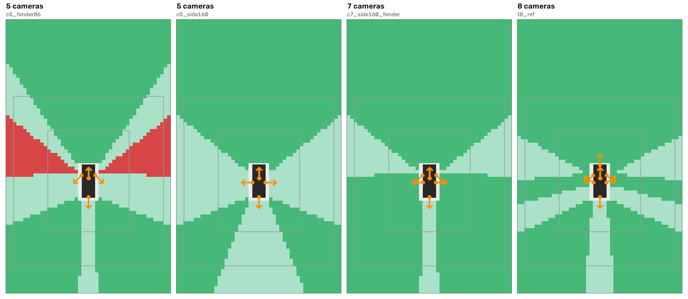

# 19. 카메라 대수 시뮬레이션

이 문서는 차에 달 카메라를 몇 대로 할지 정하려고, 지금의 2대와 4대에서 8대까지의 배치를 같은 장면에 넣어 주변 물체가 화면에 얼마나 끊김 없이 나오는지 시뮬레이션으로 비교한 결과입니다. 카메라 자리와 차체 치수는 [04 문서](../04_tesla_camera_layout.md)의 모델 Y 값(카메라 좌표는 그 문서에서도 추정)이고, 렌즈 화각은 [06 문서](../06_pi5_camera_selection.md)의 후보 제품 값입니다. 7장의 파이 실측과 제품 사양을 빼면 모든 수치는 시뮬레이션 안의 값이라 실제 차에서 다시 확인해야 합니다.

## 1. 결론

카메라는 5대로 정합니다. 앞유리 안쪽에 전방 광각과 전방 메인 2대를 CSI로 달고, 후방(뒷번호판 위)과 좌우(B필러 자리) 3대는 USB로 답니다. 후방과 좌우의 렌즈는 대각 160도(Arducam IMX291 160도)이고, 좌우 카메라는 옆을 정면으로 보게 달고 20도 아래로 숙입니다. 후방은 차 밖이라 방수 처리가 필요합니다(6장). 이 배치의 설정 파일은 configs/five_cam.yaml입니다. 실제 차량인 기아 카니발의 차체와 장착 자리로 다시 돌린 결과와 그 설정 파일은 [20번 측정](20_carnival_mount.md)에 있습니다.

이 배치는 계획 3단계의 완료 기준([구현 계획](../03_pi5_hailo8_dxm1_implementation_plan.md) 4.4절)대로 차를 한 바퀴 도는 사람을 끊김 없이 같은 ID로 따라갔습니다. 아홉 장면 전체에서 탑뷰 범위 안의 물체가 화면에 나온 비율은 0.913이고 8대 배치는 0.926으로, 차이는 1.2%p입니다. 6~8대는 이 차이를 얻는 대신 모형 FPS가 13.0에서 11.1~8.4로 내려갑니다. 지금의 카메라 간 병합 방식에서는 한 물체가 두 번 그려지는 시간도 5대의 1.6~2.6배로 늘고, USB 포트가 모자라 허브가 필요하며 7대와 8대는 전원이 따로 들어가는 허브여야 합니다(7장). FPS를 모두 13으로 맞춰도 8대와의 차이는 거의 그대로였습니다(4.5절).

5대가 눈에 띄게 뒤지는 곳은 세 군데입니다. 앞범퍼 앞 2.4m 안의 바닥은 앞유리 카메라에서 보면 보닛에 가려 보이지 않습니다. 그래서 이 안에 선 사람은 실제보다 1.2~2.3m 멀리 그려지고, 키 0.75m 이하의 아이는 범퍼 바로 앞에서 잘 잡히지 않습니다. 정차 중 차 사이로 뒤에서 다가오는 오토바이는 바로 뒤에 선 차에 가려 한 번 지나갈 때마다 1~2초 늦게 나타나고, 교차로나 주차 칸에서는 옆에 선 차 너머의 보행자가 늦게 잡힙니다. 차 바로 앞은 앞범퍼 카메라가, 오토바이는 앞펜더에서 뒤쪽 옆을 보는 카메라 2대가 메웠고, 옆 차 너머의 보행자는 앞범퍼 카메라가 일부만 줄였습니다. 늘린다면 6번째는 앞범퍼 카메라이고, 그 전에 카메라 간 병합이 바닥 접점이 보이는 카메라의 위치를 따르도록 고쳐야 효과가 납니다(4.4절).

이 결론은 두 가정에 기댑니다. 보닛에 발이 가려진 사람도 검출되어 쓰인다는 것과, 어안 렌즈 가장자리의 사람도 가운데만큼 검출된다는 것입니다. 앞의 가정이 무너지면 5대는 차 바로 앞에서, 뒤의 가정이 무너지면 차 뒤 모서리에서 사람 한 바퀴 기준을 넘지 못했고, 두 경우를 모두 통과한 배치는 8대뿐이었습니다(8장). 좌우와 후방 렌즈의 실제 화각이 대각 140도 안팎으로 좁을 때도 5대는 이 기준을 넘지 못했습니다(4.1절, 5장). 그래서 카메라를 받으면 이 세 가지를 실제 영상으로 먼저 확인하고, 보닛에 가려진 사람이 문제면 앞범퍼 카메라를, 어안 가장자리가 문제면 앞펜더 카메라 2대를 더합니다(8장).

좌우 카메라를 앞펜더에 달아 뒤쪽 옆을 보게 한 5대 배치(86도 렌즈)는 비교한 5대 배치 가운데 가장 나빴습니다. 차 옆 1~3.5m를 도는 사람이 문 옆에서 화면에서 사라져, 1초 넘는 끊김이 분당 14회 나왔습니다.

## 2. 비교한 배치

| 배치 | 대수 | 구성 |
|---|---|---|
| c2_now | 2 | 지금 단 카메라(전방 ov5647, 후방 Camera Module 3) |
| c4_side160 | 4 | 전방 광각, 후방, 정측면 좌우 160도 |
| c5_side160 | 5 | c4_side160에 전방 메인을 더함(정한 배치) |
| c5_fender86 | 5 | 전방 2대, 후방, 앞펜더 좌우 86도(뒤쪽 옆) |
| c6_side160_bumper | 6 | c5_side160에 앞범퍼 160도를 더함 |
| c7_side160_fender | 7 | c5_side160에 앞펜더 좌우 86도를 더함 |
| c8_side160_all | 8 | c5_side160에 앞펜더 좌우와 앞범퍼를 더함 |
| c7_tesla | 7 | 테슬라 자리(B필러는 앞쪽 옆, 펜더는 뒤쪽 옆), 좌우 86도 |
| t8_ref | 8 | 테슬라 자리와 테슬라 화각을 그대로 쓴 참고용 |

전방 광각은 Camera Module 3 Wide(수평 102도), 전방 메인은 Camera Module 3(제품 표기 수평 66도, 시뮬레이션에는 설정 파일 값인 68.5도를 넣음)이고 둘 다 앞유리 상단에 있습니다. 후방은 뒷번호판 위에서 대각 160도 렌즈로 20도 숙였고, 정측면 좌우는 B필러 자리에서 옆을 정면으로 보며 20도 숙였습니다. 앞펜더 카메라는 테슬라처럼 뒤쪽 옆(정면에서 135도)을 봅니다. 렌즈 160도와 86도는 각각 Arducam IMX291 160도 USB 카메라와 STARVIS 2 IP65 USB 카메라입니다.

이 밖에 13개 배치를 더 돌려 모두 22개 배치를 비교했습니다. 좌우 렌즈만 바꾼 5대(c5_side86, c5_side120), 후방과 좌우 렌즈를 함께 대각 140도로 바꾼 5대(c5_side140), 전방 광각을 지금의 ov5647로 둔 5대(c5_ov_side160), 전방과 후방과 앞펜더 좌우를 모두 Camera Module 3 Wide로 단 4대(c4_fender), 지금 카메라 2대에 정측면 좌우 160도를 더한 4대(c4_now_side160), 유리 안쪽에 단 4대와 5대(g4_cm3wide, g4_side160, g5_side160), 테슬라 배치의 변형(c6_nomain, c7_pitch20, c7_wide120, c8_tesla)입니다. 전체 목록과 좌표는 realityview/layout_sim.py의 make_layouts에 있습니다.

제조사는 IMX291 160도를 대각 화각으로만 적어 두어 [C1], 시뮬레이션에서는 등거리 어안 렌즈로 보고 수평 약 139도로 넣었습니다. 실제 수평 화각은 확인 필요입니다. 화각이 대각 140도(수평 약 122도)로 좁은 경우는 후방과 좌우를 함께 바꾼 c5_side140과, 좌우만 바꾼 5장의 훑기로 따로 돌렸습니다.

## 3. 방법

시뮬레이션 코드는 realityview/layout_sim.py이고 scripts/sim_camera_count.py로 돌립니다. 장면마다 자차 주변의 차, 트럭, 버스, 사람, 오토바이가 정해진 경로로 움직이고, 프레임마다 카메라별로 물체가 영상에 잡히는 상자를 계산합니다. 그 상자를 실제 파이프라인과 같은 함수(project_detections, merge_cross_camera, BevTracker의 robust 방식)에 넣고 화면에 무엇이 나오는지 셉니다.

물체 상자는 물체 겉면 가운데 카메라를 향한 면에 0.15m 간격으로 찍은 점으로 만듭니다. 화각 안에 들어오고, 자차 차체(보닛, 문, 트렁크)나 유리 창틀에 가려지지 않고, 다른 물체에도 가려지지 않는 점만 씁니다. 다른 물체가 가리는지는 시선마다 따져 보며, 승용차는 아래 몸통과 위 객실 두 덩어리로, 나머지는 덩어리 하나로 봅니다. 그래서 반쯤 가려진 물체는 보이는 부분만 상자가 되고 보이는 비율이 함께 남습니다. 발이나 바퀴가 가려 상자 아랫변이 바닥에 닿지 않아도 상자를 그대로 두므로, 파이프라인이 아랫변으로 거리를 계산하면서 위치가 실제보다 멀어지는 것까지 따라갑니다.

검출은 상자가 작을수록, 물체가 적게 보일수록 더 자주 놓치게 했습니다. 크기는 NPU 입력(긴 변 640픽셀)으로 줄였을 때 상자 넓이의 제곱근입니다. 크기가 아래 표의 첫 값 이하이면 검출하지 못하고 둘째 값 이상이면 95% 확률로 검출하며, 그 사이는 직선으로 잇습니다. 보이는 비율도 같은 방식으로 확률을 깎습니다. 이 값들은 실측이 아니라 가정이라 세 모형을 모두 돌려 합쳤습니다.

| 검출 모형 | 크기 기준(픽셀) | 보이는 비율 기준 |
|---|---|---|
| 쉬움(easy) | 5, 14 | 0.10, 0.30 |
| 기본(base) | 8, 24 | 0.15, 0.45 |
| 어려움(hard) | 12, 36 | 0.25, 0.65 |

어려움 모형은 광축에서 50도 넘게 벗어난 상자의 검출 확률을 80도에서 절반이 될 때까지 더 깎습니다. 상자에는 표준편차 2픽셀의 잡음을 넣었고, 카메라와 물체의 짝마다 크기 배율(로그 정규, 표준편차 0.25)을 고정해 특정 카메라에서 유난히 안 잡히는 물체를 흉내 냈습니다. 카메라마다 촬영 시각이 CSI는 8ms, USB는 25ms 안에서 서로 어긋나게 했습니다([14번 측정](14_four_cam.md)에서 본 크기).

| 장면 | 내용 |
|---|---|
| overtake | 옆 차로에서 추월하고 추월당함, 트럭 포함 |
| dense | 정체 구간에서 양옆 차로의 차, 트럭, 버스와 나란히 달림 |
| oncoming | 왕복 2차로, 마주 오는 차, 길가에 선 차와 보행자 |
| cross | 교차로 정지, 앞을 가로지르는 차와 보행자, 옆과 뒤에 선 차 |
| walk | 정차 중 사람 셋이 차에서 1m, 2m, 3.5m 떨어져 한 바퀴씩 돎 |
| far | 앞 12~44m를 오가는 차와 트럭, 길가를 지나가는 보행자 |
| queue | 정차 대기열, 앞뒤와 옆 차로에 선 차, 차 사이로 지나가는 오토바이 |
| sidewalk | 서행 중 길가, 보도의 보행자, 길가에 선 차, 옆을 지나가는 오토바이 |
| backout | 주차 칸에서 후진 출차, 양옆에 선 차, 앞뒤를 가로지르는 차와 사람 |

지표는 탑뷰 범위(앞 25m, 뒤 15m, 좌우 12m) 안의 모든 물체를 기준으로 셉니다. 카메라에 보이지 않는 물체도 분모에 넣었으므로 사각에 들어간 물체만큼 표시 비율이 낮아집니다. 표시 비율은 물체 근처(가까우면 3m, 멀면 거리의 20% 안)에 같은 종류의 트랙이 그려진 시간의 비율입니다. 끊김은 물체가 1초 넘게 화면에서 사라진 횟수, ID 바뀜은 같은 물체의 추적 번호가 바뀐 횟수입니다. 중복은 한 물체 곁에 트랙이 하나 더 그려진 시간, 헛 표시는 물체가 없는 자리에 트랙이 그려진 시간입니다. 3D 화면에만 나오는 앞쪽 25~40m(좌우 6m 안)는 먼 앞쪽 표시 비율로 따로 셉니다.

FPS는 배치마다 다르게 넣었습니다. 카메라가 늘면 루프가 느려지고, 느린 루프는 추적을 어렵게 하기 때문입니다. 값은 7장의 처리량 모형에서 나온 4대 15.5, 5대 13.0, 6대 11.1, 7대 9.6, 8대 8.4 FPS입니다(검출만, 탑뷰 화면). 배치마다 장면 9개를 검출 모형 3개와 seed 3개로 돌렸고, 한 번 돌리는 장면 길이는 모두 합쳐 706초입니다.

## 4. 결과

### 4.1 사람 한 바퀴

| 배치 | 표시 비율 | 끊김(분당) | ID 바뀜(분당) |
|---|---|---|---|
| c4_side160 | 0.996 | 0 | 0 |
| c5_side160 | 0.996 | 0 | 0 |
| c5_side140(후방도 140도) | 0.976 | 1.18 | 1.53 |
| c5_side120 | 0.946 | 3.40 | 5.00 |
| c5_side86 | 0.859 | 8.96 | 12.43 |
| c5_fender86 | 0.860 | 14.17 | 14.93 |
| g5_side160 | 0.967 | 0.97 | 10.07 |
| c7_side160_fender | 0.998 | 0 | 0 |
| c8_side160_all | 0.998 | 0 | 0 |

후방을 번호판 위 160도로 두고 B필러 자리에 정측면 160도 좌우 카메라를 단 배치는 4대부터 8대까지 모두 사람 셋을 1초 넘는 끊김과 중복 없이 처음 ID 그대로 따라갔고, 사람 한 명에 트랙이 하나씩만 생겼습니다. c5_side160에서 가장 긴 끊김은 0.23초(어려움 검출 모형)인데, 검출을 네 프레임 연달아 놓쳐 화면에서 세 프레임 깜박인 것입니다(파이프라인은 최근 한 프레임 안에 다시 관측된 트랙만 그림). 8대 배치도 같은 크기의 깜박임이 있었습니다. 테슬라 자리를 쓴 c7_tesla와 t8_ref도 통과했고, 후방이 Camera Module 3인 c4_now_side160은 분당 5.35회 끊겨 통과하지 못했습니다.

좌우 렌즈가 좁아질수록 문 옆을 지나는 사람이 전방, 후방, 좌우 카메라 사이의 틈에 빠집니다. 좌우만 대각 140도(수평 약 122도)로 바꿔도 끊김과 ID 바뀜이 생기므로(5장) 좌우 렌즈는 160도급이어야 합니다. c5_side140은 후방까지 140도라 표의 값이 그보다 나쁩니다. 앞펜더에서 뒤쪽 옆을 보는 86도 좌우 카메라는 앞문 옆과 차 앞 모서리를 거의 보지 못해 가장 나빴습니다. 유리 안쪽에 단 g5_side160은 차 바로 뒤에 선 사람의 발이 트렁크에 가려, 뒷유리 카메라로 구한 그 사람의 위치가 실제보다 멀어지는 탓에 통과하지 못했습니다(6장).



위 그림은 왼쪽부터 c5_fender86, c5_side160, c7_side160_fender, t8_ref의 시야 지도입니다. 바닥을 0.5m 간격 칸으로 나누고 칸마다 키 1.7m인 사람을 세워, 몸의 5% 이상이 영상에 들어오는 카메라 대수를 색으로 나타냈습니다. 다른 물체는 없다고 봤고, 위쪽이 차 앞입니다. 빨강은 어느 카메라에도 보이지 않는 칸, 옅은 초록은 한 대, 진한 초록은 두 대 이상에 보이는 칸이고, 회색 선은 차체에서 5m와 10m 떨어진 선, 주황 화살표는 카메라 자리와 보는 방향입니다. 앞펜더 86도 배치는 앞문 옆에서 바깥 앞쪽으로 사각이 퍼지고, 정한 5대 배치는 차 주변 전체가 한 대 이상에 보입니다.

### 4.2 장면별 결과

아래 표는 장면별 표시 비율이고, 괄호 안은 1초 넘는 끊김의 분당 횟수입니다.

| 장면 | 5대 | 6대(범퍼) | 7대(펜더) | 8대 |
|---|---|---|---|---|
| overtake | 0.995 (0.08) | 0.994 (0.08) | 0.996 (0) | 0.996 (0) |
| dense | 0.864 (8.28) | 0.870 (9.78) | 0.869 (8.06) | 0.874 (9.67) |
| oncoming | 0.958 (1.33) | 0.961 (1.44) | 0.961 (1.00) | 0.963 (1.22) |
| cross | 0.940 (11.11) | 0.960 (7.00) | 0.939 (11.11) | 0.959 (6.99) |
| walk | 0.996 (0) | 0.997 (0) | 0.998 (0) | 0.998 (0) |
| far | 0.993 (0) | 0.992 (0) | 0.993 (0) | 0.992 (0) |
| queue | 0.946 (10.25) | 0.948 (10.01) | 0.962 (5.17) | 0.964 (5.25) |
| sidewalk | 0.861 (16.19) | 0.872 (15.33) | 0.875 (14.86) | 0.882 (14.86) |
| backout | 0.847 (20.39) | 0.865 (20.14) | 0.849 (20.27) | 0.871 (19.87) |

다섯 장면에서는 5대와 8대의 차이가 1%p 안쪽입니다. 차이가 큰 곳은 교차로(범퍼 카메라로 +2.0%p), 정차 대기열(펜더 카메라로 +1.6%p), 길가(+1.1~2.2%p), 주차 출차(범퍼 카메라로 +1.8%p)입니다. 같은 seed와 같은 검출 모형끼리 짝지어 빼 보면 교차로의 범퍼 효과와 대기열의 펜더 효과는 표준편차가 0.2%p라 seed가 바뀌어도 거의 그대로였습니다. 다만 seed는 검출 잡음만 바꾸고 물체의 경로는 그대로라, 옆에 선 차의 자리가 바뀌면 이 차이도 달라질 수 있습니다(확인 필요).

정체 구간(dense)과 길가(sidewalk)는 8대도 0.87~0.88에 머뭅니다. 옆 차로의 차 너머 둘째 차로의 차나, 길가에 선 차 너머의 보행자는 이 시뮬레이션의 카메라 높이(0.55~1.45m)에서는 모두 가려지기 때문입니다. 대수로 풀리지 않는 부분입니다.

### 4.3 전체 장면 합

| 배치 | FPS | 표시 비율 | 끊김(분당) | 중복(분당 초) |
|---|---|---|---|---|
| c2_now | 26.2 | 0.581 | 23.68 | 0.0 |
| c4_side160 | 15.5 | 0.899 | 7.54 | 7.2 |
| c5_fender86 | 13.0 | 0.866 | 11.27 | 6.3 |
| c5_side160 | 13.0 | 0.913 | 6.68 | 10.6 |
| c6_side160_bumper | 11.1 | 0.920 | 6.47 | 23.7 |
| c7_side160_fender | 9.6 | 0.919 | 5.89 | 16.8 |
| c8_side160_all | 8.4 | 0.926 | 5.82 | 28.0 |
| c7_tesla | 9.6 | 0.917 | 6.55 | 31.3 |
| t8_ref | 8.4 | 0.922 | 6.69 | 34.7 |

ID 바뀜은 분당 c5_side160 12.6회, c6_side160_bumper 18.3회, c7_side160_fender 13.0회, c8_side160_all 18.4회였습니다. 헛 표시는 분당 4.9초, 8.5초, 5.6초, 9.4초로 범퍼 카메라가 들어간 배치에서 늘었습니다. 카메라가 늘어 같은 물체를 여러 카메라가 보면, 카메라마다 조금씩 다른 위치를 고정 반경(1.5m)으로 합치는 지금 방식에서는 두 트랙으로 갈라지는 일이 잦아집니다. 6~8대의 이득을 제대로 얻으려면 거리에 따라 병합 반경을 키우는 식의 수정이 먼저 필요합니다.

4대와 5대의 차이는 전방 메인 카메라에서 옵니다. 먼 앞쪽(25~40m) 표시 비율이 c4_side160 0.390, c5_side160 0.505이고, far 장면은 0.942와 0.993입니다. 전방 광각을 지금의 ov5647로 둔 c5_ov_side160은 0.915로 c5_side160(0.913)과 거의 같았고, 사람 한 바퀴도 통과했습니다.

위치 오차(차체에서 15m 안의 물체와 그 자리에 그려진 트랙 사이 거리)는 c5_side160에서 장면마다 가운데 값이 0.27~1.05m였습니다. 교차로를 빼면 배치 사이 차이가 작았고, 교차로의 가운데 값은 c5_side160 0.83~1.05m, 펜더 카메라가 있는 c7_side160_fender와 c8_side160_all 0.52~0.53m였습니다.

검출 모형을 바꿔도 순서는 같았습니다. c5_side160의 표시 비율은 쉬움 0.927, 기본 0.918, 어려움 0.894이고, 세 모형 모두에서 c5_side160이 c4_side160과 c5_fender86보다 높고 c8_side160_all보다 1%p 안팎 낮았습니다.

### 4.4 5대가 뒤지는 곳

앞범퍼 바로 앞은 5대 배치에서 바닥 접점이 보이는 카메라가 없습니다. 앞유리 카메라(높이 1.45m)에서는 보닛 앞끝(높이 약 0.8m, 추정)에 가려 범퍼 앞 2.4m까지의 바닥이 보이지 않고, 정측면 좌우 카메라는 차 바로 앞을 보지 못합니다. 이 거리는 앞유리 카메라 높이 1.3~1.6m, 보닛 앞끝 높이 0.7~0.9m 사이에서 1.5~4.5m로 바뀝니다. 이 안에 선 사람은 상자 아랫변이 보닛 선에 걸리고, 파이프라인이 그 자리를 바닥으로 읽어 범퍼에서 0.3~1.5m 떨어진 어른과 키 1m 아이를 1.2~2.3m 멀리 그립니다. 표시 비율은 3m 안의 트랙을 맞은 것으로 세므로, 사람 한 바퀴의 통과에는 이 오차가 드러나지 않습니다. 키 0.75m 아이(폭 0.5m로 봄)는 범퍼에서 0.6m 안에서 보이는 부분이 25% 안팎이라, 기본 검출 모형에서 카메라 한 대의 한 프레임 검출 확률이 0.3 안팎입니다(앞유리 두 대 가운데 하나라도 잡을 확률은 0.5 안팎). 범퍼 카메라는 이 거리의 사람을 바닥 접점까지 봅니다. 다만 지금의 병합 방식(고정 반경 1.5m)에서는 앞유리 카메라 두 대로 구한 먼 위치와 범퍼 카메라로 구한 위치가 따로 남습니다. 그래서 범퍼 카메라를 더할 때는 아랫변이 보닛 선에 걸린 상자를 거리 계산에서 빼거나, 상자 높이로 거리를 재도록 고쳐야 합니다.

정차 대기열에서 뒤쪽 중간 거리(차체에서 5~15m)의 오토바이 표시 비율은 c5_side160 0.470, c7_side160_fender 0.976입니다. 오토바이가 차 사이(자차 옆선에서 0.8m 바깥)로 다가올 때, 차 뒤 가운데 1.0m 높이에 있는 후방 카메라에서는 오토바이가 바로 뒤에 선 차에 가려집니다. 정측면 좌우 카메라는 수평 139도라 정면에서 160도 방향까지만 보고, 자차 옆선 가까이 오는 오토바이는 자차 뒤끝 근처까지 와야 화각에 들어옵니다. 그래서 오토바이가 탑뷰 뒤끝(자차 뒤 약 14m)에서 다가와 뒤차 옆을 지날 때까지, 한 번 지나갈 때마다 1~2초 동안 보이지 않습니다. 앞펜더에서 뒤쪽 옆을 보는 카메라는 자차 옆선을 따라 뒤를 보므로 이 구간을 메웁니다.

교차로에서 앞쪽 옆 중간 거리의 보행자 표시 비율은 c5_side160 0.783, 범퍼 카메라를 더한 c6_side160_bumper 0.916입니다. 옆 차로에 선 차가 앞유리 카메라와 좌우 카메라의 시선을 막을 때, 차 앞 끝에 있는 범퍼 카메라는 그 차보다 앞에서 보기 때문입니다. 주차 출차에서도 앞쪽 옆 중간 거리의 보행자 표시 비율이 c5_side160 0.010, c6_side160_bumper 0.258로 범퍼 카메라만 일부를 봤습니다.

주차 출차 장면의 헛 표시(분당 26초 안팎)는 대수와 관계없이 좌우 렌즈가 대각 140도 이상인 배치에서 모두 나왔습니다(좌우 120도는 분당 2.7초, 86도는 0.4초). 옆에 선 차 너머의 보행자를 넓은 좌우 카메라가 보지만 발이 그 차에 가려, 상자 아랫변이 차 몸통에 걸리면서 파이프라인이 그 사람의 위치를 실제보다 10m 안팎 멀리 잡기 때문입니다. 시뮬레이터가 아니라 상자 아랫변으로 거리를 재는 파이프라인의 한계이고, 아랫변이 다른 물체에 닿은 사람은 상자 높이로 거리를 재는 식의 보완이 필요합니다.

### 4.5 같은 FPS로 맞춘 비교

배치마다 FPS가 다르면 카메라가 많은 배치가 FPS 때문에 손해를 볼 수 있습니다. 그래서 11개 배치를 모두 13 FPS로 맞춰 다시 돌렸습니다(기본과 어려움 검출 모형, seed 3개).

| 배치 | 13 FPS | 모형 FPS | 5대와의 차이(13 FPS) |
|---|---|---|---|
| c4_side160 | 0.887 | 0.887 | -2.0%p |
| c5_side160 | 0.907 | 0.906 | 0 |
| c6_side160_bumper | 0.913 | 0.913 | +0.6%p |
| c7_side160_fender | 0.914 | 0.914 | +0.7%p |
| c8_side160_all | 0.920 | 0.919 | +1.3%p |
| t8_ref | 0.916 | 0.915 | +0.9%p |

표의 값은 아홉 장면 전체의 표시 비율이고, 두 열 모두 기본과 어려움 모형만 합친 값이라 세 모형을 합친 4.3절 값보다 조금 낮습니다. FPS를 맞춰도 표시 비율과 끊김은 거의 그대로였습니다. 이 범위(8~16 FPS)에서는 FPS가 화면 표시를 거의 바꾸지 않고, 배치 사이의 차이는 시야에서 나온다는 뜻입니다. 같은 seed와 검출 모형끼리 짝지어 뺀 8대와 5대의 차이는 +1.34%p(표준편차 0.07%p)로 일정했습니다. 사람 한 바퀴는 13 FPS에서도 160도 좌우 카메라를 단 배치가 모두 통과했습니다. 따라서 6~8대를 미루는 이유는 FPS가 낮아져 추적이 나빠지기 때문이 아니라, 지금 병합 방식에서 늘어나는 중복 표시와 ID 바뀜(4.3절), 세그를 켜면 7대와 8대가 처리량 기준 아래로 내려가는 점(7장), USB 허브가 필요한 점입니다.

## 5. 좌우 카메라의 렌즈와 자리와 방향

좌우 카메라만 바꿔 가며 사람 한 바퀴, 정차 대기열, 추월 장면을 돌렸습니다. 나머지 카메라는 c5_side160과 같고, 13 FPS에 기본과 어려움 검출 모형, seed 3개입니다.

| 좌우 수평 화각 | 사람 한 바퀴 표시 비율 | 끊김(분당) | ID 바뀜(분당) |
|---|---|---|---|
| 122도(대각 140도) | 0.981 | 0.10 | 0.52 |
| 126도 | 0.988 | 0 | 0.10 |
| 130도 | 0.991 | 0 | 0 |
| 134도 | 0.995 | 0 | 0 |
| 139도(대각 160도) | 0.996 | 0 | 0 |
| 150도 | 0.996 | 0 | 0 |

수평 130도부터는 끊김과 ID 바뀜이 없었습니다. 대각 160도를 등거리 어안으로 옮기면 수평 139도이고, 수평이 130도 아래가 되려면 실제 대각 화각이 150도보다 좁아야 합니다. USB 카메라를 1280x720으로 받을 때 센서 가운데를 잘라 쓰는 방식이면 화각이 그만큼 좁아지므로, 화각은 실제로 쓸 해상도에서 재야 합니다(잘라 쓰는지는 확인 필요). 대기열과 추월 장면은 화각이 바뀌어도 거의 같았습니다(대기열 0.934~0.942, 추월 0.992~0.994).

방향은 옆을 정면으로 보는 90도에서 뒤쪽으로 100도까지 돌려도 사람 한 바퀴 기준을 통과했고, 105도부터 앞 모서리 쪽에서 끊김이 생겼습니다. 110도로 돌리면 대기열의 끊김이 분당 10.25회에서 5.62회로 줄지만(뒤에서 오는 오토바이를 일찍 봄) 사람 한 바퀴에서 분당 0.62회 끊겨 기준을 넘지 못했습니다. 그래서 90도로 정했습니다.

2열 옆유리 안쪽(창틀이 창 방향에서 좌우 62도 밖을 가린다고 가정)에 옆을 정면으로 보게 달아도 사람 한 바퀴의 끊김과 ID 바뀜이 없었습니다. 표시 비율은 0.989로 B필러 자리(0.996)보다 조금 낮았고, 대기열 0.937, 추월 0.994였습니다. 유리 안쪽에서는 100도부터 끊김이 생기므로 방향을 정측면(90도)에 가깝게 맞춰야 합니다. 이 IMX291 160도 제품은 방수 표기가 없으므로 [C1] 처음 차량 시험은 유리 안쪽이 무난합니다. 다만 유리의 반사와 틴팅이 밤 영상에 주는 영향은 확인 필요입니다.

자리를 사이드미러 아래나 앞펜더로 옮겨도(좌표는 추정), 160도 렌즈를 정측면에서 뒤로 15도(105도) 돌리면 사람 한 바퀴 표시 비율 0.998로 1초 넘는 끊김이 없었습니다(기본 검출 모형, seed 2개. 이 훑기는 사람 한 바퀴의 ID 바뀜을 따로 남기지 않아 기준 통과는 확인 필요). 앞펜더나 사이드미러에서 테슬라 펜더처럼 135도로 돌리면 앞 모서리 근처에 어느 카메라도 보지 못하는 곳이 생겨 0.93~0.95로 떨어졌습니다. 차 밖에 달 수 있게 되면 사이드미러 아래 105도도 후보입니다. 숙임 각은 10도, 20도, 30도에서 사람 한 바퀴와 표시 비율이 같아 20도로 두었습니다.

## 6. 후방 카메라와 유리 안쪽 장착

후방 카메라의 렌즈만 바꿔 c5_side160을 다시 돌렸습니다. 조건은 본 실행과 같습니다(배치별 모형 FPS, 검출 모형 3개, seed 3개).

| 후방 렌즈 | 사람 한 바퀴 표시 비율 | ID 바뀜(분당) | 전체 표시 비율 |
|---|---|---|---|
| 대각 160도(수평 약 139도) | 0.996 | 0 | 0.913 |
| 대각 120도(수평 약 105도) | 0.986 | 0.35 | 0.901 |
| 수평 86도 | 0.965 | 2.50 | 0.895 |

대각 120도 렌즈(Arducam IMX291 120도 방수 모델 [C2])는 1초 넘는 끊김은 없었지만 기준을 넘지 못했습니다. 뒤범퍼에서 0.5m, 옆으로 1.5m 떨어진 뒤 모서리 쪽이 후방 카메라 화각 밖이라, 뒤 모서리를 도는 사람이 후방과 좌우 카메라 사이를 넘어갈 때 ID가 바뀌고 사람 한 명에 트랙이 평균 1.19개 생겼습니다. 주차 출차 장면의 표시 비율도 0.847에서 0.714로 떨어졌습니다. 수평 86도는 분당 1.74회 끊겼습니다.

뒷유리 안쪽 가운데(높이 약 1.35m, 좌표는 추정)에 160도 렌즈를 단 g5_side160은 사람 한 바퀴에서 분당 0.97회 끊기고 ID가 분당 10.07회 바뀌었습니다. 차 뒤 2m 안에 선 사람은 발이 트렁크에 가려 상자 아랫변이 트렁크 윗선에 걸리고, 파이프라인이 이 아랫변으로 거리를 계산하면서 사람의 위치를 실제보다 1.4~4.8m 멀리 잡습니다. 좌우 카메라로 구한 같은 사람의 위치는 제자리라 트랙이 둘로 갈라집니다. 뒷유리 안쪽은 후방 렌즈를 120도나 86도로 바꿔도 통과하지 못했습니다. 아홉 장면 전체의 표시 비율은 0.910으로 번호판 위(0.913)와 거의 같아, 이 차이는 차 바로 뒤에서만 나타납니다.

그래서 후방은 테슬라처럼 차 밖 번호판 위에 달고, 렌즈는 좌우와 같은 대각 160도로 정했습니다. Arducam의 USB 2.0 카메라 안내 표에서 방수 케이스로 적힌 IMX291 모델은 120도 모델뿐이고 [C3], 160도 모델은 방수 표기가 없어 [C1] 번호판 위에 달 때 방수 처리가 따로 필요합니다([06 문서](../06_pi5_camera_selection.md)).

## 7. 처리량과 연결

카메라가 한 대 늘 때마다 루프가 약 12ms 길어집니다. 파이 실측은 Hailo 검출만 켠 탑뷰 화면에서 2대 38.2ms([03번 측정](03_render_mask.md)), 4대 61.6ms와 62.8ms([14번 측정](14_four_cam.md))이고, 두 점을 이은 직선(14.2 + 12.0 x 대수 ms)으로 5대 이상을 어림했습니다. DX-M1 도로 세그를 함께 돌리는 경우는 2대 실측 51.0ms([06번 측정](06_stage2_dxnn.md))에 맞춘 식을 썼습니다. 그래서 5대 이상의 값과 세그를 켠 3대 이상의 값은 실측이 없는 어림입니다.

USB 카메라는 영상을 MJPEG로 보냅니다. 파이 5에는 이전 모델에 있던 하드웨어 H.264, JPEG 코덱이 없어 [S1][S2] CPU가 풀어야 합니다. 파이 5의 코어 하나로 1280x720 한 장을 푸는 데 4.82ms, 1920x1080은 9.84ms가 걸렸다는 측정이 있습니다 [S3]. 아래 표는 USB 카메라를 1280x720 30fps로 받고 한 장에 5ms가 든다고 본 값입니다. 해제는 카메라별 스레드에서 돌아 루프 시간에 그대로 더해지지 않고, 코어를 나눠 쓰는 만큼만 루프를 늦춘다고 봤습니다.

| 배치 | 검출만(FPS) | 세그 포함(FPS) | 세그 포함, 바닥 영상 끔(FPS) |
|---|---|---|---|
| 4대(USB 카메라 3대) | 15.5 | 11.5 | 15.7 |
| 5대(USB 카메라 3대) | 13.0 | 9.6 | 13.4 |
| 6대(USB 카메라 4대) | 11.1 | 8.2 | 11.6 |
| 7대(USB 카메라 5대) | 9.6 | 7.1 | 10.1 |
| 8대(USB 카메라 6대) | 8.4 | 6.2 | 8.9 |

계획의 기준은 4대 8 FPS입니다([구현 계획](../03_pi5_hailo8_dxm1_implementation_plan.md) 4.4절). 5대는 세그까지 켜도 9.6 FPS로 기준을 넘고, 7대와 8대는 세그를 켜면 기준 아래입니다. 탑뷰 바닥에 카메라 영상을 까는 단계(BEV 합성)는 실측으로 2대 9.5ms([03번 측정](03_render_mask.md)), 4대 19.8ms([14번 측정](14_four_cam.md)의 19.6ms와 20.0ms 평균)라 대수에 비례해 커집니다. run_demo.py --no-ground로 이 단계를 끄면 표의 마지막 열처럼 7대도 세그와 함께 10 FPS를 넘깁니다.

3D 화면을 탑뷰와 함께 그리면(--view both) 렌더링이 물체 0개에서 프레임당 17.1ms 늘고, 물체 20개면 벤치 기준 10.2ms가 더 들어 약 27ms가 됩니다([10번 측정](10_reality_view_3d.md)). 그러면 세그를 켠 5대는 8.3~7.6 FPS로 물체가 많을 때 기준 아래로 내려가고, 바닥 영상까지 끄면 10.9~9.8 FPS로 어림됩니다(바닥 영상을 끌 때 3D 바닥 비용이 얼마나 빠지는지는 확인 필요). USB 영상을 768x432로 줄이는 시간도 주 스레드에서 들어가므로(카메라마다 1.5ms로 가정하면 5대 12.3 FPS) 실제 시간은 확인 필요입니다.

파이 5의 USB 포트는 4개이고, USB 컨트롤러 2개가 USB 3.0 포트와 USB 2.0 포트를 하나씩 맡습니다 [S4]. M.2 슬롯 두 개를 NPU가 쓰고 있어 녹화용 SSD가 USB 포트 하나를 차지하므로([07 문서](../07_vehicle_mount_and_training_plan.md) 5.2절), 허브 없이 꽂을 수 있는 USB 카메라는 3대이고 CSI 2대를 더하면 5대입니다. 남는 포트는 없습니다.

USB 카메라 여러 대가 한 USB 2.0 버스를 나눠 쓰면, 카메라가 실제 전송량과 상관없이 대역을 크게 잡아 두는 탓에 둘째 카메라가 열리지 않는 일이 흔합니다 [S5]. 파이 5는 포트마다 USB 2.0 대역을 따로 쓴다는 설명이 있어 [S6] 포트마다 한 대씩 꽂으면 이 문제를 피할 것으로 보지만, 파이 5에서 MJPEG 카메라 3대를 함께 돌린 사례는 찾지 못해 확인 필요입니다. 6대 이상은 허브 하나에 카메라 여러 대가 물리므로 이 문제를 직접 만납니다. 연결한 뒤에는 lsusb -t로 카메라가 서로 다른 버스에 있는지, dmesg에 "Not enough bandwidth"가 없는지 봅니다.

전류도 5대 쪽이 안전합니다. 파이 5는 5V 5A 전원일 때 USB 포트 전체에 1.6A, 그 밖의 전원에서는 600mA까지만 줍니다 [S7]. IMX291 USB 카메라는 대당 최대 300mA라 [C1] 3대면 0.9A이고, 여기에 USB SSD가 더해지므로 합계는 확인 필요입니다. 7대와 8대는 카메라만 1.5A와 1.8A라 전원이 따로 들어가는 허브가 있어야 합니다.

## 8. 가정을 바꿔 본 결과

시뮬레이터의 가정 가운데 결론을 바꿀 수 있는 두 가지를 바꿔 7개 배치를 다시 돌렸습니다(기본 검출 모형, seed 2개, 배치별 모형 FPS).

첫째는 아랫변이 실제 바닥 접점이 아닌 상자를 버리는 경우입니다(--contact drop). 기본 실행은 이런 상자도 그대로 쓰는데, 실제 검출기가 보닛이나 다른 차에 하반신이 가려진 사람을 잡지 못하면 이 경우에 가까워집니다. 둘째는 어안 렌즈 가장자리에서 검출이 크게 떨어지는 경우입니다(--det edge). 어안 렌즈 카메라에서 광축과 35도 넘게 벗어난 상자의 검출 확률을 65도에서 10%가 될 때까지 깎았고, 어려움 모형(80도에서 절반)보다 훨씬 가혹한 값입니다.

| 배치 | 기본 | 접점 없는 상자 버림 | 어안 가장자리 저하 |
|---|---|---|---|
| c5_side160 | 0 / 0 | 5.63 / 4.38 | 1.25 / 1.56 |
| c6_side160_bumper | 0 / 0 | 0 / 0 | 0.94 / 2.19 |
| c7_side160_fender | 0 / 0 | 5.62 / 4.37 | 0 / 0 |
| c8_side160_all | 0 / 0 | 0 / 0 | 0 / 0 |

칸의 값은 사람 한 바퀴에서 1초 넘는 끊김과 ID 바뀜의 분당 횟수입니다. 접점 없는 상자를 버리면 5대는 차 바로 앞(앞쪽 5m 안)의 사람 표시 비율이 0.336으로 떨어졌고, 범퍼 카메라를 더한 배치만 이곳을 지켰습니다(4.4절의 보닛 가림). 어안 가장자리에서 검출이 떨어지면 5대는 차 뒤쪽 옆 5m 안의 표시 비율이 0.796으로 떨어졌고, 뒤쪽 옆을 보는 펜더 카메라를 더한 배치만 이곳을 메웠습니다. 두 경우를 모두 통과한 것은 8대뿐이었고, 아홉 장면 전체의 표시 비율은 8대가 5대보다 각각 2.7%p와 2.1%p 높았습니다. 좌우를 앞펜더 86도로 단 5대 배치는 두 경우 모두 가장 나빴습니다.

두 가정이 틀렸을 때의 손해는 소프트웨어로도 줄일 수 있습니다. 보닛 선에 걸린 상자는 보정 때 정한 차체 영역으로 알아볼 수 있으므로 상자 높이로 거리를 잴 수 있습니다. 어안 영상은 검출 전에 가장자리를 원근 영상 몇 장으로 펴서 넣거나, 어안 영상으로 검출기를 추가 학습할 수 있습니다. 실제 카메라에서 이 두 가지를 먼저 재 보고, 소프트웨어로 메우지 못하면 보닛에 가려진 사람이 문제일 때는 앞범퍼 카메라를, 어안 가장자리가 문제일 때는 앞펜더 카메라 2대를 먼저 더합니다. 둘 다 문제가 없으면 늘리는 순서는 앞범퍼, 앞펜더입니다.

## 9. 한계와 확인 필요

USB 카메라와 ov5647 렌즈는 제품 표기 화각을 왜곡 없는 등거리 어안으로, Camera Module 3 계열은 설정 파일의 왜곡 없는 핀홀로 옮긴 값이고, IMX291 160도의 수평 화각은 제조사 값이 없어 확인 필요입니다. 카메라를 단 뒤 내부 보정으로 실제 화각을 재서 configs/five_cam.yaml을 고쳐야 합니다. 차체 윗면 높이(옆유리 아랫선, 보닛, 트렁크)와 사이드미러, 유리 안쪽 자리의 좌표는 추정입니다.

검출 확률은 크기와 보이는 비율로 정하고, 어려움 모형과 8장의 --det edge에서만 광축에서 벗어난 각도로 더 깎은 가정입니다. 밤, 비, 역광처럼 실제 검출 성능을 떨어뜨리는 조건은 들어 있지 않고, 어안 가장자리의 왜곡은 검출 확률을 깎는 방식으로만 흉내 냈습니다. 사람 한 바퀴의 통과는 3m 안에 트랙이 있는지와 ID로만 판단했으므로, 위치가 얼마나 맞는지는 4.3절과 4.4절처럼 따로 봐야 합니다.

장면은 직접 만든 아홉 가지라 실제 도로의 물체 분포와 다르고, 자차는 장면 안에서 움직이지 않으며 다른 물체가 자차를 기준으로 한 상대 경로로 움직입니다. 좌우 카메라의 자리와 방향과 숙임 각은 이 장면들로 골랐고 범퍼와 펜더 카메라는 따로 맞추지 않아, 비교가 5대 쪽에 조금 유리할 수 있습니다. 옆 차로에서 빠르게 다가오는 차가 바로 뒤차에 가려지는 경우나 좁은 골목처럼 장면에 없는 상황도 펜더나 범퍼 카메라, 또는 더 넓은 전방 렌즈 쪽에 유리할 수 있어 확인 필요입니다.

처리량은 5대 이상의 실측이 없고, USB 대역과 전류는 실제 카메라로 확인해야 합니다. 카메라 사이의 시각 어긋남은 고정값이고, USB 카메라의 실제 전송 지연은 확인 필요입니다.

## 10. 다시 돌리는 명령

결과 JSON은 out/sim/ 아래에 둡니다(git에는 넣지 않음). 4코어에서 본 실행은 30분 남짓 걸립니다.

```
# 본 실행: 22개 배치, 9개 장면, 검출 모형 3개, seed 3개, 배치별 모형 FPS
python3 scripts/sim_camera_count.py run --fps model --decode-ms 5 --seeds 3 --jobs 4 --out out/sim/19_run_model.json
python3 scripts/sim_camera_count.py report --in out/sim/19_run_model.json

# 같은 FPS로 맞춘 비교(4.5절)
python3 scripts/sim_camera_count.py run --fps 13 --seeds 3 --det base,hard \
  --layouts c4_side160,c5_fender86,c5_side160,c5_side140,c5_ov_side160,c6_side160_bumper,c7_tesla,c7_pitch20,c7_side160_fender,c8_side160_all,t8_ref \
  --jobs 4 --out out/sim/19_run_fps13.json

# 좌우 렌즈 화각과 방향, 유리 안쪽 장착(5장)
python3 scripts/sim_camera_count.py sweep --mounts bpillar --lenses imx291_140,h126,h130,h134,imx291_160,h145,h150 \
  --yaws 90 --pitches 20 --det base,hard --seeds 3 --fps 13 --jobs 4 --out out/sim/19_side_lens.json
python3 scripts/sim_camera_count.py sweep --mounts bpillar,side_glass --lenses imx291_160 --yaws 90,95,100,105,110 \
  --pitches 20 --det base,hard --seeds 3 --fps 13 --jobs 4 --out out/sim/19_side_yaw.json
python3 scripts/sim_camera_count.py sweep --mounts mirror,fender --lenses imx291_160 --yaws 90,105,135 --pitches 20 \
  --det base --seeds 2 --fps 13 --jobs 4 --out out/sim/19_sweep_mount.json
python3 scripts/sim_camera_count.py sweep --mounts bpillar --lenses imx291_160 --yaws 90 --pitches 10,20,30 \
  --det base --seeds 2 --fps 13 --jobs 4 --out out/sim/19_sweep_pitch.json
# 후방 렌즈(6장): imx291_120, starvis2_86
python3 scripts/sim_camera_count.py run --rear-lens imx291_120 --layouts c5_side160,g5_side160 --fps model --decode-ms 5 \
  --seeds 3 --jobs 4 --out out/sim/19_rear_imx291_120.json

# 가정 바꾸기(8장): 아래 명령을 돌린 뒤, --det base --contact drop을 --det edge로, --out을 out/sim/19_sens_edge.json으로 바꿔 한 번 더 돌림
python3 scripts/sim_camera_count.py run --fps model --decode-ms 5 --seeds 2 --det base --contact drop \
  --layouts c5_fender86,c5_side160,c5_side140,c6_side160_bumper,c7_side160_fender,c7_pitch20,c8_side160_all \
  --jobs 4 --out out/sim/19_sens_drop.json

# 시야 지도 그림
python3 scripts/sim_camera_count.py coverage --layouts c5_fender86,c5_side160,c7_side160_fender,t8_ref --labels person \
  --figure docs/images/camera_count_coverage.png --jobs 4 --out out/sim/19_coverage.json
```

시험은 tests/test_camera_count.py에 있습니다(pytest tests/test_camera_count.py).

## 출처

- C1: [Arducam 1080P Low Light WDR USB Camera Module with Metal Case, IMX291 160 Degree](https://www.arducam.com/b020201-arducam-1080p-low-light-wdr-usb-camera-module-with-metal-case-2mp-1-2-8-cmos-imx291-160-degree-ultra-wide-angle-mini-uvc-webcam-board-with-microphones.html)
- C2: [Arducam 2MP IMX291 Low Light 120° Wide Angle USB Camera Module with Waterproof Metal Case](https://www.arducam.com/2mp-imx291-low-light-120-wide-angle-usb-camera-module-with-waterproof-metal-case-for-windows-linux-android-and-mac-os.html)
- C3: [Arducam USB 2.0 UVC 카메라 사양과 선택 안내](https://docs.arducam.com/UVC-Camera/USB2-UVC-Camera-Kit/Specs-and-Selection-Guide/)
- S1: [H.264 encoding performance on Raspberry Pi 5-series computers, Raspberry Pi 백서 RP-010033](https://pip-assets.raspberrypi.com/categories/685-app-notes-guides-whitepapers/documents/RP-010033-WP-1-H.264%20encoding%20performance%20on%20Raspberry%20Pi%205_series%20computers.pdf)
- S2: [ustreamer 이슈 260, 파이 5의 하드웨어 인코더](https://github.com/pikvm/ustreamer/issues/260)
- S3: [TrussC 풀 리퀘스트 1399, 파이 5의 libjpeg-turbo 해제 시간](https://github.com/TrussC-org/TrussC/pull/1399)
- S4: [Raspberry Pi 문서, I/O 컨트롤러(RP1)](https://www.raspberrypi.com/documentation/computers/io-controllers.html)
- S5: [linux-media 메일링 리스트, uvcvideo 대역 계산](https://lore.kernel.org/linux-media/3352116.QQFTFoArGT@avalon/T/)
- S6: [I read the RP1 documentation so you don't have to, PiCockpit](https://picockpit.com/raspberry-pi/i-read-the-rp1-documentation-so-you-dont-have-to/)
- S7: [Raspberry Pi 문서, 전원 공급](https://www.raspberrypi.com/documentation/computers/raspberry-pi.html)
