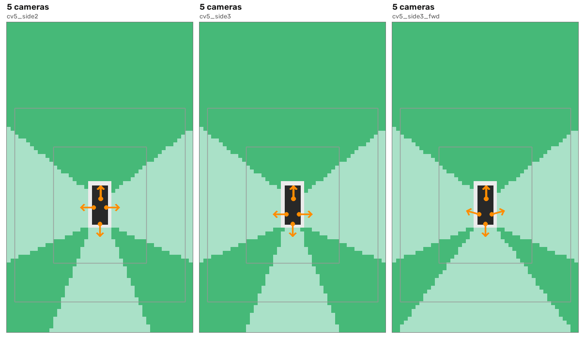

# 20. 카니발 3D 모델로 잰 카메라 자리와 배선 길이

이 문서는 사용자 차량과 같은 차종인 기아 카니발 2011의 3D 모델에서 카메라 자리, 유리 기울기, 차체 가림, 케이블 길이를 재고, 그 자리로 [19번 측정](19_camera_count_sim.md)의 카메라 대수 시뮬레이션을 다시 돌린 결과입니다. 실제 차를 잰 것이 아니라 공개된 3D 모델을 공식 제원 크기에 맞춘 것이라, 모든 값은 실제 차에서 줄자와 수평계로 다시 확인해야 합니다. 장착 방법과 준비물은 [07 문서](../07_vehicle_mount_and_training_plan.md)에 있고, 여기서 정한 자리는 `configs/five_cam_carnival.yaml`에 적었습니다.

## 1. 결론

카메라는 5대 그대로 둡니다. 카니발 차체와 아래 자리로 돌린 시뮬레이션에서 좌우를 3열 옆유리 안쪽에 단 배치는 차 둘레의 모든 칸을 한 대 이상이 보았고, 아홉 장면 전체에서 화면에 나온 비율이 0.917로 모델 Y 기준 5대 배치(0.913)와 같은 수준이었습니다(6장).

자리는 전방 광각과 전방 메인이 앞유리 안쪽 룸미러 다리 오른쪽, 후방이 테일게이트 번호판 홈의 위쪽 턱 아래(차 밖), 좌우가 3열 옆유리 안쪽입니다. 좌우를 2열 슬라이딩 도어 유리에 달면 문을 열 때마다 문이 뒤로 미끄러져 케이블이 움직이는 문과 차체 사이를 건너야 하고, 시뮬레이션의 후진 출차 장면에서도 3열 자리가 나았습니다(0.874와 0.818).

모델 Y 기준으로 잡았던 각도 가운데 가장 크게 달라지는 것은 좌우 케이스입니다. 카니발의 옆유리는 위쪽이 차 안쪽으로 약 20도 기울어 있어, 렌즈를 유리에 바로 붙이면 카메라는 20도 위를 봅니다. 설정대로 20도 아래를 보게 하려면 케이스의 쐐기각이 약 40도여야 합니다. 앞유리는 룸미러 높이에서 수평으로부터 약 30도, 브래킷을 붙이는 바닥 위 1.55~1.58m에서는 약 28도 기울어 있어, 전방 카메라를 3도 아래로 보게 하는 브래킷은 유리면과 카메라 판 사이를 약 65도로 잡습니다(계산값).

라즈베리파이는 조수석 아래에 둡니다. 경로를 따라 잰 케이블 길이(여유 15% 포함)는 전방 약 3.8m, 좌우 약 2.8~3.8m, 후방 약 5.9m입니다. 그래서 전방 HDMI는 5m를 쓰고, 후방은 카메라 케이블 1m에 5m 리피터를 이으면 남는 길이가 거의 없어 리피터를 하나 더 준비합니다(7장).

## 2. 모델과 크기 맞추기

모델은 Sketchfab에 CC BY 4.0으로 공개된 "Kia Carnival 2011"(Doz3)입니다 [V1]. 모델에는 단위가 없어, 바퀴 네 개의 중심을 찾은 뒤 좌우 바퀴 중심 사이 거리(윤거)가 공식 값 1,685mm [V2]가 되도록 크기를 맞췄습니다. 좌표는 설정 파일과 같은 차량 좌표(X 전방, Y 좌측, Z 위, 원점은 뒷바퀴 축 가운데 바닥)로 옮겼습니다.

| 항목 | 모델 | 롱바디(11인승) | 숏바디(9인승) |
|---|---|---|---|
| 축거 | 3,025mm | 3,020mm | 2,890mm |
| 전장 | 5,022mm | 5,130mm | 4,810mm |
| 전폭 | 1,987mm | 1,985mm | 1,985mm |
| 전고 | 1,760mm(루프 랙 위 1,785mm) | 1,780mm | 1,760mm |

공식 값은 2세대 카니발의 국내 제원이고 [V2], 영문 위키백과의 축거, 전장, 전폭도 같습니다 [V3]. 모델의 전폭은 사이드미러를 뺀 도장면의 폭이고, 전고는 루프 랙을 뺀 지붕 꼭대기와 루프 랙 위 끝을 함께 적었습니다. 공식 전고가 루프 랙을 넣은 값인지는 확인 필요입니다. 축거가 롱바디와 0.2% 안에서 맞고 숏바디와는 4.7% 달라, 모델은 롱바디(그랜드 카니발 11인승)입니다. 크기를 맞추는 데 쓰지 않은 전폭도 0.1% 안에서 맞습니다. 전장은 롱바디보다 2.1%(약 11cm) 짧아 앞뒤 끝이 덜 튀어나오게 만들어진 것으로 보이며 이유는 확인 필요입니다. 연식에 따른 제원 차이도 확인 필요입니다.

사용자 차가 숏바디라면 축거가 13cm 짧아 앞뒤 거리가 들어간 값(3열 유리 위치, 케이블 길이)이 달라집니다. 숏바디의 후방 케이블은 축거 차이만큼 줄여 약 5.5m로 어림했습니다.

재는 방법은 모두 같습니다. 모델의 차체, 유리, 실내(대시보드, 시트, 룸미러, 기둥 내장재)를 삼각형 면 그대로 두고, 카메라 자리에서 화면의 화소마다 시선을 쏘아 무엇에 먼저 닿는지를 셉니다. 렌즈 값은 `configs/five_cam.yaml`의 보정 전 값(768x432, Camera Module 3 Wide 초점거리 311px, Camera Module 3 564.3px, IMX291 160도 등거리 어안 315.5px)입니다. 유리 기울기는 붙일 자리 둘레 3cm 안의 유리 면에 점 25개를 찍어 평면을 맞춘 값입니다.

## 3. 앞유리와 전방 2대

앞유리는 휘어 있어 높이마다 기울기가 다릅니다. 가운데 근처의 기울기는 수평에서 바닥 위 1.45m 높이 33.6도, 1.50m 32.8도, 1.53m 29.8도, 1.56m 28.4도입니다. 모델의 앞유리는 평평한 면 조각을 이어 만든 것이라 1.52m와 1.60m 높이에서 기울기가 33.6도, 28.4도, 24.4도로 꺾이고, 위 값은 둘레 3cm를 평균한 것입니다. 실제 유리는 이 사이를 매끈하게 잇는 곡면이라 1.53m에서는 약 30도로 봅니다. 룸미러는 거울 몸체가 X 2.11~2.21m, Y −0.10~0.11m, Z 1.49~1.56m에 있고, 다리는 유리에 붙는 곳에서 Y −0.020~0.016m, Z 1.52~1.55m입니다.

전방 2대는 다리 오른쪽(조수석 쪽)에 메인을 안쪽, 광각을 바깥쪽으로 6cm 간격을 두고 바닥 위 1.53m에 둡니다. 좌표는 메인 (2.246, −0.065, 1.53), 광각 (2.244, −0.125, 1.53)이고 렌즈 중심은 유리에서 약 1cm 안쪽입니다. 실제 차에서는 룸미러 다리의 오른쪽 면과 앞유리 위쪽 검은 띠를 기준으로 자리를 잡습니다. 다리 오른쪽 면(Y −0.020m)에서 메인 렌즈 중심까지 4.5cm, 브래킷 패드 왼쪽 끝까지 2.2cm이고, 패드 위 끝은 검은 띠의 아래 끝(바닥 위 약 1.58m)에서 유리를 따라 8mm 아래입니다. 패드는 유리를 따라 6.4cm입니다. 메인을 다리에 더 붙이지 않는 것은 차광 후드 때문입니다. 메인의 시선이 유리를 지나는 범위는 다리 높이에서 카메라 왼쪽 4.2cm까지 퍼지므로, 메인을 차 가운데에서 4.5cm 오른쪽에 두면 후드 왼쪽 벽이 다리에 걸립니다. 6.5cm 오른쪽에 두면 그 범위가 Y −0.023m에서 끝나 다리(Y −0.020m부터)와 3mm 떨어집니다.

메인은 화면의 0.4%만 보닛 끝에 가리고, 화면 가운데 세로줄에서 바닥은 앞범퍼 앞 1.9m부터 보입니다. 광각은 화면 아래쪽 18%가 가려지고 바닥은 앞범퍼 앞 1.8m부터 보입니다. 가려진 18% 가운데 약 10%는 유리 너머의 보닛과 와이퍼 자리이고, 약 7%는 유리보다 가파르게 내려가 유리를 지나지 않는 시선이 닿는 대시보드 윗면입니다. 앞범퍼 바로 앞을 보지 못하는 것은 19번 측정 4.4절의 모델 Y와 같은 성질입니다.

앞유리 자리의 약점은 유리를 비스듬히 지나는 시선이 많다는 것입니다. 유리에 75도보다 비스듬히 들어가는 시선이 메인 화면의 21%, 광각 화면의 32%이고 대부분 화면 아래쪽입니다. 이 각도에서는 유리 반사가 커져 대시보드가 화면에 비치기 쉬우므로 차광 후드를 꼭 둡니다. 후드 바닥판은 렌즈 아래 끝에서 시작해 메인 화면의 아래 끝 시선(수평에서 약 24도 아래)을 따라 내려가 유리에 닿게 만듭니다. 바닥판을 수평으로 두면 화면 아래쪽을 가립니다. 이 바닥판은 메인 화면을 가리지 않고, 광각은 화면 아래 두 모서리에서 차 앞 양옆의 바닥을 보는 시선(화면의 약 2%)을 가립니다. 이 시선은 모두 유리에 75도보다 비스듬히(가운데값 86도) 들어가 반사가 큰 곳이라 잃는 것이 적습니다. 나머지 길과 하늘을 보는 시선이 유리를 지나는 곳은 렌즈 앞 유리 점에서 경사를 따라 아래로 메인이 6.2cm 안(98%는 5.2cm 안), 광각이 12.8cm 안(98%는 7.1cm 안)입니다. 그래서 후드가 유리에 닿는 면은 경사 방향으로 약 10cm, 좌우로 먼 끝에서 약 25cm로 잡습니다. 후드 왼쪽 벽은 룸미러 다리와 가장 가까운 곳에서 약 6.5mm 떨어집니다. 이 범위 밖에서 유리를 지나는 광각의 시선은 화면의 1% 미만입니다.

유리 기울기가 높이마다 달라 브래킷 각도는 실제로 붙일 자리(바닥 위 약 1.55m)에서 휴대폰 수평계로 잰 값으로 정합니다. 룸미러 뒤에 레인 센서나 블랙박스가 있는지는 확인 필요이고, 있으면 그 자리를 피해 오른쪽으로 옮기고 옮긴 만큼 설정 파일 좌표를 바꿉니다.

## 4. 옆유리와 좌우 2대

2열 슬라이딩 도어 유리와 3열 옆유리는 모두 위쪽이 차 안쪽으로 기울어 있습니다. 바닥 위 1.38m에서 잰 유리 바깥 방향 법선은 수평보다 20.5도(3열, X 0.28m), 20.9도(2열, X 1.15m) 위를 향합니다. 그래서 렌즈를 유리에 바로 붙이면 카메라는 약 20도 위를 보고, 설정의 20도 아래를 보게 하려면 카메라 축을 유리 법선에서 40.5도 아래로 돌려야 합니다. 10도 아래면 30.5도, 수평이면 20.6도입니다. 옆유리는 위로 갈수록 더 기울어 3열 유리 가운데에서 바닥 위 1.20m는 약 13도, 1.60m는 약 30도이고, 높이 1cm마다 약 0.4도씩 바뀝니다. 그래서 쐐기각은 실제로 붙일 높이에서 휴대폰 수평계로 잰 유리 기울기에 숙일 각도를 더해 정합니다.

3열 옆유리에서 검은 테두리와 실내 내장재에 가리지 않는 투명한 부분은 바닥 위 1.38m 높이에서 X −0.43~0.375m이고, X 0.28m에서는 바닥 위 1.20~1.61m입니다. 2열 슬라이딩 도어 유리는 X 0.60~1.25m입니다. 좌우 카메라는 3열 유리 앞쪽인 X 0.28m, 바닥 위 1.38m에 둡니다. 렌즈 중심의 Y는 ±0.812m입니다. 실제 차에서는 차 안에서 보이는 유리 끝(검은 테두리의 안쪽 끝)을 기준으로, 렌즈 자리를 앞 끝에서 9.5cm 뒤, 아래 끝에서 유리를 따라 18.5cm 위(위 끝까지 24.7cm)로 잡습니다.

| 숙인 각 | 쐐기각 | 바닥이 보이는 곳 | 75도 넘게 비스듬한 시선 |
|---|---|---|---|
| 20도 | 40.5도 | 차체 옆 0.66m부터 | 16% |
| 10도 | 30.5도 | 차체 옆 1.04m부터 | 9% |
| 0도 | 20.6도 | 차체 옆 1.54m부터 | 5% |

바닥이 보이는 곳은 화면 가운데 세로줄에서 가장 가까운 바닥까지의 거리를 차체 옆면(Y 0.98m)부터 잰 값이고, 마지막 칸은 유리에 75도보다 비스듬히 들어가는 시선이 화면에서 차지하는 비율입니다. 20도로 숙이면 유리 너머의 차체와 실내 기둥 내장재가 화면 아래 모서리를 약 4% 가립니다.

숙인 각은 설정대로 20도로 둡니다. 문 옆에 선 사람의 발과 연석이 차체 옆 0.66m부터 보이고, 시뮬레이션에서 10도와 20도의 결과가 같았기 때문입니다(6장). 대신 화면 아래 16%는 유리를 아주 비스듬히 지나 어둡고 반사가 큽니다. 케이스가 렌즈와 유리 사이를 검게 막고 있으면 유리에 비치는 것은 케이스 안쪽이라 겹쳐 보이는 상은 생기지 않고 어두워지기만 합니다. 첫 시험에서 화면 아래가 너무 어두우면 30도 쐐기(10도)로 바꿉니다.

케이스는 유리 쪽이 트인 쐐기 모양입니다. 렌즈 앞면을 유리에서 6mm 안에 두면, 유리에 80도보다 덜 비스듬히 들어가는 시선(화면의 89%)은 렌즈 중심에서 유리에 내린 점을 기준으로 앞뒤 각 32mm, 아래 34mm, 위 4mm 안에서 유리를 지납니다(계산값). 그래서 유리 쪽 입구는 폭 약 70mm, 높이 약 40mm로 렌즈 아래쪽을 크게 트고, 그 테두리에 검은 폼을 둘러 유리에 붙입니다. 화면 아래 두 모서리(약 3%)는 시선이 유리와 나란하거나 안쪽을 향해 케이스 벽이 보입니다. 카메라를 40도 기울이면 기판 위 끝이 유리 쪽으로 들려, 기판이 38mm 각이고 렌즈 경통이 15mm라면 기판 위 끝과 유리 사이가 5mm 남짓입니다(가정에 따른 계산값). 케이스를 그리기 전에 B0202 기판과 렌즈의 실제 치수를 잽니다.

2열 자리도 시야는 비슷했습니다(20도에서 가림 약 4%, 바닥은 차체 옆 0.67m부터). 3열을 고른 것은 케이블과 후진 장면 때문입니다. 3열 유리가 열리는 환기창인지, 커튼 에어백이 3열 유리 위까지 오는지는 확인 필요입니다. 열리는 창이면 시험 중에는 열지 않습니다. 3열에 사람이 타면 케이스가 머리 옆에 오므로 모서리를 둥글게 만듭니다.

## 5. 후방

테일게이트의 번호판 홈은 평평한 뒷벽이 X −0.93m, 바닥 위 0.88~1.06m에 있고, 그 아래는 아래쪽 턱(Z 0.80m)까지 비스듬히 내려가는 바닥입니다. 홈의 폭은 입구 기준으로 위쪽 약 0.90m, 아래쪽 약 0.84m이고, 뒷벽이 평평한 부분은 가운데 약 0.50m입니다. 위쪽 턱의 아랫면은 바닥 위 1.064m이고, 턱 끝은 X −0.999m라 뒷벽에서 약 7cm 나와 있습니다. 턱 끝에는 밝은 장식(Z 1.07~1.09m)이 있고 그 위에 KIA 엠블럼이 있습니다.

후방 카메라는 이 턱 아래 가운데 (−0.985, 0, 1.02)에 두고 뒤를 보며 20도 숙입니다. 20도 쐐기를 홈 뒷벽에 붙이고 카메라를 쐐기에 붙이는 방식이라, 쐐기와 카메라 케이스, 렌즈 길이만큼 렌즈가 뒷벽에서 나옵니다. 쐐기는 높이 4.6cm, 두께가 아래 끝 3mm에서 위 끝 약 2.1cm이고 위 끝을 턱 아랫면 6mm 밑에 둡니다. 카메라 케이스를 40x40x26mm, 렌즈 돌출을 16.5mm로 잡으면(확인 필요) 렌즈 앞면은 뒷벽에서 약 5.4cm 뒤, 턱 아랫면에서 약 4.4cm 아래, 턱 끝보다 약 1.4cm 안쪽입니다(계산값). 이 자리에서 차체가 가리는 것은 화면 아래 두 모서리의 뒤범퍼 윗면으로 화면의 0.1%이고, 턱 끝은 카메라 축에서 위로 약 94도에 있어 화면에 들어오지 않습니다. 바닥은 뒤범퍼 뒤 0.51m부터 보입니다. 바로 위에서 떨어지는 비는 턱이 막지만, 렌즈가 턱 끝 가까이 나와 있어 수직에서 약 18도보다 더 기울어 뒤에서 들이치는 비는 렌즈에 닿을 수 있습니다(계산값). 그래서 차양은 처음에 달지 않고, 비 오는 날 렌즈에 물방울이 남는지 본 뒤 덧답니다.

카메라는 번호판 위 끝과 턱 아랫면 사이의 틈에 들어가야 합니다. 그림은 긴 번호판을 홈 가운데보다 조금 아래(위 끝 Z 0.995m)에 그린 것으로, 이때 틈은 약 7cm입니다. 턱 아랫면에서 케이스 아래 끝까지는 약 5.7cm라 케이스와 번호판 사이는 약 1.2cm 남습니다. 렌즈가 뒷벽에서 나와 있어 위에서 30도로 내려다보면 렌즈 아래 끝이 번호판 위쪽 약 0.8cm를 덮습니다(계산값). 모델에는 번호판과 번호등이 없어, 번호판 종류(긴 번호판 또는 짧은 번호판)와 실제 높이, 번호등 자리, 카메라 케이스와 쐐기가 이 틈에 들어가는지는 확인 필요입니다.

## 6. 카니발 차체로 돌린 카메라 대수 시뮬레이션

`realityview/layout_sim.py`에 카니발 차체(뒤끝 X −1.087m, 앞끝 3.935m, 반폭 0.98m, 모델에서 잰 차체 윗면 높이)와 위 자리를 넣고, `scripts/sim_camera_count.py`에 `--vehicle carnival`로 고르게 했습니다. 비교한 배치는 전방 2대와 후방을 위 자리에 두고 좌우만 바꾼 셋입니다. cv5_side2는 2열 슬라이딩 도어 유리, cv5_side3는 3열 옆유리, cv5_side3_fwd는 3열 옆유리에서 앞으로 15도 돌린 배치이고 좌우는 모두 20도 숙였습니다. cv5_side3는 10도로 숙인 경우도 돌렸습니다. 기준은 같은 실행 조건으로 다시 돌린 모델 Y의 c5_side160입니다.



위 그림은 왼쪽부터 cv5_side2, cv5_side3, cv5_side3_fwd의 시야 지도이고, 그리는 방법과 색은 19번 측정 4.1절과 같습니다(옅은 초록은 한 대, 진한 초록은 두 대 이상에 보이는 칸, 위쪽이 차 앞). 세 배치 모두 보이지 않는 칸이 없었고, 차 둘레 5m 안, 앞옆, 옆, 뒤옆 칸이 모두 한 대 이상에 보였습니다. 칸마다 검출될 확률의 평균은 차 0.98, 사람 0.96입니다.

| 배치 | 화면에 나온 비율 | 후진 출차 | 분당 끊김 | 분당 ID 바뀜 |
|---|---|---|---|---|
| c5_side160(모델 Y) | 0.913 | 0.846 | 6.72 | 12.4 |
| cv5_side2 | 0.915 | 0.818 | 6.33 | 12.2 |
| cv5_side3 | 0.917 | 0.874 | 6.41 | 12.1 |
| cv5_side3_fwd | 0.917 | 0.873 | 6.58 | 14.5 |
| cv5_side3(10도) | 0.917 | 0.873 | 6.36 | 12.3 |

화면에 나온 비율은 아홉 장면 전체에서 탑뷰 범위 안의 물체가 화면에 나온 비율이고, 후진 출차는 그 가운데 주차 칸에서 뒤로 빠지는 장면(backout)의 값입니다. 분당 끊김은 1초 넘게 화면에서 사라진 횟수입니다. 세 검출 모형(easy, base, hard)을 합친 값이고 FPS는 배치별 모형 FPS(13.5)입니다.

3열 자리는 전체 비율과 후진 출차에서 2열 자리보다 나았고, 분당 끊김은 거의 같았습니다. 교차로 정지 장면(cross)은 2열이 나았습니다(0.960과 0.938). 3열 자리를 앞으로 15도 돌리면 전체 비율은 같고 ID 바뀜이 분당 12.1회에서 14.5회로, 한 물체가 두 번 그려지는 시간이 분당 9.7초에서 18.0초로 늘어 정측면(yaw ±90도)을 그대로 둡니다. 10도와 20도는 거의 같았습니다. 앞쪽 25~40m의 물체가 화면에 나온 비율은 카니발 배치가 0.525, 모델 Y가 0.508입니다.

## 7. 배선 경로와 길이

라즈베리파이와 두 NPU는 조수석 아래(X 1.70m, Y −0.45m)에 둡니다. 햇볕이 닿지 않고([07 문서](../07_vehicle_mount_and_training_plan.md) 5.1절), 전방 HDMI가 내려오는 오른쪽 A필러와 USB가 지나는 오른쪽 문턱에 가깝습니다.

| 케이블 | 경로 길이 | 여유 15% 포함 | 쓸 케이블 |
|---|---|---|---|
| 전방 HDMI 2가닥 | 3.3m | 3.8m | HDMI 5m |
| 우측 USB | 2.4m | 2.8m | 카메라 1m와 연장 3m |
| 좌측 USB | 3.3m | 3.8m | 카메라 1m와 연장 3m |
| 후방 USB | 5.1m | 5.9m | 카메라 1m와 리피터 5m, 예비 리피터 5m |

길이는 모델에서 경유점을 이어 잰 값에 여유 15%를 더한 어림값입니다. 전방은 카메라에서 천장 앞 가장자리, 오른쪽 A필러, 대시 옆, 조수석 발밑 옆을 지나 조수석 아래로 갑니다. 좌우는 3열 유리 아래에서 옆 내장재를 따라 내려와 문턱 몰딩 아래로 앞으로 오고, 좌측은 2열 앞 바닥 매트 아래로 오른쪽으로 건너옵니다. 후방은 턱 아래 구멍으로 테일게이트 안에 들어가 위쪽 경첩 쪽 주름관, D필러, 3열 옆, 오른쪽 문턱 몰딩을 지납니다.

후방은 카메라 케이블 1m와 리피터 5m를 더한 6m가 여유를 포함한 5.9m와 거의 같습니다. 그래서 리피터를 두 개 사서, 실제 경로가 6m를 넘으면 이어 씁니다. 라즈베리파이를 운전석과 조수석 사이에 두면 후방은 약 6.4m가 되어 처음부터 두 개를 이어야 합니다. 리피터는 허브 칩이 든 케이블이라 둘을 이으면 허브가 두 단이 되므로, 둘 다 5V 전원을 넣는 것을 기본으로 합니다(07 문서 2.3절).

## 8. 한계와 확인 필요

공개된 3D 모델이라 실제 차의 설계 도면과 같다는 보장이 없고, 특히 실내 내장재, 유리 곡률, 번호판 홈 모양은 실제 차와 다를 수 있습니다. 모델의 유리는 10~20cm 간격의 평평한 면으로 되어 있어 기울기 값은 1도 안팎의 오차를 봅니다. 전장이 제원보다 약 11cm 짧아, 범퍼 끝에서 잰 거리(바닥이 보이는 곳)와 후방 케이블 길이는 실제와 수 cm 다를 수 있습니다. 사용자 차가 롱바디인지 숏바디인지, 3열 유리가 열리는 창인지, 룸미러 뒤에 센서가 있는지, 번호판 종류와 번호등 자리는 확인 필요입니다. 3열 유리의 틴팅 농도는 야간 화질에 영향을 주므로 실제 차에서 먼저 봅니다. 렌즈 값은 보정 전 가정값이라, 비스듬한 시선의 비율과 바닥이 보이는 거리는 내부 보정 뒤 조금 달라질 수 있습니다.

## 9. 다시 돌리는 명령

```
# 시야 지도와 그림(6장)
python3 scripts/sim_camera_count.py coverage --vehicle carnival \
  --figure docs/images/carnival_coverage.png --out out/sim/20_coverage.json
# 카니발 배치 비교(6장), 좌우 10도
python3 scripts/sim_camera_count.py run --vehicle carnival --fps model --out out/sim/20_run_carnival.json
python3 scripts/sim_camera_count.py run --vehicle carnival --side-pitch 10 --layouts cv5_side3 --fps model \
  --out out/sim/20_run_carnival_p10.json
# 같은 조건의 모델 Y 기준
python3 scripts/sim_camera_count.py run --layouts c5_side160 --fps model --out out/sim/20_run_model_y.json
```

카니발 차체 전환과 `configs/five_cam_carnival.yaml`의 시험은 `tests/test_camera_count.py`에 있습니다.

## 출처

- V1: [Kia Carnival 2011, Doz3, Sketchfab (CC BY 4.0)](https://sketchfab.com/3d-models/kia-carnival-2011-855c464351f244cbaafa8269a5d472df)
- V2: [기아 카니발, 위키백과](https://ko.wikipedia.org/wiki/기아_카니발)
- V3: [Kia Carnival, Wikipedia](https://en.wikipedia.org/wiki/Kia_Carnival)
