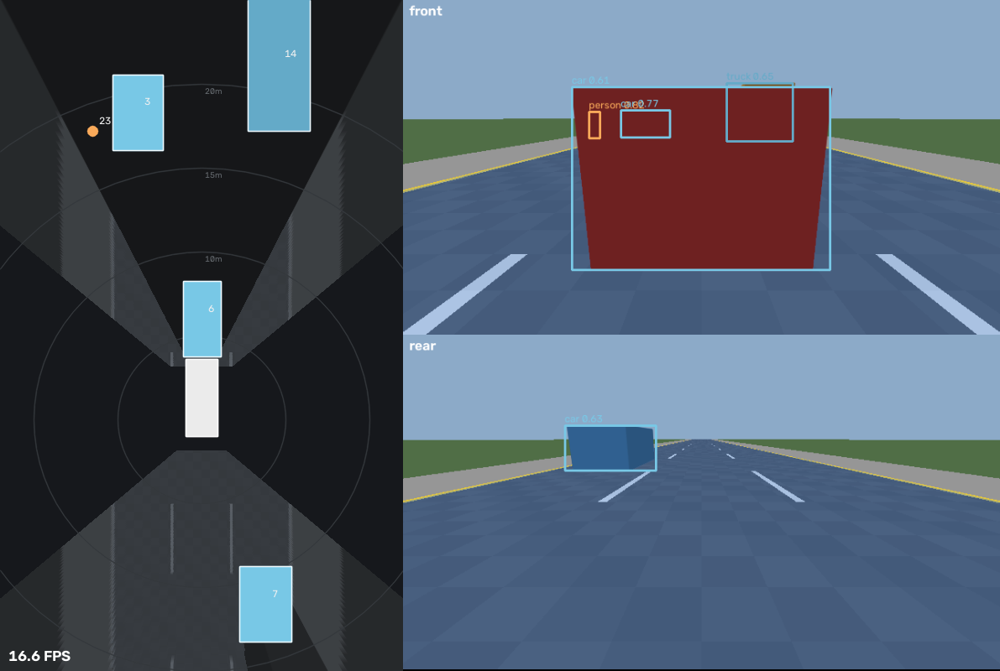

# 리얼리티 뷰 1단계 데모: 카메라별 검출+세그 → BEV 합성

[추천안 문서](edge_npu_model_selection.md)의 1단계(방식 B)를 구현한 코드다. 카메라 영상마다 NPU에서 객체 검출(과 선택적으로 도로 세그멘테이션)을 돌리고, CPU에서 지면 평면 가정으로 탑뷰(BEV)에 합성해 리얼리티 뷰처럼 그린다.



왼쪽이 탑뷰(흰 차가 자차, 원은 5m 간격), 오른쪽이 카메라별 검출 결과다. 4캠 구성은 [이 그림](images/phase1_sim_four_cam.png)처럼 좌우 사각지대까지 덮는다.

## 구조

```
카메라 N대 ──► NPU (Hailo-8)                 ──► CPU                                   ──► 화면
              · YOLOv8 검출 (NMS 내장 HEF)        · 접지점 → 지면 좌표 (광선-평면 교차)
              · 도로 세그 HEF (선택, N프레임마다)   · 카메라 간 중복 병합 + BEV 추적
                                                · IPM LUT로 바닥 영상/도로 마스크 합성
```

| 파일 | 역할 |
|---|---|
| `realityview/camera_model.py` | 카메라 모델(핀홀/어안), 픽셀 ↔ 지면 변환, PnP 결과 → 자세 |
| `realityview/bev.py` | BEV 격자, IPM 합성(`cv2.remap` LUT), 검출 → 지면 객체, 중복 병합 |
| `realityview/detectors.py` | `HailoBackend`(라즈베리파이), `UltralyticsBackend`(PC 개발용) |
| `realityview/tracker.py` | BEV 평면 최근접 매칭 추적 |
| `realityview/render.py` | 탑뷰 렌더링과 대시보드 |
| `realityview/sim.py` | 하드웨어 없이 확인하는 합성 장면과 가짜 검출기 |
| `scripts/run_demo.py` | 실행 진입점 |
| `scripts/calib_intrinsics.py`, `scripts/calib_extrinsics.py` | 카메라 보정 |
| `configs/two_cam.yaml`, `configs/four_cam.yaml` | 카메라 배치 예시 |

## 바로 해 보기 (PC, 하드웨어 없음)

```bash
pip install -r requirements.txt
python -m pytest -q tests
python scripts/run_demo.py --backend sim --frames 150 --save out/sim.mp4 --headless
python scripts/run_demo.py --config configs/four_cam.yaml --backend sim --frames 150 --save out/sim4.mp4 --headless
```

녹화 영상이 있으면 PC에서 실제 검출기로 확인할 수 있다(`pip install ultralytics`).

```bash
python scripts/run_demo.py --backend ultralytics --video front=rec/front.mp4 --video rear=rec/rear.mp4
```

## 라즈베리파이 5 + Hailo-8 설치

1. Raspberry Pi OS(64bit) 최신으로 업데이트하고 AI HAT+(26 TOPS)를 장착한다. 전원은 27W 공식 어댑터, 쿨러 필수.
2. `sudo apt install hailo-all python3-picamera2` 후 재부팅. `hailortcli fw-control identify`로 Hailo-8이 보이는지 확인.
3. PCIe Gen3 사용: `/boot/firmware/config.txt`에 `dtparam=pciex1_gen=3`.
4. 가상환경은 시스템 패키지를 보이게 만든다: `python3 -m venv --system-site-packages .venv && . .venv/bin/activate && pip install pyyaml`.
5. Hailo Model Zoo에서 Hailo-8용 `yolov8s.hef`(또는 `yolov8m.hef`)를 받아 `models/yolov8s_h8.hef`로 둔다. Hailo-8L용 HEF는 Hailo-8에서 돌지 않으니 아키텍처를 맞춘다.
6. (선택) 도로 세그: Model Zoo의 Cityscapes 시맨틱 세그 HEF를 `npu.seg_hef`에 지정한다. 출력이 클래스 로짓이든 클래스 맵이든 처리하며, `road_classes`로 도로 클래스 번호를 지정한다.
7. 실행: `python scripts/run_demo.py --config configs/two_cam.yaml --backend hailo`

## 카메라 보정 (품질을 가장 크게 좌우)

1. **내부 파라미터**: 체커보드(예: 내부 코너 9x6, 2.5cm)를 데모 해상도(768x432)로 20장 이상 다양한 각도에서 찍고
   `python scripts/calib_intrinsics.py --images calib/front/*.jpg --model fisheye`. 광각 모듈은 `fisheye`가 대개 더 잘 맞는다. RMS 1px 이하가 목표.
2. **외부 파라미터**: 차 주변 바닥에 마스킹 테이프로 점 6개 이상을 찍고 차량 좌표(X 전방, Y 좌측, 원점은 뒷바퀴 축 중앙 바닥)를 줄자로 잰다. 각 점의 픽셀 좌표를 `u,v,X,Y` CSV로 적은 뒤
   `python scripts/calib_extrinsics.py --config configs/two_cam.yaml --camera front --points calib/front_points.csv`.
   출력되는 지면 역투영 오차가 10cm 이내면 충분하다.

## 시뮬레이션에서 확인한 것

- 단위 테스트 24개: 투영/역투영 왕복(핀홀, 어안, 여러 방향), PnP 자세 복원, IPM 담당 카메라, 접지점 거리, Hailo NMS 출력 좌표 복원, 세그 마스크, 추적, 전체 파이프라인.
- 합성 장면에서 15m 이내 차량의 추적 위치가 정답과 1m 이내(테스트로 고정).
- 클라우드 x86 CPU 기준 CPU 단계 시간: 2캠 BEV 합성 약 19ms + 렌더 약 40ms, 4캠 약 33ms + 75ms. 라즈베리파이 5에서는 몇 배 느릴 것으로 보여 실측이 필요하다. 느리면 `--no-ground`로 바닥 영상 합성을 끄거나 `bev.res`를 0.1로 키운다.

## 알려진 한계와 다음 작업

- **평지 가정**: 경사로, 과속방지턱에서 거리 오차가 커진다. 2단계 FlashOcc로 넘어가는 이유다.
- **차량 방향**: 자차 오도메트리가 없어 상대좌표만 알기 때문에, 차량은 자차와 평행하게 그린다. IMU나 휠 속도를 넣으면 정지 물체를 고정 좌표로 추적하고 방향도 추정할 수 있다.
- **빠른 상대 이동**: 자차가 빠르면 정지 물체도 빠르게 움직이는 것으로 보여 ID가 바뀔 수 있다. 위와 같은 이유로 오도메트리 보정이 다음 개선 항목이다.
- **실기 미검증**: `HailoBackend`와 `PiCameraSource`는 HailoRT/Picamera2 공개 API 기준으로 작성했지만 실제 보드에서 아직 돌려 보지 않았다. 처음 실행할 때 HEF 출력 이름이나 형식이 다르면 `detectors.py`의 `parse_hailo_nms`만 맞추면 된다.
- 차선 인식은 아직 없다(도로 영역 세그만). 차선 전용 모델(예: UFLD 계열)을 Hailo로 컴파일해 넣는 것이 1.5단계 후보다.
