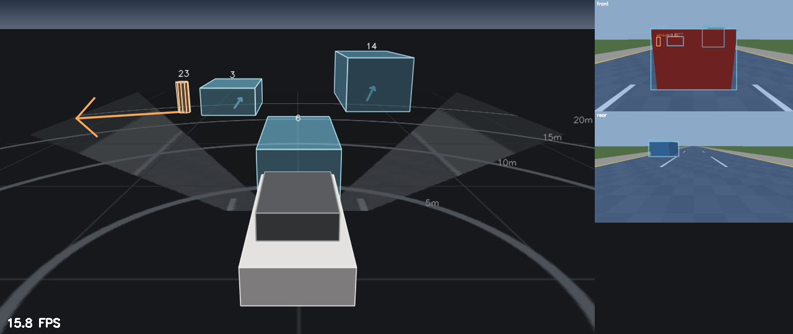

# 진행 상황

이 문서는 라즈베리파이 5, Hailo-8, DX-M1 구현 작업의 현재 진행 상황입니다. 다른 사람이나 다른 세션이 이 문서만 읽고 작업을 이어받을 수 있게, 실행이 끝날 때마다 갱신해 main에 올립니다. 단계와 완료 기준은 [구현 계획](03_pi5_hailo8_dxm1_implementation_plan.md)을 따릅니다.

## 지금 위치

1단계는 코드와 측정을 마쳤고 사람이 하는 보정만 남았습니다. 2단계는 DEEPX 공식 .dxnn(YOLOv8s PPU, BiSeNetV2 세그)으로 검출 비교와 동시 실행까지 마쳤고, 도로 IoU 측정만 남았습니다. 카메라 위치 기준값은 테슬라 모델 Y 배치로 바꿨습니다(전방 ov5647은 앞유리 상단 전방 광각 자리, 후방 imx708은 뒷번호판 위). 지금은 사용자의 모형 보정을 기다립니다. 4단계 준비로 BEVPool CPU 구현을 마쳤습니다.

| 단계 | 상태 |
|---|---|
| 0단계 장비 확인 | 30분 연속 실행 실패 (Hailo-8 과열), 방열 후 재시험 |
| 1단계 Hailo 실기 | 보정과 거리 오차 측정 남음 |
| 2단계 DX-M1 추가 | 도로 IoU 측정 남음 |
| 4단계 준비 | BEVPool CPU 구현 끝남 |

## 3D 시점 화면

`run_demo.py --view 3d`로 테슬라 리얼리티 뷰처럼 자차 뒤쪽 위에서 내려다보는 화면을 그립니다(`both`는 탑뷰와 함께, 기본은 `bev`). 시뮬레이션 결과는 아래와 같고, 영상은 [videos](videos/)에 있습니다. 파이5 카메라 2대에서 20.8 FPS이고, 바닥 갱신을 3프레임마다, 해상도를 절반으로 하면 28.3 FPS입니다(물체가 없는 장면).



먼 차 하나가 트랙 여러 개로 쪼개지던 문제는 `--tracker robust`로 고쳤습니다. 시뮬레이션 정답과 비교하면(`scripts/eval_tracking.py`, 225프레임 x seed 5개, 15fps) ID 바뀜이 카메라 2대에서 381회에서 48회로, 카메라 4대에서 487회에서 51회로 줄었습니다. 기본값은 아직 basic이고, 실제 카메라 장면에서 확인한 뒤 바꿉니다.

센서에서 화면까지 지연(Hailo 단독, 평균 84.1ms, 26.1 FPS) 중 약 16ms는 Picamera2가 들고 있던 프레임이 묵은 몫입니다. `--cam-fps 20`이면 74.0ms, `--cam-queue off`면 67.9ms로 줄지만 FPS도 20.0, 15.0으로 떨어져 기본값은 그대로 둡니다. 카메라 앞에 사람이 없어도 `--replay 폴더`로 저장 이미지를 넣어 3D 화면의 사람 표시를 확인할 수 있습니다.

## v15풍 화면

`run_demo.py --view v15`로 FSD v15 리얼리티 뷰를 닮은 화면을 그립니다. 실제 색 IPM 바닥에 거리 안개를 넣고, 차와 사람은 박스 대신 3D 모델(햇빛 명암, 그림자, z-버퍼)로, 차선은 폭 있는 띠로, 계획 경로는 파란 띠로 그립니다. 시점은 chase, high, rear, side, top, orbit 여섯 가지이고 창에서 숫자 키로 부드럽게 바꿉니다. 자차는 사용자 차량과 같은 카니발 2011 모델(흰색 도장, 원본 153,373면을 11,561면으로 줄임)입니다. 클라우드 x86에서 렌더러만 물체 20개 기준 chase 22.3ms, orbit 36.3ms였고 파이 실측은 아직입니다. 자세한 내용은 [v15풍 화면 문서](v15_render.md), 영상은 [videos/20_v15_sim.mp4](videos/20_v15_sim.mp4)에 있습니다.

## 차량 장착 전 준비

주행 수집 도구를 만들었습니다. `scripts/record_drive.py`는 NPU 추론 없이 카메라 전부를 세그먼트 단위 MJPEG와 타임스탬프 csv로 녹화하고(카메라 2대 30fps에서 누락 0, 한 시간 약 7.1GB), `run_demo.py --trigger-clips`는 애매한 점수, 추적 ID 변화, 두 NPU 불일치가 나온 순간을 앞뒤로 저장하며, `--shadow`는 두 NPU에 다른 회차 모델을 올려 비교합니다. 사용법은 [주행 녹화 문서](drive_recording.md)에 있습니다.

학습 서버 쪽 파이프라인(`training/`)도 만들었습니다. 프레임 선별, Grounding DINO와 SAM 2 자동 라벨, CVAT 내보내기와 다시 읽기, 라벨 검수 지표, YOLOv8s 추가 학습(COCO 일부 섞기), 고정 시험 세트 평가, Hailo와 DEEPX 변환 명령 생성, 파이 배포까지 `python3 -m training.run_round` 하나로 돌립니다. 맥에서는 가짜 라벨러와 학습기로 끝까지 시험했고(37개 통과), 실제 실행은 데스크탑 WSL2에서 합니다. 순서는 [학습 파이프라인 문서](training_pipeline.md)에 있습니다.

카메라 4대 구성도 미리 만들었습니다. CSI, USB(UVC), 쿼드 키트 분할 소스를 카메라마다 설정에서 고르고, 카메라 시각이 다르면 가장 가까운 프레임끼리 묶습니다(`--sync`, 허용 오차 25ms). 파이에서 CSI 2대와 재생 2대를 섞은 4대 구성으로 Hailo 검출 15.8 FPS가 나와 4대 목표(8 FPS)를 넘었습니다(USB 전송 비용과 쿼드 키트 프레임레이트 제한은 빠진 값).

3D 화면에 차선과 신호등 색을 더했습니다(`--lanes`, `--traffic-lights`). 파이에 차선 HEF가 없어 탑뷰 바닥 영상에서 흰색과 노란색 차선을 찾는 고전 방식(파이 CPU 8.1ms)을 쓰고, 신호등은 YOLOv8s의 traffic light 박스를 HSV로 판정합니다. 시뮬레이션에서 차선 곡선 오차 평균 1.3~3.0cm, 신호등 색 정확도 0.91~1.00이었고, 파이 3D 화면에 둘을 켜고 19.7 FPS입니다. 실제 도로 정확도는 주행 녹화 뒤 확인합니다.

시동 연동과 과열 대응도 준비했습니다. `--thermal`을 켜면 Hailo, DX-M1, SoC 온도에 따라 세그와 깊이 주기를 늘리고, DX-M1을 멈추고, 끝으로 종료하는 단계를 히스테리시스와 함께 밟습니다. 부팅 후 자동 녹화와 데모용 systemd 사용자 서비스는 `deploy/systemd/`에 있고, ACC 신호(GPIO)나 SIGTERM을 받으면 세그먼트를 닫고 동기화한 뒤 끝납니다. 설치와 배선은 [차량 전원과 자동 시작 문서](vehicle_power_and_autostart.md)에 있습니다.

빠른 물체 추적도 고쳤습니다. 마주 오는 차(상대 25 m/s)에서 ID가 바뀌던 원인은 겹친 트랙 정리가 빠른 트랙을 지운 것, 카메라 사이 공백보다 짧은 트랙 유지 한도, 느린 속도 수렴, 먼 거리의 좁은 짝짓기 거리였고, `--tracker robust`에서 모두 고쳤습니다(물체 20개에 6.6ms). 카메라가 응답하지 않으면 다시 여는 `--cam-retry`도 넣었습니다. robust를 기본값으로 바꾸는 것은 주행 녹화로 한 번 비교한 뒤 합니다.

빠른 재보정 도구를 만들었습니다. `scripts/recalib_markers.py`는 바닥 마커 4개 이상으로 카메라 각도만 다시 구하고(확인 후 `--write`), `--calib-monitor`는 주행 중 차선 소실점으로 pitch와 yaw가 1도 넘게 벗어나면 경고하며(시뮬레이션에서 1~2도 틀어짐을 찾음), `scripts/check_overlap.py`는 두 카메라가 함께 보는 바닥이 맞물리는지 봅니다. 절차는 [모형 보정 문서](phase1_model_rig_calibration.md) 9장에 있습니다.

차에 달 카메라는 5대로 정했습니다. 앞유리 안쪽의 전방 광각과 전방 메인은 CSI로 달고, 후방(번호판 위)과 좌우는 대각 160도 USB 카메라로 답니다. 좌우는 B필러 자리(카니발에서는 3열 옆유리 안쪽)에서 옆을 정면으로 보고, 후방은 차 밖이라 방수 처리가 필요합니다. 지금의 2대와 4대에서 8대까지 모두 22개 배치를 아홉 장면에 넣어 비교한 시뮬레이션에서, 이 5대는 차를 한 바퀴 도는 사람을 끊김 없이 같은 ID로 따라갔고 물체가 화면에 나온 비율(표시 비율)은 8대보다 1.2%p 낮았습니다(0.913과 0.926). 앞범퍼 2.4m 안의 사람 위치, 뒤에서 차 사이로 오는 오토바이, 옆 차 너머의 보행자는 5대가 약한 곳입니다. 결과는 [19번 측정](measurements/19_camera_count_sim.md), 설정은 [configs/five_cam.yaml](../configs/five_cam.yaml), 제품과 판매처는 [06 문서](06_pi5_camera_selection.md)에 있습니다.

차량이 기아 카니발 2011이라, 같은 차종의 공개 3D 모델을 공식 제원 크기에 맞춰 카메라 자리와 각도, 케이블 길이를 쟀습니다. 모델은 롱바디(축거 3,020mm)와 맞았습니다. 자리는 전방 2대가 앞유리 안쪽 룸미러 다리 오른쪽(바닥 위 1.53m), 좌우가 3열 옆유리 안쪽, 후방이 번호판 홈의 위쪽 턱 아래(차 밖)입니다. 옆유리가 위쪽으로 약 20도 기울어 있어 좌우 케이스는 약 40도 쐐기가 되고, 앞유리 브래킷은 유리면과 카메라 판 사이를 약 63도로 잡습니다. 이 자리로 시뮬레이션을 다시 돌려도 5대로 충분했습니다(표시 비율 0.916, 모델 Y 기준 0.913). 파이는 조수석 아래에 두고, 전방 HDMI는 5m를 쓰며, 후방 USB는 약 5.9m라 리피터를 하나 더 준비합니다. 결과는 [20번 측정](measurements/20_carnival_mount.md), 설정은 [configs/five_cam_carnival.yaml](../configs/five_cam_carnival.yaml), 장착 방법은 [07 문서](07_vehicle_mount_and_training_plan.md)에 있습니다.

## 장비 구성

라즈베리파이 5(Debian 13, 64비트)에 Seeed 듀얼 M.2 HAT로 Hailo-8과 DX-M1 4GB를 함께 달았고, 두 NPU 모두 PCIe Gen3 x1로 인식됩니다. 런타임은 HailoRT 4.23.0, DXRT 3.4.2이고, `dx_engine`은 파이 저장소의 `.venv`에만 있습니다.

카메라는 계획의 Camera Module 3 Wide 2대가 아니라 지금 달린 카메라를 계속 씁니다. 0번은 ov5647(전방, 사용자 확인 기준 130도 광각, IR 컷, 야간 가능)이고 1번은 일반 Camera Module 3(imx708, 후방)입니다. 설정은 [configs/two_cam_current.yaml](../configs/two_cam_current.yaml)이고, 내부 파라미터는 보정 전 근사값입니다. 보정과 시험은 실제 차량이 아니라 모형으로 먼저 하고, 카메라 위치는 테슬라 모델 Y에서 같은 역할의 카메라 자리([04 문서](04_tesla_camera_layout.md))를 기준으로 둡니다. 모형은 그 배치를 축척으로 줄인 설정([configs/two_cam_model.yaml](../configs/two_cam_model.yaml))을 쓰고, 보정 절차는 [모형 보정 문서](phase1_model_rig_calibration.md)에 있습니다.

DX-M1은 부하가 없을 때도 약 72도이고, 짧은 벤치를 여러 번 돌린 뒤 89도까지 오른 적이 있습니다. DX-M1을 오래 돌리기 전에 방열 상태 확인이 필요합니다.

## 작업 방식

맥북의 감독 세션이 목표를 작업 파일로 써서 `~/Desktop/App/fsd_agent.py`(Claude Agent SDK, 사용자 API 크레딧 사용)에 넘기고, 결과를 검토한 뒤 커밋해 main에 올립니다. 넘긴 작업 파일은 [agent_tasks](agent_tasks/)에 있습니다. 실행 명령은 아래와 같고, 로그는 맥의 `out/agent_logs/`에 남습니다.

```bash
source ~/.venvs/claude-agent/bin/activate
cd ~/Desktop/App/fsd_diff_npu && python ~/Desktop/App/fsd_agent.py --task-file docs/agent_tasks/06_dxnn_stage2.txt --budget 15
```

파이는 맥북 ssh 설정의 `pi5`로 키 인증 접속하고, 파이의 저장소는 `~/work/fsd_diff_npu`, 가상환경은 그 안의 `.venv`입니다. 맥에서 고친 코드는 rsync로 파이에 보냅니다(파이 쪽은 git이 아닙니다). 맥의 테스트는 `/usr/bin/python3 -m pytest -q`로 돌립니다.

크레딧이 떨어져 `fsd_agent.py`가 멈추면, 아래 "다음에 할 일"의 작업 파일을 Claude Code에서 직접 읽혀 이어 가면 됩니다.

## 측정 결과 요약

모두 파이 5, 카메라 2대, 창 없는 실행 기준입니다. 자세한 값과 조건은 [measurements](measurements/)에 있습니다.

| 항목 | 값 |
|---|---|
| Hailo-8 YOLOv8s 단독 (hailortcli) | 284 FPS |
| 1단계 데모 기본 설정 | 14.2 FPS |
| 마스크 렌더링 개선 후 Hailo 단독 | 26.2 FPS |
| 개선 후 Hailo 검출 + DX-M1 세그 동시 | 21.4 FPS |
| BEVPool C 구현, 카메라 4대 (스레드 1개) | 7.8ms |
| Hailo 검출 + DX-M1 BiSeNetV2 세그 동시 | 19.6 FPS |
| 두 NPU YOLOv8s 박스 일치 (IoU 평균) | 0.973 |
| 센서에서 화면까지 지연, Hailo 단독 (평균 / p95) | 81 / 97ms |
| 같은 지연, Hailo + DX-M1 세그 | 94 / 114ms |
| DX-M1 깊이 yolo26-depth-n (장당 NPU) | 25.4ms |
| 3D 시점 화면, Hailo 단독 | 20.8 FPS |

1단계 기본 설정에서 병목은 NPU(약 18ms)가 아니라 CPU의 BEV 합성(23ms)과 렌더링(28ms)이었습니다. 도로 마스크 덧칠을 OpenCV로 바꿔 카메라 2대 기준 39.5ms에서 5.8ms로 줄였습니다. BEVPool은 입력 256x704, D=88, C=64, BEV 100x100 조건이고 NumPy로는 약 110ms라 C 구현(ctypes, OpenMP)을 씁니다. 21.4 FPS는 세그 자리에 드론 모델을 넣어 잰 값이고, 실제 BiSeNetV2 세그로는 19.6 FPS입니다. 세그는 한 번(카메라 2장)에 151ms가 걸려 3프레임마다 돌립니다. 검출 비교는 방 안 녹화 100프레임에서 COCO 80 클래스, 점수 0.25로 했습니다(사람과 차가 없어서).

## 다음에 할 일

1. 실제 장면 확인: 사람이 걷는 장면을 `scripts/record_frames.py`로 녹화해 `--replay`와 `--tracker robust`로 보고, robust를 기본값으로 바꿀지와 물체가 있을 때의 3D 화면 FPS를 확인합니다. 카메라 4대 시뮬레이션에서 남은 중복 표시는 측면 카메라의 투영점 가정을 확인해야 합니다.
2. DX-M1 방열팬을 단 뒤 깊이 모델(yolo26-depth-n 추천, 대안 fastdepth)을 별도 스레드로 파이프라인에 붙입니다. 모델 비교는 [09 측정 문서](measurements/09_npu_models.md)에 있습니다.
3. 사용자가 모형 보정을 마치면, 보정값을 넣고 거리 오차와 도로 IoU(직접 칠한 20프레임)를 잽니다.
4. 3단계(카메라 4대 이상)와 연산자 확인, FlashOcc 재학습은 5대 구성 카메라와 x86 GPU 서버가 준비된 뒤에 합니다.
5. 차량 장착 전 준비는 [07 문서](07_vehicle_mount_and_training_plan.md) 11장 순서를 따릅니다. 학습과 변환은 사용자 데스크탑(RTX 4070, Windows)의 WSL2에서 하며 설치 순서는 같은 문서 6.3절에 있습니다.
6. 카메라를 6대 이상으로 늘리기 전에 카메라 간 병합을 고칩니다. 아랫변이 보닛 선이나 다른 물체에 걸린 상자는 상자 높이로 거리를 재거나 바닥 접점이 보이는 카메라의 위치를 따르게 하고, 병합 반경은 거리에 따라 키웁니다. 지금 방식에서는 6~8대 모두 한 물체가 두 번 그려지는 시간이 5대의 1.6~2.6배였습니다([19번 측정](measurements/19_camera_count_sim.md) 4.3절, 4.4절). 늘릴 때는 보닛에 가려진 사람이 문제면 앞범퍼 카메라를, 어안 가장자리 검출이 문제면 앞펜더 2대를 먼저 더하고, 둘 다 괜찮으면 앞범퍼, 앞펜더 순서입니다.
7. v15풍 화면의 파이 실측: [agent_tasks/20_v15_render_pi.txt](agent_tasks/20_v15_render_pi.txt)를 맥북 감독 세션으로 돌려 렌더러 벤치와 카메라 2대 실행 FPS를 잽니다.

## 사용자가 해야 할 일

1. Hailo-8 방열판이나 팬 장착. Hailo-8 단독 연속 실행 720초 만에 칩이 120도에 닿아 HailoRT가 스트림을 닫았고(76초에 약 104도), 클럭을 400에서 200MHz로 낮춘 뒤에도 온도가 계속 올랐습니다. 부하 없이도 약 81도입니다. 재시험 명령은 [08 측정 문서](measurements/08_soak_latency.md)에 있습니다.
2. DX-M1 방열팬 장착. 지금은 팬이 없고 동시 실행 14초 만에 77도에서 83도로 올랐습니다. 팬을 달기 전까지 DX-M1을 쓰는 실행은 30초 이내로 하고, 80도를 넘으면 멈춰 식힌 뒤 이어 갑니다.
3. 모형 축척 결정(기본 1/10, 모델 Y 길이 4.79m 기준)과 카메라 장착. 전방 카메라가 거의 수평이라 모형 앞쪽 틀은 낮게 두어야 합니다. 이어서 [모형 보정 문서](phase1_model_rig_calibration.md) 순서대로 체커보드 촬영, 외부 보정, 장난감 차 거리 오차 측정.
4. Camera Module 3(5대 구성에서는 후방에서 전방 메인으로 옮김)는 자동 초점이므로 보정과 시험 때 초점 고정 확인.
5. 동시 실행 판정 기준 결정: 1단계 기록(14.2 FPS) 기준이면 통과, 같은 코드의 Hailo 단독(26.2 FPS) 기준이면 25% 낮습니다.
6. 진짜 반대 배치(세그 Hailo, 검출 DX-M1)를 재려면 Hailo 도로 세그 HEF(예: Hailo Model Zoo의 stdc1)를 받을지 결정. 지금 배치(검출 Hailo, 세그 DX-M1)가 대용 비교에서 더 빨랐습니다.
7. 몇 시간씩 녹화하려면 SSD 장착(SD 카드로는 약 3.3시간), 차량에서 ACC 꺼짐에 맞춰 종료 신호를 보내는 전원 장치 설정.
8. 데스크탑 WSL2에 학습 환경을 설치하고 `python3 -m pytest -q training`이 통과하는지 확인. 그다음 Grounding DINO와 SAM 2 설치, 지금 쓰는 YOLOv8s를 다시 변환해 파이 결과와 같은지 확인.
9. Hailo DFC와 DX-COM 컴파일, FlashOcc 학습이 필요해지면 x86 리눅스 GPU 서버 연결.
10. 5대 구성 카메라 구매(제품과 판매처는 [06 문서](06_pi5_camera_selection.md)). 받으면 USB 카메라 3대를 포트마다 하나씩 꽂아 `lsusb -t`와 `dmesg`로 대역 문제가 없는지, 5V 5A 전원에서 전류가 모자라지 않은지 봅니다. 좌우 카메라의 수평 화각은 실제로 쓸 해상도(1280x720)에서 내부 보정으로 잽니다(130도 이상이어야 함). 이어서 사람이 좌우 카메라 화면 가장자리를 걷는 영상과 앞범퍼 바로 앞에 선 영상을 녹화해 두면, 이 결정이 기대는 두 가정(어안 가장자리 검출, 보닛에 가려진 사람 검출)을 확인할 수 있습니다.
11. 차량 장착 준비물 구매(목록과 판매처는 [07 문서](07_vehicle_mount_and_training_plan.md) 12장). 쐐기, 브래킷, 케이스 같은 3D 출력 부품은 실제 차에서 앞유리와 3열 옆유리의 기울기를 잰 뒤 맡깁니다.
12. 카니발 확인: 롱바디(11인승)인지 숏바디(9인승)인지, 3열 유리가 열리는 창인지, 룸미러 뒤에 센서나 블랙박스가 있는지, 번호판 종류와 번호등 자리를 사진으로 확인합니다. 숏바디라면 3열 자리와 케이블 길이를 다시 잽니다([20번 측정](measurements/20_carnival_mount.md) 8장).

## 알려진 문제

- 두 NPU 모두 방열이 없어 과열됩니다. 방열을 달기 전까지 NPU를 쓰는 실행은 짧게 하고 `--hailo-stop-temp`와 `scripts/dx_temp.py`로 온도를 지킵니다. Hailo-8 열이 옆의 DX-M1까지 데워, DX-M1이 부하 없이 85도까지 오른 적이 있습니다.
- 지연 중 약 40ms는 카메라 큐에서 쌓인 앞 프레임을 받는 몫으로 보이며, 줄이는 방법은 아직 시험하지 않았습니다.

- 전방 ov5647의 130도는 제품 표기가 "FOV"라 수평인지 대각인지 알 수 없습니다. 이런 렌즈 표기는 대개 대각 화각이라 대각으로 두었고(f 약 423px), 체커보드 내부 보정 값이 나오면 그 값으로 바꿉니다.

- `fsd_agent.py`가 큰 이미지를 읽으면 SDK 메시지 한도(1MB)를 넘어 멈추던 문제는 `max_buffer_size`를 32MB로 올려 고쳤습니다. 그래서 작업 파일에는 이미지를 줄인 사본을 읽으라고 적습니다.
- DEEPX 최신 모델 목록(2_5_0)은 DX-RT 3.5.0 이상이 필요해, 파이의 DX-RT 3.4.2에 맞는 2_4_0 목록의 모델을 씁니다.
- 맥 numpy에서 `camera_model.py`의 행렬 곱 경고가 나오지만 테스트 결과에는 영향이 없습니다.

## 크레딧 사용 기록

| 실행 | 추정 비용 |
|---|---|
| 01 파이 점검 | 2.00달러 |
| 02 1단계 (중간에 끊김) | 미집계 |
| 02b 1단계 이어서 | 4.96달러 |
| 03 DX-M1 백엔드 | 6.88달러 |
| 04 마스크 렌더링 | 5.73달러 |
| 05 BEVPool CPU | 3.23달러 |
| 06 2단계 .dxnn과 모형 보정 | 11.86달러 |
| 07 테슬라 배치 기준 설정 | 5.99달러 |
| 08 연속 실행과 지연, 녹화 | 6.64달러 |
| 09 깊이와 세그 모델 비교 | 6.64달러 |
| 10 3D 시점 렌더러 | 8.40달러 |
| 11 추적기와 카메라 지연 | 5.87달러 |
| 12 주행 수집 도구 | 8.05달러 |
| 13 학습 파이프라인 | 11.32달러 |
| 14 카메라 4대 지원 | 7.76달러 |
| 15 차선과 신호등 | 8.76달러 |
| 16 자동 시작과 과열 대응 | 4.29달러 |
| 17 빠른 물체 추적 | 6.03달러 |
| 18 빠른 재보정 | 7.48달러 |

합계는 121.89달러에 끊긴 실행 한 번이 더해집니다. 실제 금액은 Console의 Cost 페이지가 기준입니다.
