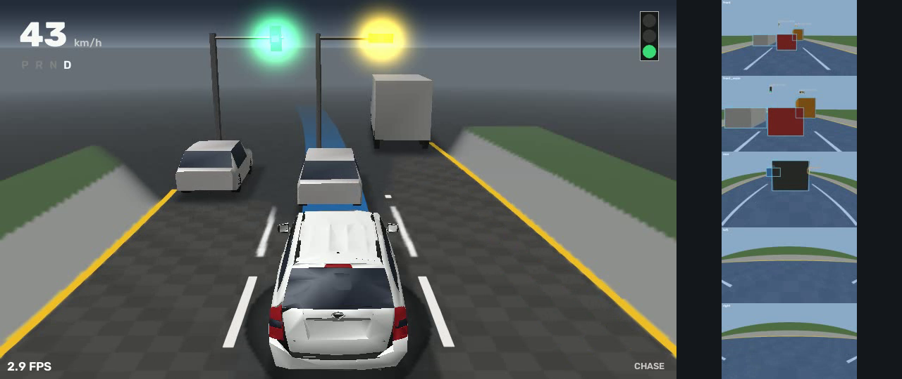

# v15풍 화면 (`--view v15`)

이 문서는 테슬라 FSD v15 리얼리티 뷰를 라즈베리파이 5에서 최대한 닮게 그리는 화면(`realityview/render_v15.py`)의 구성, 실행 방법, 자차 모델 교체 방법, 속도 측정값을 정리한 것입니다.

## 1. 무엇을 따라 했는가

v15 리얼리티 뷰는 약 10억 파라미터 생성 모델이 카메라 특징에서 화면을 바로 만들고, AI4 컴퓨터의 한 칩에서 돕니다([01 문서](01_fsd_v15_reality_view_research.md) 1장, 4장). Hailo-8이나 DX-M1으로는 이 모델을 돌릴 수 없으므로, 화면에 보이는 특징을 지금 있는 검출, 추적, IPM 바닥으로 흉내 냅니다.

| v15 화면의 특징 | 이 화면에서 한 방법 |
|---|---|
| 카메라 영상을 입힌 사실적인 바닥 | IPM 바닥 영상을 실제 색으로 깔고 거리 안개를 넣음 |
| 차와 사람이 실제 모양 | 저폴리 3D 모델, 햇빛 명암, 그림자 |
| 임의의 가상 카메라 시점 | 시점 6개와 부드러운 전환 |
| 경로와 회전 안내 | 내 차선 가운데를 따라 파란 띠 |

v15의 경로 화살표, 주차 핀, 회전 안내([01 문서](01_fsd_v15_reality_view_research.md) 2.1절)는 주행 모델의 의도를 그리는 것인데, 이 프로젝트에는 주행 모델이 없어서 내 차선을 따라가는 띠만 그립니다. 생성 모델처럼 검출되지 않은 물체까지 그리지는 못합니다.

## 2. 화면 구성

바닥은 탑뷰 IPM 영상을 채도를 조금 낮춰 깔고, 카메라가 못 보는 곳은 아스팔트 무늬로 채우며 경계는 흐리게 섞습니다. 18m부터 70m까지 안개가 짙어지고 지평선 위는 하늘색 그라데이션입니다. 차나 사람이 IPM에서 바닥으로 길게 늘어진 자리는 지웁니다. 지울 자리는 검출 상자를 바닥으로 편 마스크와, 트랙 위치에서 카메라마다 물체가 가리는 바닥을 계산한 마스크(`stretch_mask`)를 합친 것입니다. 그 자리에는 3D 모델이 섭니다.

바닥 위에는 차선(폭 16cm 띠, 흰색과 노란색, 실선과 점선), 계획 경로(폭 1.9m 파란 띠, 멀수록 흐림), 물체 그림자(햇빛 방향으로 늘인 부드러운 그림자와 바로 밑의 짙은 그림자)를 그립니다.

물체는 모두 3D 메시입니다. 자차는 사용자 차량 모델(3장), 다른 승용차는 단면 8개로 만든 저폴리 차체와 바퀴, 트럭은 캐빈과 짐칸, 버스는 긴 차체와 창 띠, 자전거와 오토바이는 바퀴 둘과 탄 사람, 사람은 팔다리가 걸음에 맞춰 흔들리는 모양입니다. 신호등은 기둥과 도로 위로 뻗은 팔, 켜진 등의 빛 번짐으로 그립니다. 면 색에는 햇빛 명암, 하늘빛, 하이라이트, 거리 안개를 꼭짓점마다 계산해 넣고 면 안에서 보간하므로 저폴리 차체도 둥글게 보입니다. 가림은 z-버퍼로 맞춥니다. 삼각형 그리기는 작은 C 코드(`realityview/_raster.c`)이고 처음 실행할 때 `build/`에 빌드됩니다. 컴파일러가 없으면 OpenCV로 면을 먼 순서대로 칠하는 방식으로 대신하며 이때는 느리고 결과가 조금 다릅니다.

자차 속도를 알면 차의 방향을 땅에 대한 속도로 정합니다. 추적기 속도는 자차에 대한 상대 속도라서, 자차 속도를 모르면 마주 오는 차와 뒤로 밀리는 차를 구별할 수 없기 때문입니다. 자차 속도를 모를 때 차는 모두 앞을 보게 두고, 사람만 상대 속도 방향으로 돌립니다. 지금 자차 속도는 시뮬레이션에서만 들어오고, 실차에서는 CAN이나 GPS를 연결한 뒤 `pipe.ego_speed`에 넣으면 됩니다. 이 연결은 아직 없습니다.

화면 왼쪽 위에는 속도와 기어(자차 속도를 알 때만), 오른쪽 위에는 대표 신호등, 오른쪽 아래에는 지금 시점 이름이 나옵니다. 트랙 번호는 v15 화면처럼 기본으로 숨깁니다.



시뮬레이션 영상은 [videos/20_v15_sim.mp4](videos/20_v15_sim.mp4)(20초, 3초마다 시점을 바꿈)입니다. 시뮬레이션의 카메라 영상은 물체를 단색 상자로 그리고, 자차 차선의 물체가 자차를 뚫고 지나가는 경우가 있어서, 그 순간 바닥에 빨갛거나 검은 쐐기 모양 번짐이 남습니다. 실제 카메라 영상에서 같은 일이 생기는지는 확인 필요입니다.

## 3. 실행

```bash
# 시뮬레이션, 카메라 5대 설정, 차선과 신호등까지
python3 scripts/run_demo.py --backend sim --config configs/five_cam.yaml --view v15 --lanes --traffic-lights --sim-lights

# 파이, Hailo 검출, 처음 시점을 후방으로
python3 scripts/run_demo.py --backend hailo --config configs/two_cam_current.yaml --view v15 --v15-view rear --lanes
```

시점은 `--v15-view`로 처음 값을 정하고, 창을 띄운 경우 숫자 키로 바꿉니다. 바꾸면 1초 동안 부드럽게 옮겨 갑니다. `--v15-tour 초`를 주면 정한 간격으로 시점을 차례로 돌립니다(시연 영상용).

| 키 | 시점 | 모습 |
|---|---|---|
| 1 | chase | 자차 뒤쪽 위(기본) |
| 2 | high | 더 높이서 넓게 |
| 3 | rear | 자차 앞쪽 위에서 뒤를 봄 |
| 4 | side | 왼쪽 옆 |
| 5 | top | 거의 바로 위 |
| 6 | orbit | 자차 둘레를 천천히 돎 |

rear 시점은 후방 카메라가 바닥에 편 영상과 뒤쪽 물체를 보여 줍니다. 카메라가 2대인 지금 구성에서는 후방 imx708 영역만 보이고, 5대 구성이면 좌우 어안 영역까지 이어집니다.

그 밖의 옵션은 `--view3d-size 폭x높이`(기본 960x540), `--view3d-scale`(작게 그린 뒤 키움, 0.25~1), `--v15-paint R,G,B`(자차 도장 색), `--v15-ego-model 파일`(다른 차량 모델)입니다. 설정 파일에 `v15:` 항목을 두면 `V15Config`의 값(안개 거리, 그림자와 경로 끄기, 시점 전환 시간 등)을 바꿀 수 있습니다.

## 4. 자차 모델

자차는 사용자 차량과 같은 기아 카니발 2011 모델을 흰색 도장으로 바꿔 씁니다. 원본은 Doz3의 Sketchfab 모델 "Kia Carnival 2011"(CC-BY-4.0)이고, 출처 표기는 [assets/vehicles/README.md](../assets/vehicles/README.md)에 있습니다.

원본 glTF는 메시 48개, 삼각형 153,373개입니다. 파이 CPU에서 그릴 수 있게 `scripts/convert_vehicle_model.py`로 줄였습니다. 엠블럼과 실내 질감, 차체 안쪽 겹면을 빼고, 부품마다 같은 비율로 면을 줄인 뒤(quadric 면 줄이기), 3cm 격자로 정점을 묶었습니다. 재질은 도장, 유리, 타이어, 휠, 전조등, 후미등, 검은 부품으로 나눠 색을 다시 붙였고 도장은 흰색(245, 245, 245)입니다.

| 단계 | 삼각형 수 | 쓰는 때 |
|---|---|---|
| 원본 | 153,373 | 쓰지 않음 |
| 높은 단계 | 11,561 | 시점이 멈춰 있을 때 |
| 낮은 단계 | 6,378 | 시점이 움직일 때 |

자차는 가상 카메라가 그대로면 처음 한 번만 그리고 그 그림과 깊이를 다시 씁니다. 그래서 시점이 멈춘 화면에서는 자차 면 수가 속도에 거의 영향을 주지 않습니다. 길이는 5.13m로 맞췄는데, 이 값은 2세대 카니발 롱바디 제원으로 넣은 것이라 실제 차량 제원과 같은지 확인 필요입니다. 다르면 `--length`로 다시 만듭니다. 결과 크기는 폭 2.33m(사이드 미러 포함), 높이 1.95m, 뒷바퀴 축에서 뒤끝까지 1.11m입니다.

```bash
pip install trimesh fast-simplification
python3 scripts/convert_vehicle_model.py kia_carnival_2011.glb assets/vehicles/ego_carnival_2011.npz \
    --length 5.13 --paint 245,245,245 --cell-low 0.05
```

다른 차로 바꿀 때 재질 이름이 다르면 스크립트 위쪽 `ROLE_RULES`에 도장 재질 이름을 넣어야 흰색으로 바뀝니다.

## 5. 속도

아래는 클라우드 x86 가상 머신(Intel Xeon 2.1GHz, C 래스터 사용)에서 `scripts/bench_render_v15.py`로 렌더러만 잰 값입니다. 960x540, 가짜 트랙(차, 트럭, 사람)을 자차 주변에 흩어 놓았고 40번 평균입니다. 공유 가상 머신이라 같은 조건에서도 값이 수 ms씩 흔들렸습니다(원자료 out/measure/20_bench_v15_cloud.json).

| 조건 | v15 (ms) | 기존 3D (ms) |
|---|---|---|
| chase, 물체 0 | 8.2 | 5.8 |
| chase, 물체 20 | 22.3 | 12.1 |
| orbit, 물체 0 | 25.0 | 해당 없음 |
| orbit, 물체 20 | 36.3 | 해당 없음 |

값은 바닥 갱신을 포함한 프레임 하나의 시간입니다. 기존 3D 렌더러는 파이에서 물체 20개 23.4ms였고([10번 측정](measurements/10_reality_view_3d.md) 3.1절) 같은 클라우드에서는 12.1ms여서 파이가 약 1.9배 느립니다. 이 비율을 그대로 쓰면 파이에서 v15 chase 물체 20개는 약 42ms, orbit은 약 69ms이고, 실측은 확인 필요입니다. orbit과 시점 전환 중에는 바닥 표와 자차 그림을 매 프레임 다시 만들어서 느립니다. 카메라 5대 구성의 예상 처리 속도가 초당 6~10장이라, 화면 그리기를 렌더링 스레드(`--render-thread`)로 빼면 chase 시점은 전체 속도를 크게 낮추지 않을 것으로 보지만 이것도 확인 필요입니다. 느리면 `--view3d-scale 0.75`와 `--view3d-ground-every 2`부터 씁니다.

## 6. 남은 일

파이 5에서 렌더러 벤치와 실제 카메라 실행으로 FPS를 잽니다(작업 파일 [agent_tasks/20_v15_render_pi.txt](agent_tasks/20_v15_render_pi.txt)). 자차 속도를 CAN이나 GPS에서 받아 `pipe.ego_speed`에 넣으면 다른 차의 방향과 속도 표시가 실차에서도 켜집니다. 주행 모델이 없어 회전 화살표와 주차 핀은 그리지 않습니다.
